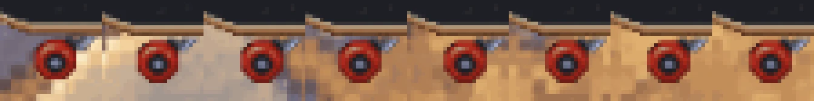
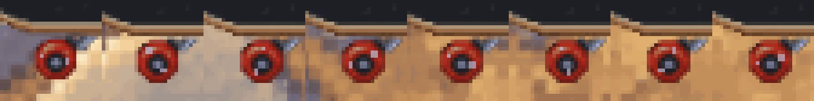
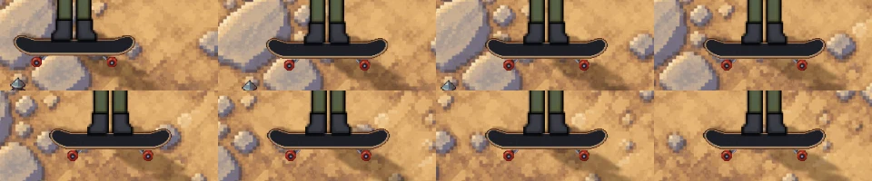
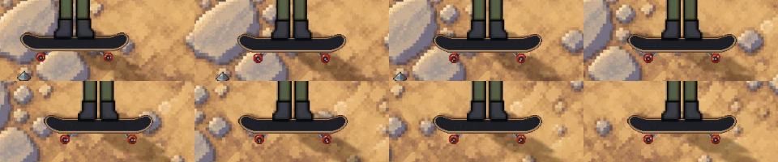

# The skateboard's wheels roll (v2.3.3855)

Owner: *"use code to make the skateboard wheels appear moving using lighting or
wobble just a bit whatever you think looks good"*.

Taken by `node tools/qa/mp/run.mjs boardwheels` on a computer (1440 x 900,
picture at 2x). The board was rolled east in short pushes, with a picture after
each push. "Before" is the same build with `?boardroll=0`.

## The front wheel, close up (8 pushes)

Before: the wheel looks the same in every picture.

After: two light spots turn round the hub.

## The board, as seen in the game

| Before | After |
|---|---|
|  |  |
