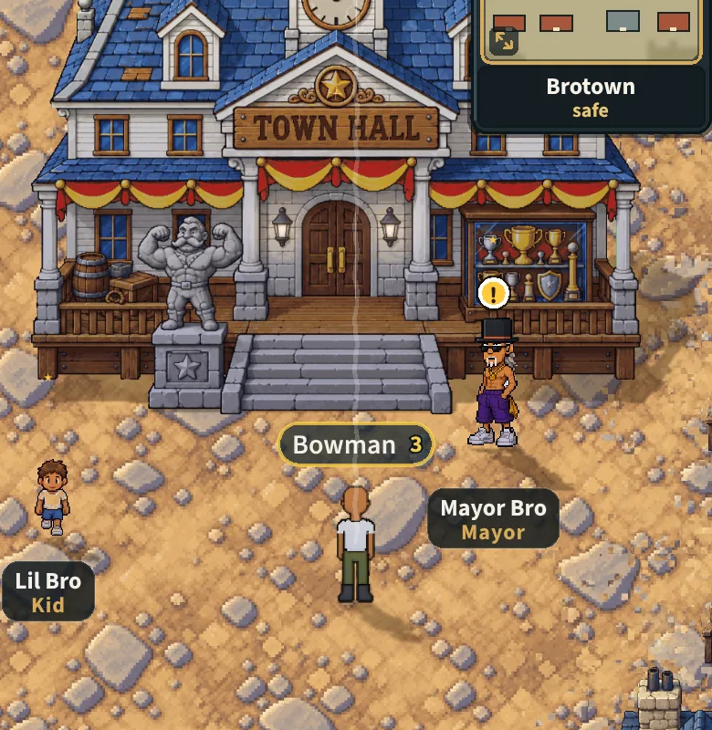
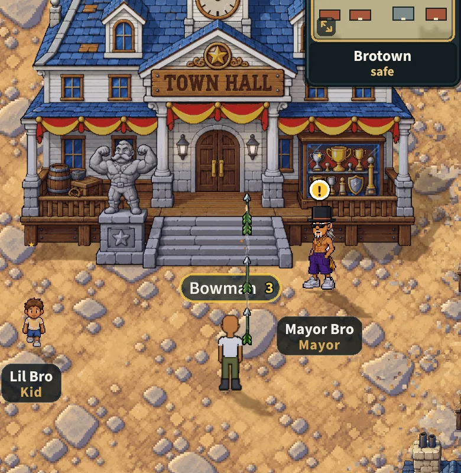
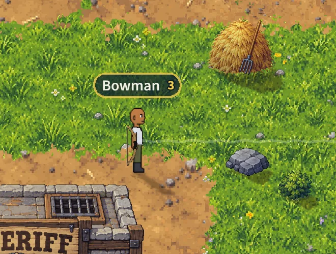
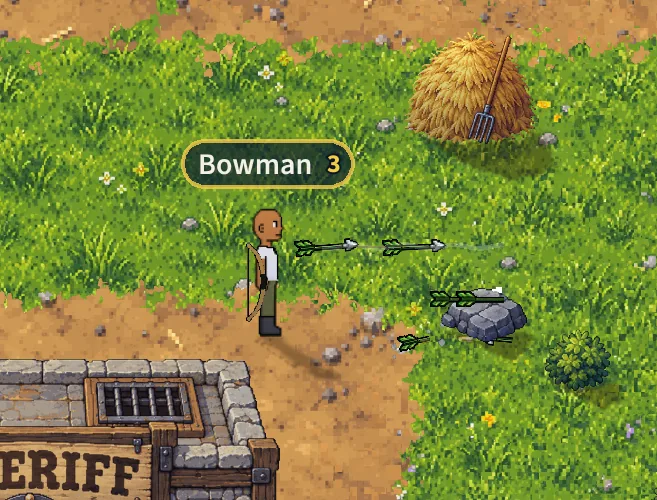

# The bow shoots props, buildings included (v2.3.3200)

Owner: *"Make the bow able to shoot at any props including buildings"*

These were taken on a 390 x 844 phone (dpr 2) in the Wheel's BroTown. Each
time a pine bow was in hand and the attack was HELD and aimed the way the
right stick aims it. The picture was taken while it was still held, because
the aim line is drawn only then.

- **Before** is main's build (v2.3.3197). It was held for 7 seconds.
- **After** is this change. It was held until the target had taken 3 arrows
  (the Town Hall) or 2 (the rock).

The pictures are cropped round the archer and the target.

## The Town Hall, 170 px from its front, aimed north

Before, the line runs straight up through the hall and no arrow leaves. After,
the line stops at the hall's front and the arrows go. The ones that hit stay in
it at the height they flew.

| Before | After |
|---|---|
|  |  |

## A rock level with you, aimed east

The rock is 45 px tall, and an arrow flies at your shoulder, about 80 px up.

- **Before:** the line passes over the rock and no arrow leaves.
- **After:** the line stops at the rock. The arrows that hit stay IN it, in
  its upper part, not in the air over it.

| Before | After |
|---|---|
|  |  |
