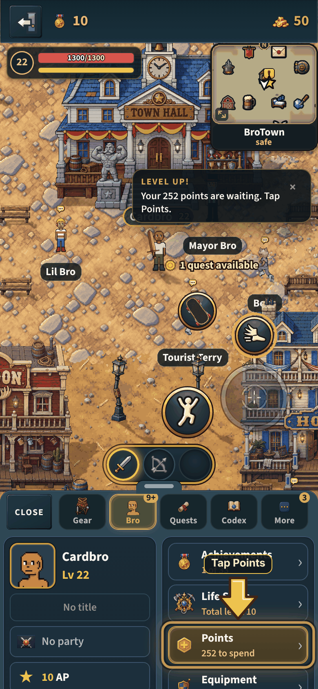
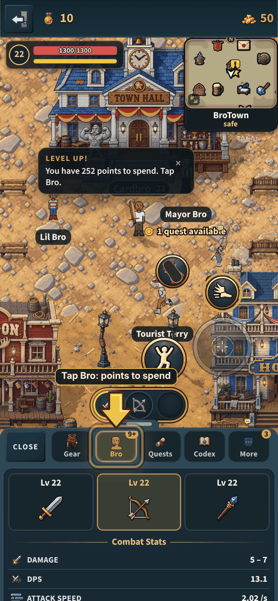
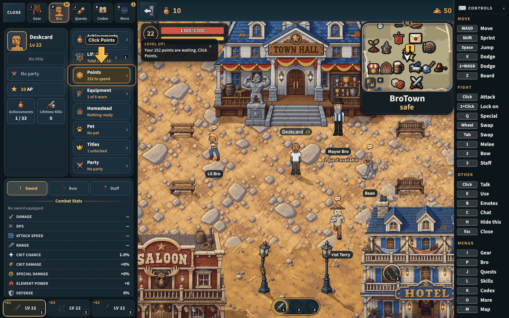
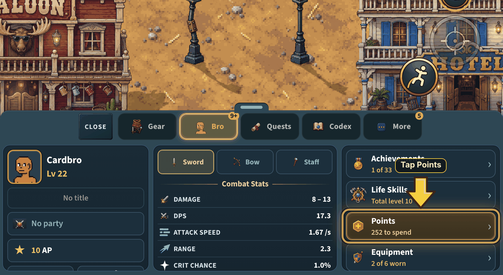
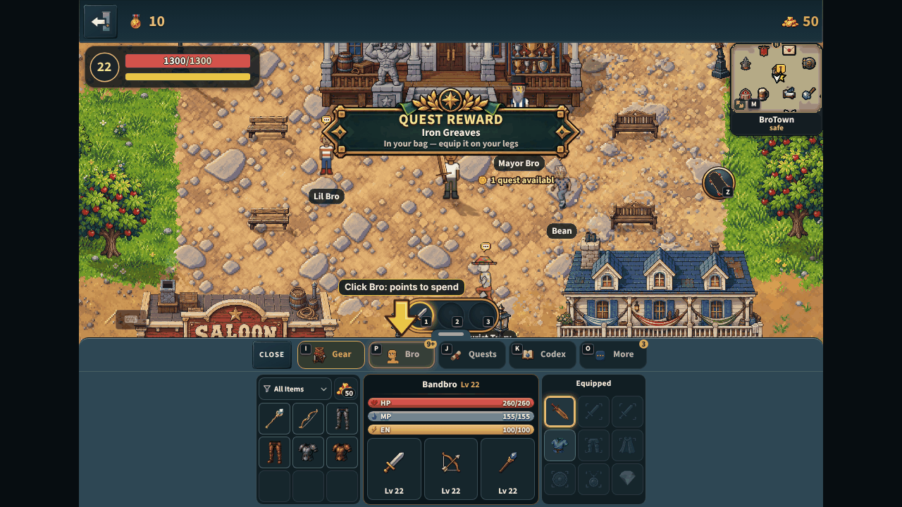
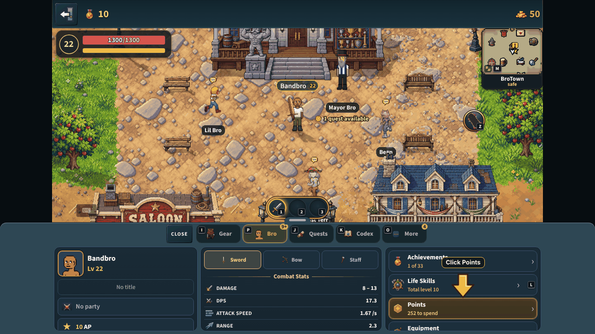
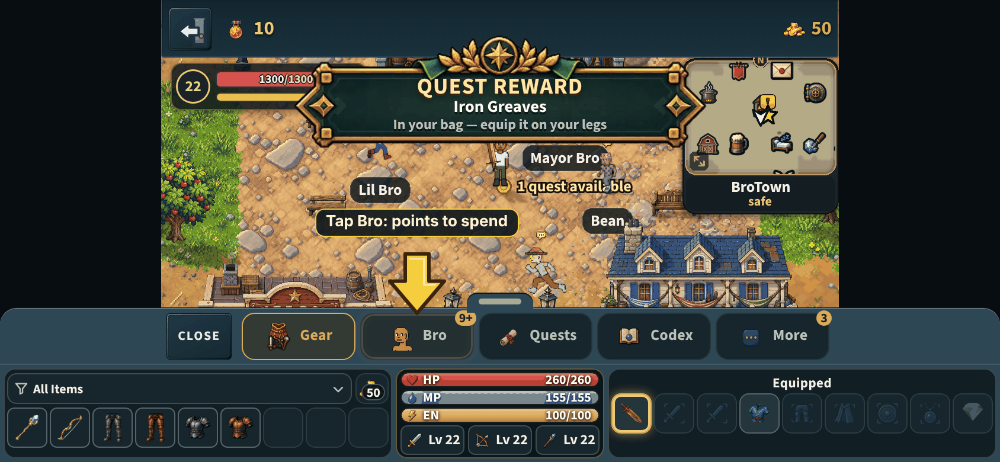
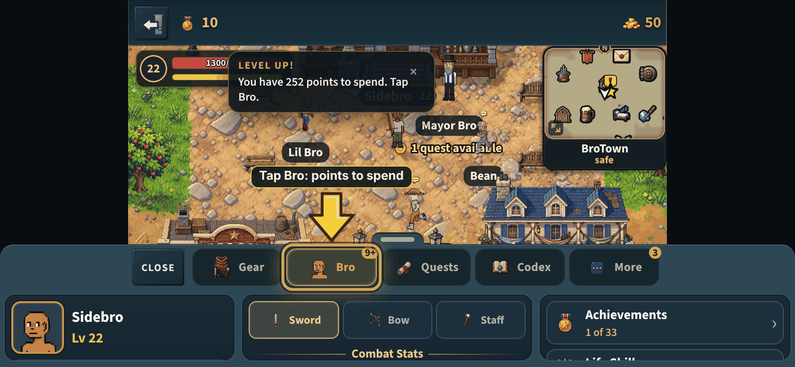
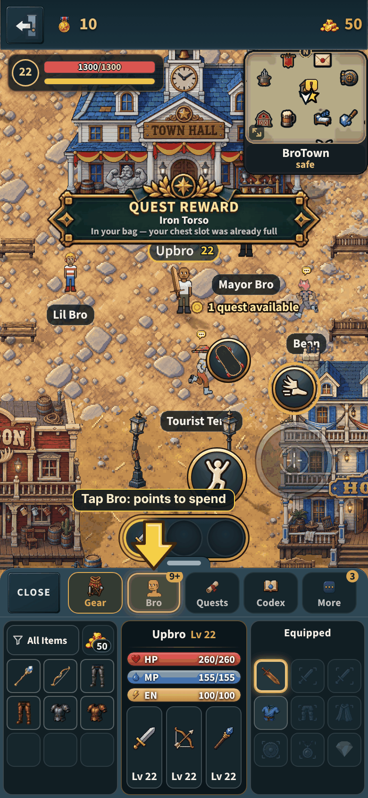
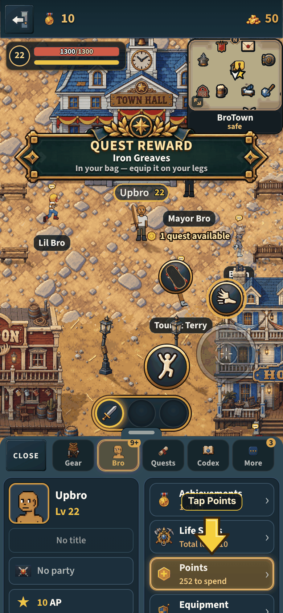

# The Bro page, as the owner drew it (v2.3.4172)

The owner, of the first card (his own inspect card): *"I'll need to change the
layout of the bro tab, it reads like an old PC menu."* Then: *"I added what I
want bro tab layout to look like on GitHub. One different thing is the xp bar
near profile portrait (no general combat xp)"* (the drawing:
`D474F679-6893-4890-823A-3BC96F817184.png` in the repo root), *"Keep the 5
buttons"* and *"No don't change todays dashboard height"*.

Three panels: you (portrait, name, level, title, clan, AP, achievements,
kills), the combat stats of the weapon picked in Sword | Bow | Staff, and the
doors (Achievements, Life Skills, Points, Equipment, Homestead, Pet, Titles,
Clan). The button row is CLOSE, then Gear, Bro, Quests, Codex and More with
their words. The page lays itself out from its own width: side by side from
600 px, you beside the doors with the stats under them on an upright phone,
all stacked on a phone on its side.

Taken by `node tools/qa/mp/run.mjs brocard` after a real level-up, so points
wait (the Points door glows, and the coach and the arrow say "Tap Points").
Every picture is on 256 colours.

| An upright phone (390 x 844) | Bow picked, the stats scrolled to |
|---|---|
|  |  |

A computer (1440 x 900, the side column: you beside the doors, the stats
under them):

A tablet upright (820 x 1180): the three panels side by side, as drawn:

## The band open on Gear and on Bro, on every screen (the one band)

Taken by `node tools/qa/mp/run.mjs bandshots` on main's one band (#1410) and
Gear tab (#1388): a computer at 1280 x 720 (wide), a phone on its side at
844 x 390 (opened from the folded band) and upright at 390 x 844.

| | Gear | Bro |
|---|---|---|
| Computer |  |  |
| On its side |  |  |
| Upright |  |  |
