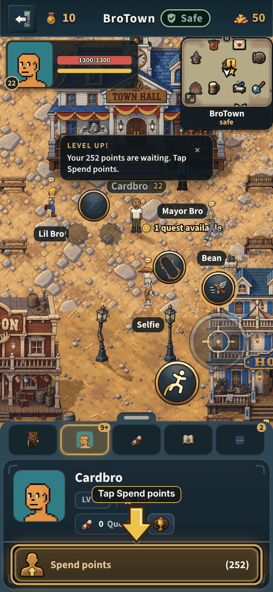
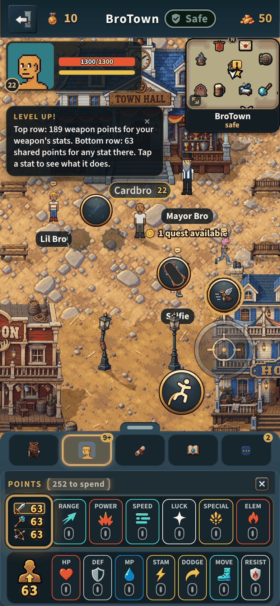
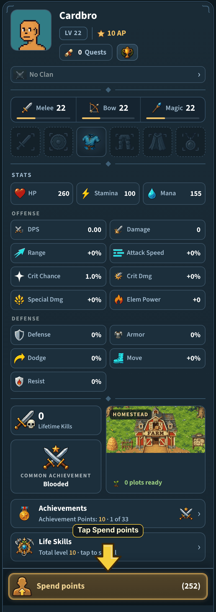
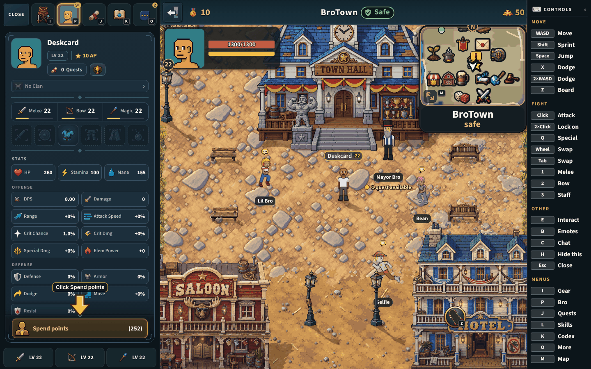

# The Bro page is your own inspect card (v2.3.4062)

The owner: *"I wanted the bro tab to be like what it looks like when you
inspect another player. PFP clan, achievements, all the base character stats,
primary combat skills, place where you can tap to open points spend window,
etc"*.

Taken by `node tools/qa/mp/run.mjs brocard` (a phone at 390 x 844 upright, a
computer at 1440 x 900 playing wide), after a real level-up, so points wait.
Every picture is on 256 colours.

| The Bro page on a phone | Spend points opens the Points window |
|---|---|
|  |  |

The whole card (stood up over a tall screen for the picture: on a phone the
page is about 190 px tall and the card scrolls under "Spend points"):

On a computer:

