# Old wooden greatswords become copper, and copper looks like copper (v2.3.3947)

Owner: *"'Copper great sword' when Smithed looks gray in color like iron. Fix
that. Also just remove any of the 'wooden' swords. Right now it's just called
'great sword'."*

Taken by `node tools/qa/mp/run.mjs greatswordcopper`: a deploy, played. The
worker from before this change smiths a wood greatsword (the old ladder,
`forgeladder: false`) and then a copper one; it stops, and the next worker
starts on the same storage, so the character's next login is the one every
player will have after the deploy. The computer is 1440 x 900 (the sideways
layout), the other player a phone (390 x 844), both at 2x, in BroTown.
"Before" is the same run with both workers and the game from before this change
(`GSC_LABEL=before`).

## The old wood greatsword, in hand

Before, the wood blade is grey steel. After the login it is a Copper Great
Sword (copper, 1.12, its grade kept).

| Before | After |
|---|---|
| 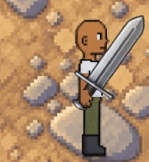 | 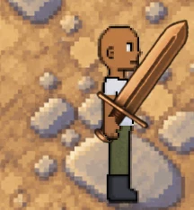 |

## The bag

Before, the bag holds the grey wood greatsword. After, a copper one.

| Before | After |
|---|---|
| 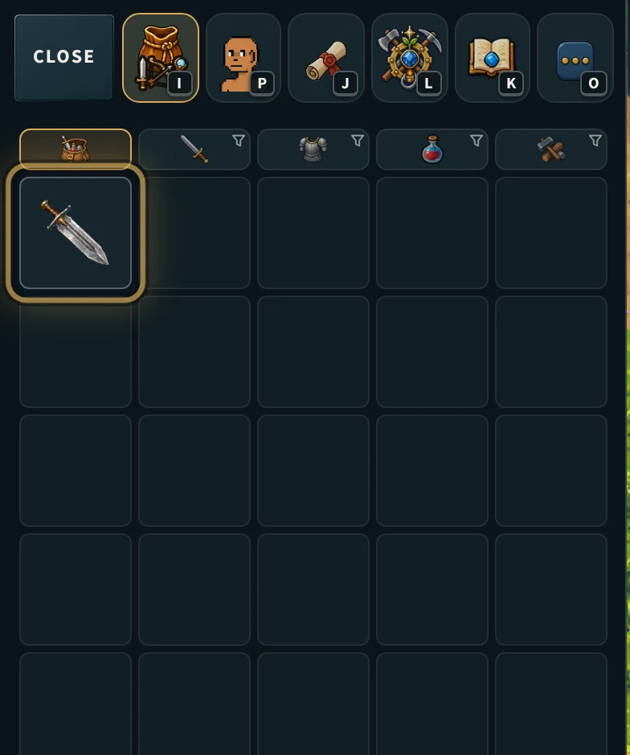 | 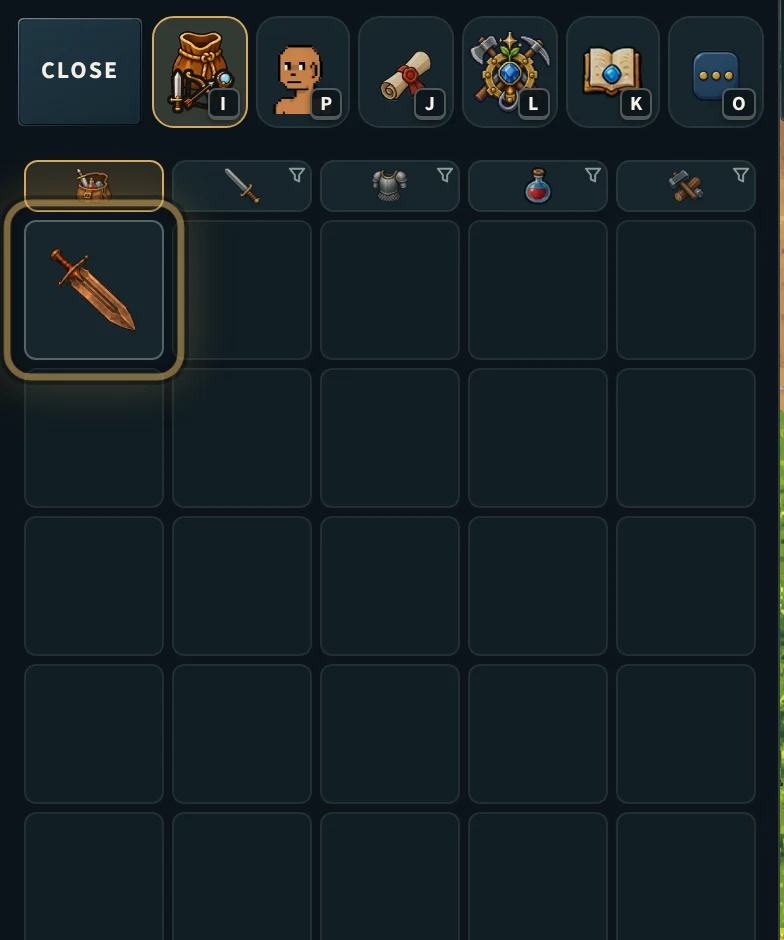 |

## The smithed copper greatsword in your own hand

This was already copper on a freshly smithed blade (`__btWeaponTint().local`
0xFF9E58 standing, jogging and swinging, before and after; the character
window the same), so the grey one the owner saw was most likely the old
starter: named "Copper Great Sword" by an old migration but wood underneath.

| | Standing | Jogging | Swinging |
|---|---|---|---|
| Before |  | 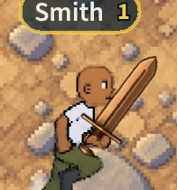 | 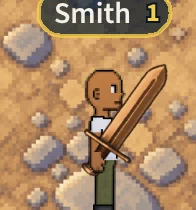 |
| After | 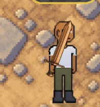 | 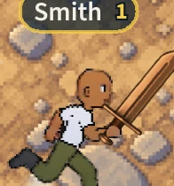 |  |

## The character window

| Before | After |
|---|---|
| 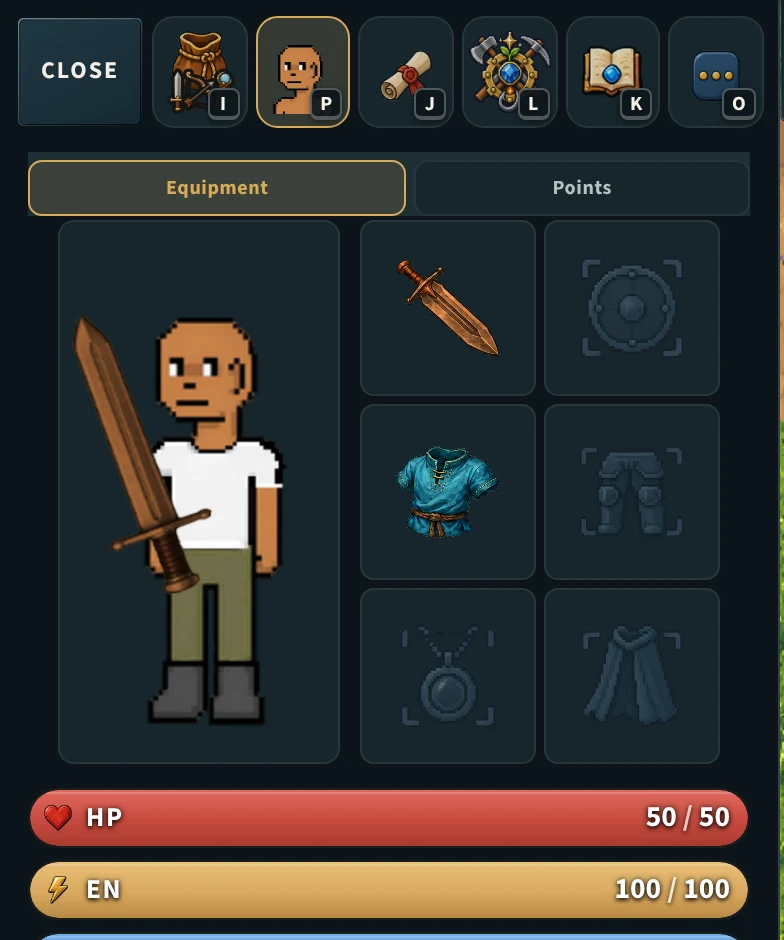 |  |

## As another player sees it (the phone)

Before, another player's greatsword was the thin one-handed icon (tinted
copper, jogging, behind the onlooker's name). After, the same per-facing blade
you hold, in copper (`__btPeerSword.art` "greatsword-east", tint 0xFF9E58).

| Before | After |
|---|---|
| 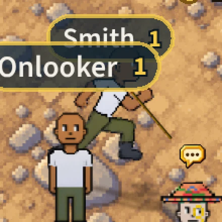 | 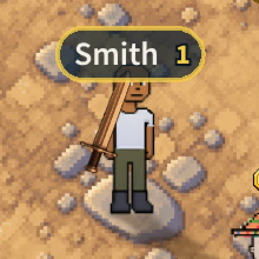 |
