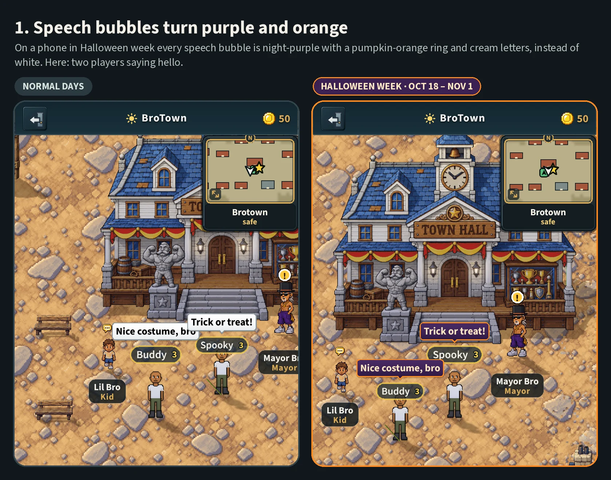
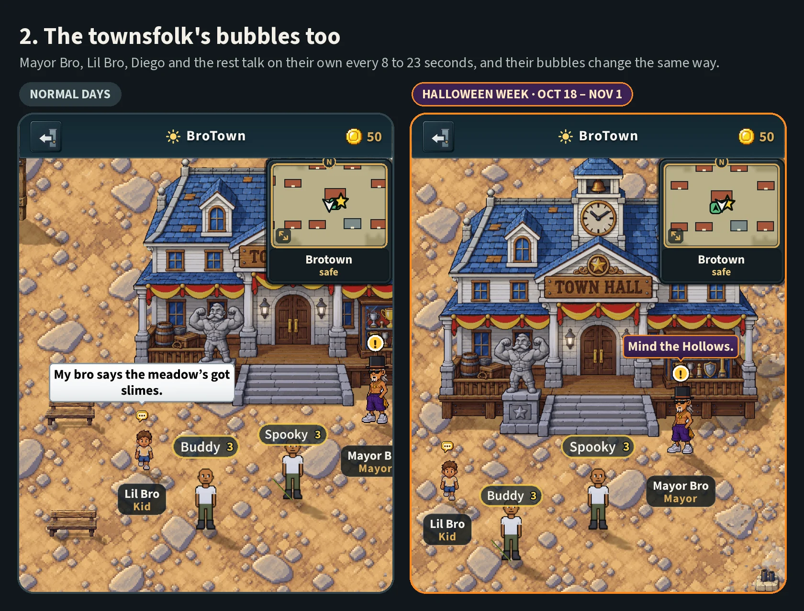
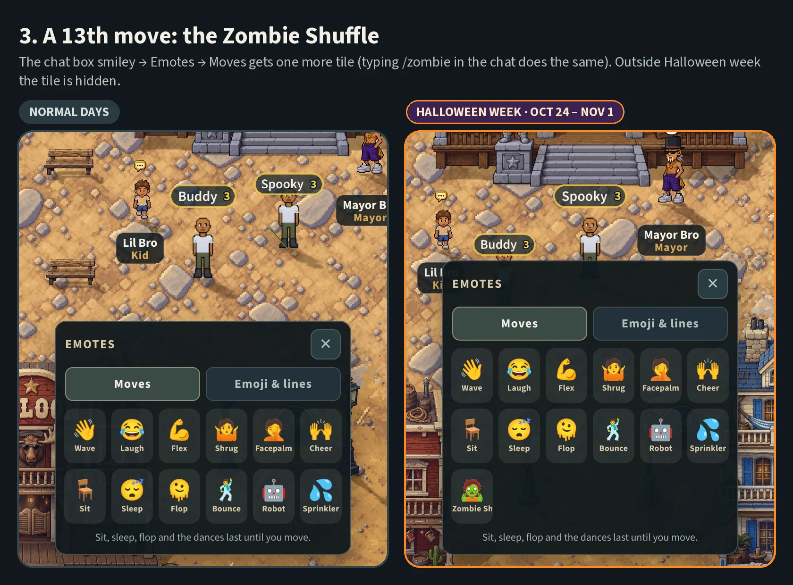
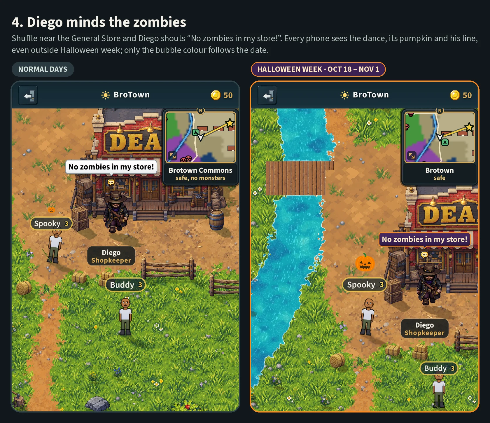
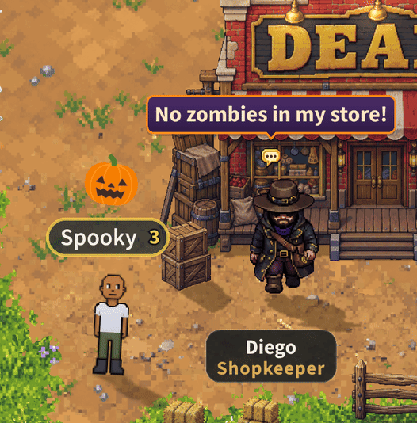

# Halloween week, before and after (v2.3.3463)

Owner: *"A recent session added a 'Halloween mode' but I could not see any
difference. Can you include screenshots of what the differences are?"*

**Why nothing looked different:** Halloween week (v2.3.3395,
docs/specs/halloween.md) began on **24 October**, by each phone's own calendar,
and the owner looked on the 18th. Shown these pictures, the owner chose "Start
today for everyone": since v2.3.3463 it runs from **18 October to 1 November**,
this year and every year after.

**To see it on any other day:** open the game with `?halloween=1` on the end of
the address (`brotown.net/?halloween=1`) and play the character you usually
play on that phone. Measured on the way in: a returning player who taps their
own character on the door keeps the setting all the way into BroTown, with the
thirteenth move and the purple bubbles. Switching to a different character, or
typing a login key, reloads the page at the plain address and drops it.
`?halloween=0` turns it off. It changes only your own screen (other players
still see your Zombie Shuffle, in their usual colours).

Four things change, all small on purpose: it is a look, never a rule. There is
no new picture anywhere; the Pumpkin Head hat waits for its picture
(docs/FUN-SOCIAL-PLAN.md).

How they were taken: two phones (390 x 844) standing side by side in the
Wheel's BroTown against a local worker, one opened with `?halloween=0` (left,
"normal days") and one with `?halloween=1` (right), so both pictures in a pair
show the same moment from two screens. The game's own font (Source Sans 3) was
installed on the test machine first (docs/DEV-TOOLS.md), and the tutorial's
pop-up tips are hidden. Each picture was taken with that page's clock held
(Playwright's `page.clock`), because this machine draws a frame every second or
so and a five-second speech bubble could fade while it drew.

## 1. Speech bubbles turn purple and orange

Every speech bubble is night-purple with a pumpkin-orange ring and cream
letters, instead of white. Here two players are talking.

## 2. The townsfolk's bubbles too

The townsfolk talk on their own every 8 to 23 seconds, and their bubbles change
the same way. This is the change you see most: it is everywhere in town.

## 3. A 13th move: the Zombie Shuffle

The chat box's smiley, then Emotes, then Moves: one more tile, or type
`/zombie` in the chat. Outside Halloween week the tile is hidden.

Found while taking the first pictures: the tile's name did not fit and read
**"Zombie Sh"** (cut at the tile's width, in the real font as well as the
fallback). Since v2.3.3463 the tile prints "Zombie" (the move's `short`, as
"Bro Bounce" prints "Bounce"); this picture is after the fix.

## 4. Diego minds the zombies

Shuffle near the General Store and Diego shouts "No zombies in my store!" (or
"Out! And take your brains with you!"), once every 20 seconds at most. Every
phone near you sees the dance, its pumpkin and his line, even outside Halloween
week: the worker keeps the dance on any day. Only the bubble's colour follows
each phone's date.

## The Zombie Shuffle, moving

On the Halloween phone, by Diego's store: a slow lurch, leaning in, a foot
dragged every two beats (once a second), swaying side to side, with a pumpkin
popping over the dancer every 2.4 s. It lasts until you move. 50 frames, 80 ms
apart: the page's clock was stepped one frame at a time, so this machine's slow
drawing skipped none. Four seconds, two whole sways, so it loops.

