# JUMP on the disc's orbit, south-west (v2.3.3799)

Owner, 2026-10-29: *"I do want a change to the placement on the jump button.
It should be positioned orbiting southwest of the large contextual button."*

Taken by `node tools/qa/mp/run.mjs thumbbtn` (`THUMBBTN_LABEL=before` on main
for the before pictures). Every touch area is outlined: Jump red, the disc
yellow, the rest blue; a round control's outline is its circle. "door" is a
building's Enter button, as the game draws it at a Wheel door.

## 390 x 844, at a door (Enter showing)

| Before | After |
|---|---|
| 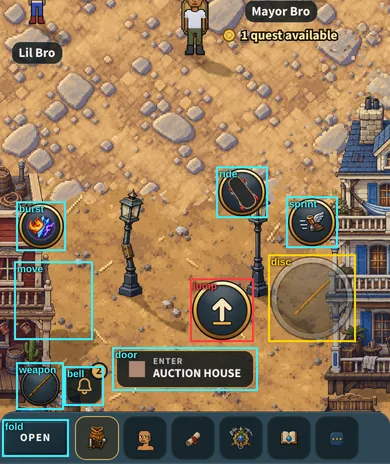 | 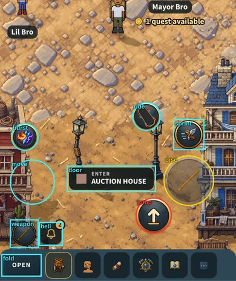 |

## 390 x 844, in a fight with the guard up (Block and Bash showing)

| Before | After |
|---|---|
| 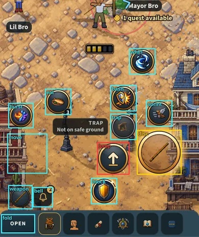 | 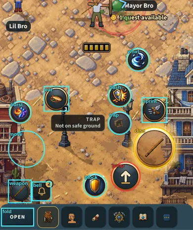 |

## 320 x 568 (the smallest phone), at a door

| Before | After |
|---|---|
| 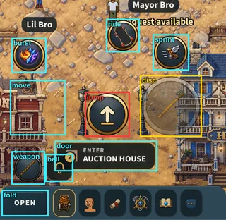 | 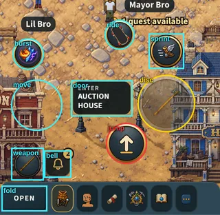 |

## 320 x 568, in a fight with the guard up

| Before | After |
|---|---|
| 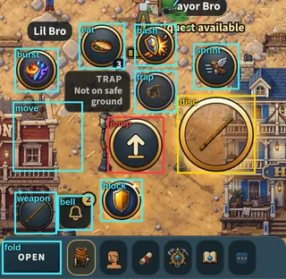 | 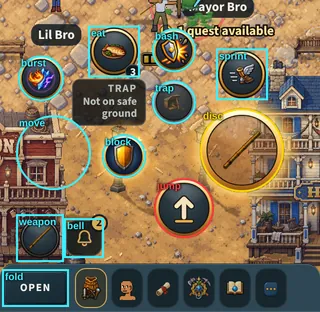 |

## 844 x 390, sideways, at a door

| Before | After |
|---|---|
| 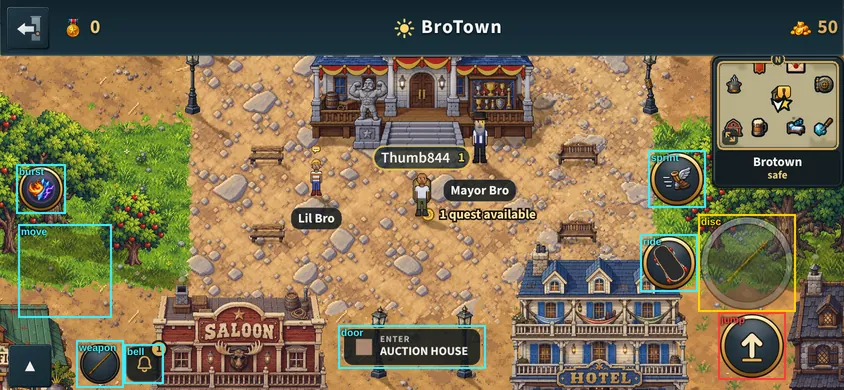 | 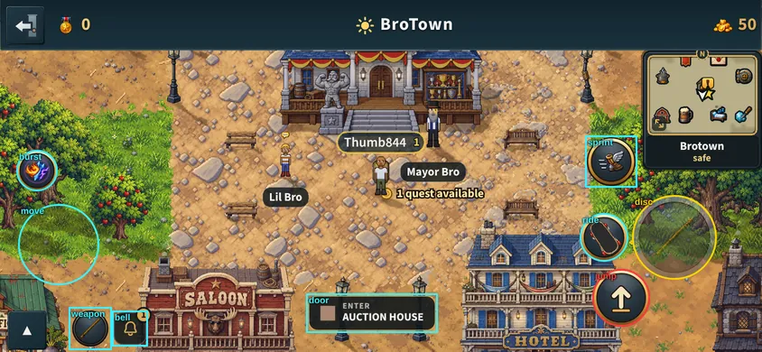 |

## 844 x 390, sideways, in a fight with the guard up

| Before | After |
|---|---|
| 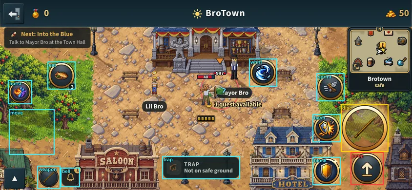 | 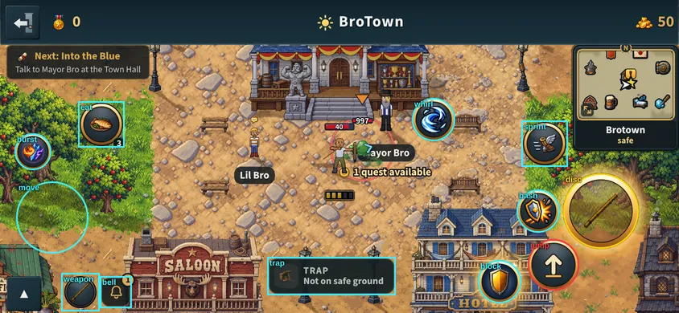 |

The whole of it: docs/specs/jumping.md, "v2.3.3799".
