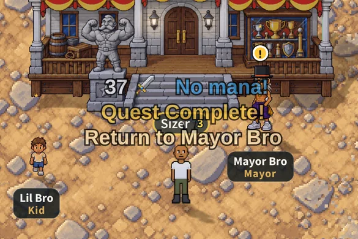
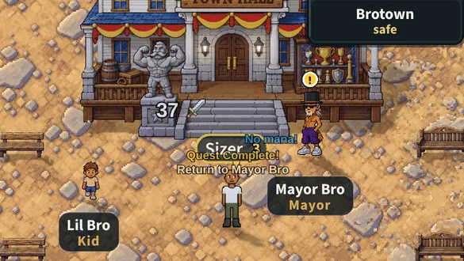
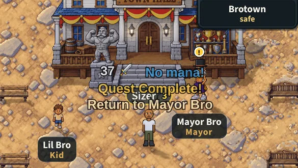
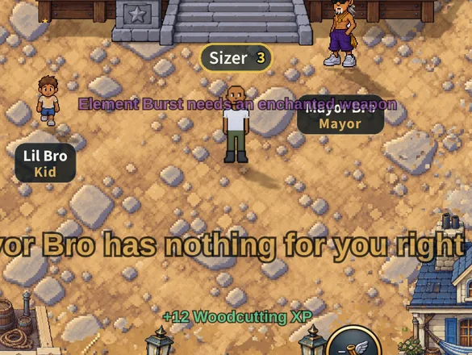
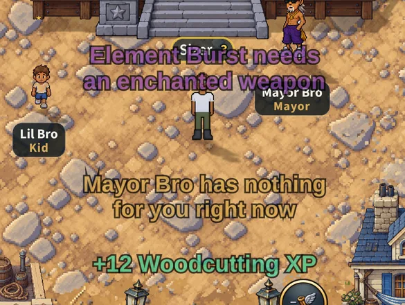

# Messages as big as the damage numbers (v2.3.3192)

Owner: *"Make the messages in the game like "no mana" and other things like
"quest complete!" the same font size as the combat damage numbers"*

Taken on a 390 x 844 phone (dpr 3) in BroTown, the popups pushed as the game
pushes them: a hit ("37"), "No mana!" 30 px over you (specialAttack), and the
quest's pair 70 and 55 px over you (questComplete.js). "Before" is main's build
(v2.3.3190), "after" this change. Cropped to the world round the bro, half size.
The words are in the game's own font, Source Sans 3.

## Dashboard folded

| Before | After |
|---|---|
|  |  |

## Dashboard up

The world is drawn smaller with the dashboard up -- the numbers with it (24.9
-> 19.0 CSS px tall here), and the messages now exactly as they do.

| Before | After |
|---|---|
|  |  |

## Long messages

"Element Burst needs an enchanted weapon" (30 px over you), the E key's "Mayor
Bro has nothing for you right now" (a note with the `crit` flag, so it
wiggles) and "+12 Woodcutting XP". At the new size the two long ones wrap into
even, centred lines instead of running across the screen.

| Before | After |
|---|---|
|  |  |
