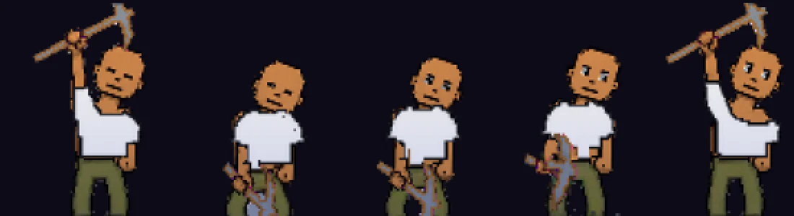
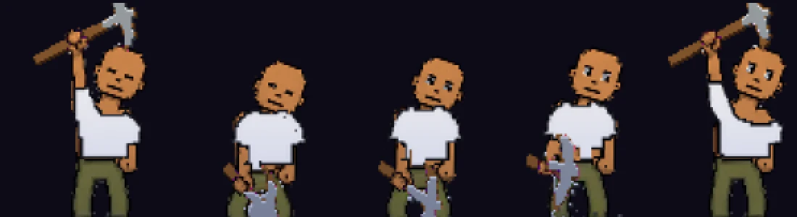

# The pickaxe, solid (v2.3.3880)

Owner: *"Ok the pickaxe for the first quest is still invisible or at least very
lightly drawn. Can you use code to fill it with a handle and just an iron color
for the metal part?"*

Taken by `node tools/qa/mp/run.mjs toolsolid` on a computer (picture at 2x, the
miner alone). The five pictures are five moments of the swing: raised, coming
down, at the rock, and raised again.

**Before**: the pickaxe as the art draws it, a thin pale stroke.

**After**: a wood handle and an iron head, solid and outlined (a computer's
way of drawing the look, `TOOLSOLID_PAL=0`).

**After, with the look palette** (phones: the numbers re-baked from the same
bake, `TOOLSOLID_PAL=1`):

