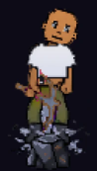
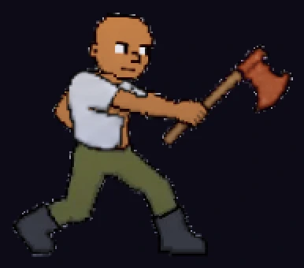
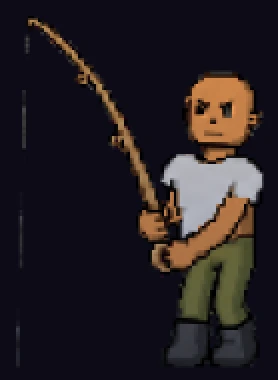
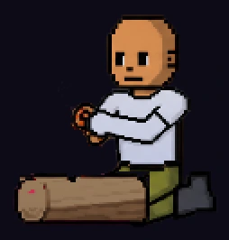
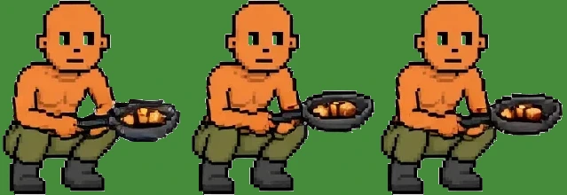
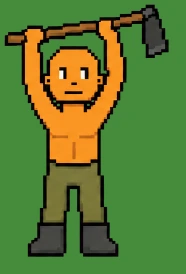
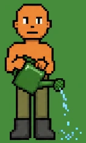

# Held tools: are any as faint as the pickaxe was? (survey, 2026-10-29)

After the solid pickaxe (#1335, v2.3.3881), per the owner's "when you find a fix,
look for the same problem elsewhere". Taken on main with the game's own colours,
no armour, the look palette off (a computer's way): mp-ghostaudit
(`BT_GHOST_ONLY=mine,chop,fish,fire,cook BT_GHOST_OUTFITS=bare
BT_GHOST_LOOK=plain BT_GHOST_QUERY=lookpalette=0`), at 2x, the figure alone.
The cook and the farmer are their strips' art (the audit did not photograph
the cook; the farm needs the player's farm).

| Tool | Picture | Verdict |
|---|---|---|
| Pickaxe (mining) |  | **faint**, on main: fixed by #1335 |
| Smith's hammer (the forge) | (the mining swing, borrowed: game/smithing.js) | **faint** on main, fixed by #1335 |
| Axe (chopping) |  | fine: a solid red head and a clear handle |
| Fishing rod |  | fine: a thin but solid rod; its line is a faint thread, as a line is |
| Log and flint (firemaking) |  | fine: a solid log; the flint is a small spark in the hands |
| Pan (cooking) |  | fine: a solid black pan with the food in it |
| Hoe (farm) |  | fine: a solid handle (the hands fill its gaps) and a dark iron blade |
| Watering can (farm) |  | fine: a solid green can |
| Woodworking tools, box trap | none | no held tool: the player has no pose for either |
