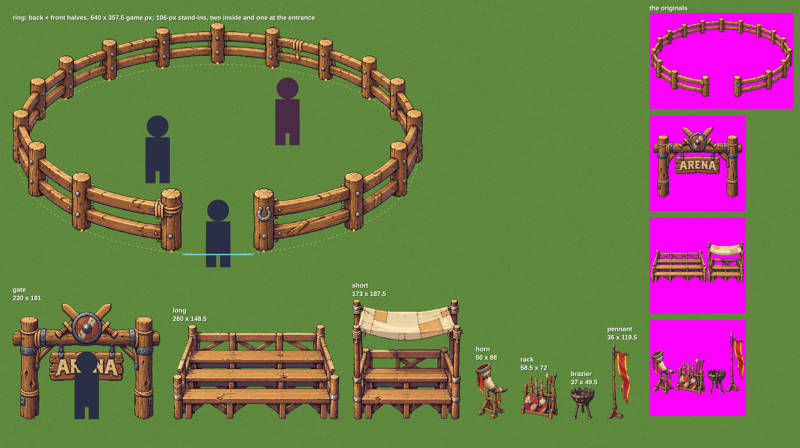

# The arena's art (v2.3.3730)

The owner made the arena's four pictures in ChatGPT, from prompts the Object
Studio's own builder made (`docs/art/ARENA-ART-PROMPTS.md`, written by
`tools/world/arena-art-prompts.mjs`). `tools/world/add-arena-art.mjs` cuts them
into game art. Nothing draws them yet: the arena (lane C) places them, using
`src/data/arenaArt.js`.



`arena-art/preview.png`: every piece at its game size on grass, the ring's two
halves put together with plain 106 game px stand-ins (two inside, one at the
entrance; never the bro's art), the measured oval dashed, the posts' feet
marked, the entrance's span in blue, and the four originals down the side.

## What was cut

| picture (`assets/prop-source/arena/`) | pieces | size asked | one scale from | game px |
|---|---|---|---|---|
| `ring.png` (1536 x 1024) | the ring, cut in two: `ring-back.png`, `ring-front.png` | 640 wide | the ring | 640 x 357.5 whole |
| `gate.png` (1254 x 1254) | `gate.png` | 230 wide | the gate | 230 x 181 |
| `stands.png` (1254 x 1254) | `stand-long.png`, `stand-short.png` | the long one 260 wide | the long one | 260 x 148.5, 173 x 187.5 |
| `props.png` (1254 x 1254) | `prop-horn.png`, `prop-rack.png`, `prop-brazier.png`, `prop-pennant.png` | the tallest 120 tall | the pennant | 50 x 88, 58.5 x 72, 37 x 49.5, 36 x 119.5 |

All in `public/world/arena/`: see-through palette PNGs, 64 colours a picture
(one palette per sheet; the ring's halves share theirs), at 2 picture px a game
px, every one shrunk from the original, none blown up. 239 KB on disk, 6.0 MB
decoded if all were loaded at once.

The prompt asked for three rails; ChatGPT drew two. The gate's picture had two
small pockets between its braces and posts filled with a bright pinkish red
(about 246, 58, 77) rather than the magenta; they are background, and the tool
clears them (every pixel that bright and red: 2,326, all in the two pockets;
the shield's reds are darker).

## The steps

The Object Studio's own (`public/tools/style/process.js`), in a headless
Chromium, as `add-ore-art.mjs` and `add-dungeon-art.mjs` do: `keyOut` (the
magenta, with its despill and holes); `objectsIn` by COUNT (1, 1, 2, 4) and the
studio's `readingOrder` (one row each, left to right); ONE scale a sheet;
`ownPalette` and `hardenAndMap` (64 colours); `trim`; `png8.js`
`encodePalettePng`. A sheet whose count or row does not come out is refused
whole, never guessed at.

## The ring's two halves and its shape

Players fight inside the ring, so it is two sprites: `back` (the far rails,
behind fighters) and `front` (the near rails, in front). The split follows the
oval's far foot line: every pixel at or above where the far fence meets the
ground (2 px of margin) is the back's, every pixel below it the front's. The
two end posts, where the far and near lines meet, go whole to the half their
foot is in (both to the front). Each half is trimmed and carries `at`, its
top-left in the whole ring, so the two line up.

Measured off the finished ring (`ARENA_ART.ring.geo`, game px from the whole
ring's top-left):

- **the oval**: `cx` 320, `cy` 214, `rx` 312, `ry` 148.5, an axis-aligned
  ellipse fitted (least squares) to the posts' feet: they sit 1.5 px off it
  on average. This is the posts' foot line, for collision and placing.
- **posts**: the 11 whose feet can be seen (a flat low stretch of the outline
  with a step up either side). The end posts' and the side posts' feet are
  hidden by the rails running down past them, so they are not listed; the
  oval covers them.
- **gap** (the entrance): x 265.5 to 376 (110.5 game px, a person's width
  about three times), 79.6 to 100 degrees round the oval (0 east, 90 the
  front, y down), the foot line at y 362.5 there.

## The data module

`src/data/arenaArt.js` (GENERATED; do not edit by hand). Every number is in
game px from the picture's top-left (draw a sprite at scale 0.5); `px` is the
file's own size; `foot` where a thing meets the ground; every `url` carries
`?v=2.3.3730`.

```js
ARENA_ART = {
  ring:   { w, h, back: { url, px, w, h, foot, at }, front: { ...same },
            geo: { cx, cy, rx, ry, posts: [{ foot, w }], gap: { x: [x0, x1], deg: [a0, a1], y } } },
  gate:   { url, px, w, h, foot, posts: [{ foot, w }, { foot, w }], walk: [x0, x1] },
  stands: { long: { url, px, w, h, foot, line: [x0, x1, y] }, short: { ... } },
  props:  { horn, rack, brazier, pennant: { url, px, w, h, foot } },
}
```

## Memory

World art in its slot's form (`docs/MEMORY-MAP.md`): 64 colours, palette PNGs.
Nothing loads it yet, so no memory line moves. Whatever draws it registers its
loader (the preloading law) and frees it where the arena is left.

## Running it again

```
node tools/world/add-arena-art.mjs          # writes public/world/arena/, src/data/arenaArt.js, the preview
node tools/world/add-arena-art.mjs --dry    # the same, to a scratch folder
node tools/world/arena-art-prompts.mjs      # the prompts doc (--check: is it stale?)
```

To replace a picture, put the new one in `assets/prop-source/arena/` under the
same name. The sizes are `ARENA_PICTURES` at the top of the tool.
