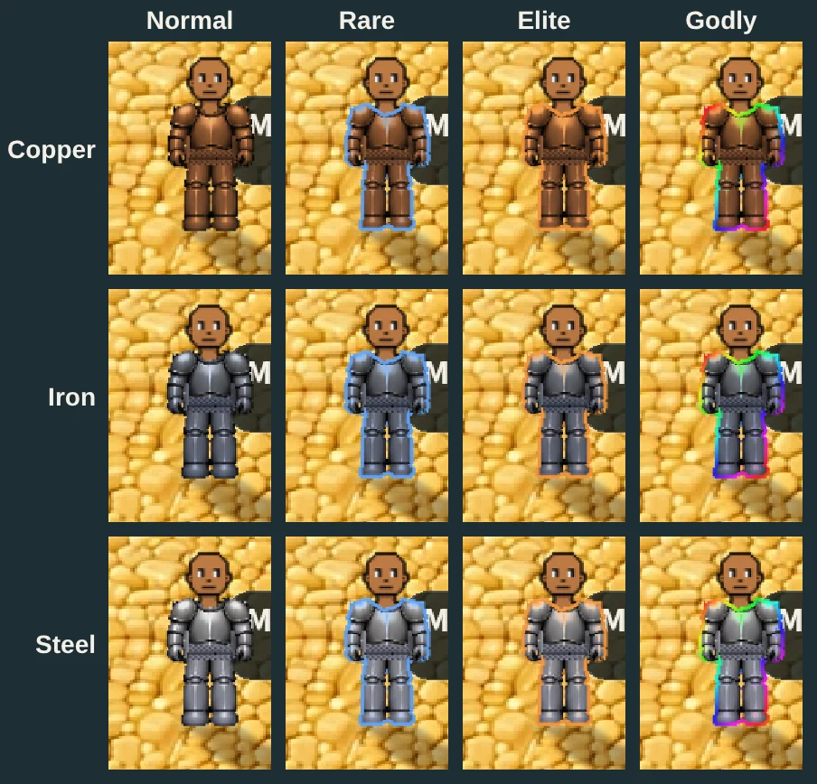
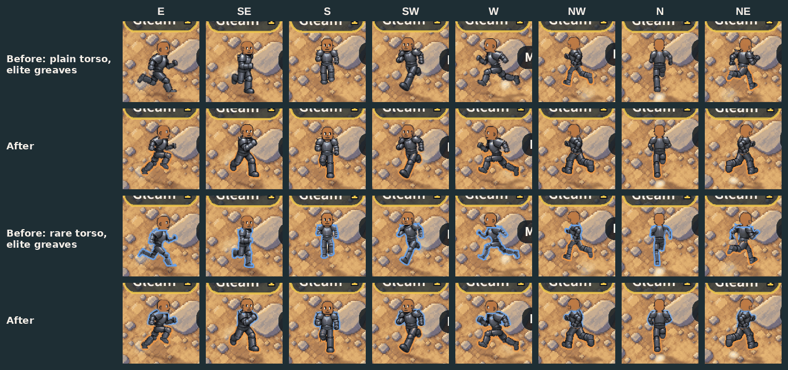
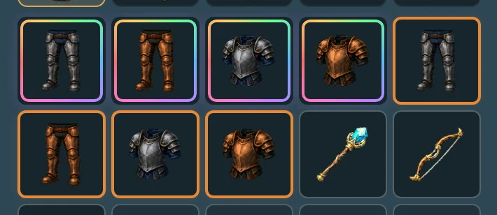
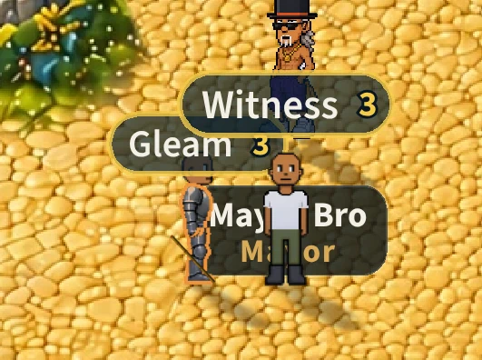

# Worn armour shows its grade (v2.3.3142; a soft glow outside it, on every facing, v2.3.3953)

Owner: *"I also think the armor should be visibly different if you're
wearing rare, elite, or godly. Wondering if you can change the outline hue or
something on the armor so it retains the color but has highlights. So rare is
blue, elite is orange, godly is prismatic"*.

*(That picture is v2.3.3142's inner outline. Since v2.3.3953 the edge is a
soft glow outside the armour, and jogging shows each piece's own grade on
every facing: see "A soft glow outside the armour, on every facing" below.)*

## What it looks like

The torso and greaves you wear keep their metal's own colour and get two
things in the grade's colour:

- **a glow** (v2.3.3953; until then an outline, about 1.4 CSS px, drawn just
  inside the silhouette): soft, outside the piece, under it, brightest
  against its edge and gone about 2 CSS px out;
- **highlights**: where the steel art is bright (the same mask the metal
  sheen uses), the bright pixels are lit in the grade's colour at their own
  brightness. A copper plate stays copper and gleams blue at its highlights.

| grade | colour |
|---|---|
| rare | blue (`[0.32, 0.62, 1.0]`) |
| elite | orange (`[1.0, 0.56, 0.14]`) |
| godly | a rainbow across the figure, about one whole spectrum from shoulder to boot, drifting round once every ~6 s |

- **Normal armour is unchanged.**
- **A full set while jogging** is one picture on the body sprite
  (entityRenderer `_fullsetFrame`), so its glow goes all the way round, in
  the torso's grade above the waist and the greaves' below it (v2.3.3953).
  Standing, the torso and greaves are separate pictures; the torso's glow
  never reaches down from its bottom edge and the greaves' never up from
  their top (`uRimSkip`), or a band would cross the waist.
- **Weapons are unchanged.** The ask was the armour. A godly weapon keeps its
  gold gleam (`GRADE_SHINE.godly.color`); godly armour shines in its own metal
  instead, because gold under a rainbow outline muddied both.
- **It is drawn with the light effects off too** (`?lightfx=0`, or a device
  that turned them off): a grade is something the player owns, not
  decoration. Then only the graded pieces are filtered.

## How it is drawn

The metal sheen's own filter (`src/rendering/lightfx/glint.js`), which
already runs on every worn metal piece every frame, so it costs **no new
pass**:

- `GRADE_LOOK` holds the three colours, `GRADE_RIM` the outline's width.
- The shader (`FRAG`, the `uGrade` block): the outline is a pixel with open
  space within `uRim` of it in one of eight directions AND still open 2.6
  times as far, so a pinhole in the art (the gaps between a gauntlet's
  fingers) does not draw a little ring. Godly's colour is `hueRgb` of a
  diagonal ramp plus `uTime`.
- `uTime` wraps every 100 s, where 0.16 turns a second is a whole number of
  turns, so the drift never jumps.
- **Every graded piece's filter works over its whole picture frame**
  (`unmaskedArea`, as the masked arm clone's always did). The rainbow and the
  outline are read off that frame, and the arm drawn again over a sword must
  find the very same frame as the body under it: measured from the body's
  own bounds it sat a step off, and a godly arm read as a patch.
- The loading screen's warm-up draws the grade branch once
  (`prewarmGlintPipe`), so the first graded piece does not compile a shader
  mid-play.
- **No textures, no memory.** Five uniforms on a filter that already exists.

## A soft glow outside the armour, on every facing (v2.3.3953)

The owner: *"The outline effects of the rare, elite etc armor needs fixed. It
doesn't show while jogging in some directions. I also want it to be less of a
hard outline and more of a tight glow. But i don't want it to eat into armor
that's already there: it makes the armor look too small otherwise."*

Standing, every metal in every grade: [before](armor-grade-look/standing-before.png),
[after](armor-grade-look/standing-after.png).

**Why it went missing jogging.** In a matched set, six of the eight jog
facings (all but north-east and north-west) draw ONE full-set figure on the
body sprite and hide the piece sprites (`_fullsetFrame`, `_placeGear`), and
glint.js put that sprite in the chest slot only. So a plain torso over graded
greaves showed no grade on six facings, and a rare torso over elite greaves
drew the whole figure rare. mp-armorgrade only looked at standing frames and
one east jog in a godly full set, both pieces the same grade, so it never saw
it.

**The fix, on the same single pass** (no new pass, no new texture, no new
memory):

- the figure's filter carries both grades: `uGrade` / `uPrism` the torso's,
  `uGrade2` / `uPrism2` the greaves', and `uSplitY` the waist, as a fraction
  of the frame. The waist is the jog frame's own pants-top row (jogWaist.js,
  256-space, the row the bow's jog-legs composite cuts at), looked up by the
  jog's phase, because the figure's sheet plays its own frame count on it
  (`src/rendering/lightfx/gradeSplit.js`, set on the display as
  `_fullsetWaist` where the figure is chosen, yours and every other
  player's). Checked against the four figure sheets: the row falls on the top
  of the chain belt. The two grades blend over a couple of rows there;
- another player's figure is split the same way, from their `eqg`'s two
  letters;
- **NOT the layered path for mixed grades.** Drawing a mixed-grade set as its
  pieces would bring back the masked bakes the full-set figure skips (the 25-64
  MB story in look-armour.md and `_fullsetCoversBake`): TRAPS §261.

**The glow.** The v2.3.3142 shader repainted the art's own outer pixels at
92% of the grade's colour (`rim * 0.92`), so every graded piece read one rim
smaller all round. Now no pixel of the art changes for the edge: the glow is
drawn in the open space round the piece and laid UNDER it (premultiplied art
over glow). Eight directions, two rings of taps (one and two steps out): a
pixel touching the art sees about three taps of each ring inside it, one a
step out sees the far ring only, so the sums fall in four levels (about 1,
0.7, 0.35, 0.15 of `GLOW_A`, 0.8) with no extra taps. A pixel with no open
space two steps out in any direction (a pinhole: between a gauntlet's
fingers) gets none. The step is **two game px** (`GRADE_GLOW_STEP`), worked
out into CSS px from each piece's drawn size every frame (`rimCss`), so the
glow keeps its size against the armour at any zoom: about 1 CSS px a step at
the world's zoom, 2 CSS px in all. The first cut (one game px a step) read as
a hairline. The highlights (the art's bright pixels lit in the grade's
colour) are unchanged: that was the owner's first ask, and it changes the
art's colour, never its shape.

**This reverses one v2.3.3142 decision on purpose.** The outline was drawn
INSIDE the silhouette so it could not paint over the neck, wrists and waist
the next layer owns. The owner now asks for the opposite, so his words win:
the glow lies faintly over the neck and wrists (and standing, a sliver of the
torso's glow at the hips lies over the greaves' sides), softly. The waist seam
is still kept clear (`uRimSkip`).

**Filter area.** Pixi clips a filter's area to the screen; the glow's waist
row and godly's rainbow are read off that area, so a graded piece's filter
sets `clipToViewport` false (its whole frame even half off the screen) and
gives it back on release.

**The cost.** The same pass per graded piece as before. The taps now run
over the empty margin round the art as well as the art (16 a pixel, as the
old outline's), on graded pieces only. mp-crowdbots now takes `BT_CROWD_GRADE`
(two letters, as `eqg`: the bots wear described iron pieces in those grades
on the worker, bots.mjs), and the phone does receive each bot's `eqg`. But on
this build the bots draw no armour on the phone at all, plain or graded: their
`eqc` arrives as `ironplate` while `equip.chest`, which the renderer and the
shine read, stays `none` (25 bots in iron: 0-2 armour slots drawn), so the
crowd's frame cost of the glow could not be read from it. A finding for the
crowd test's own lane (it predates this change); the cost per graded piece is
one pass, as since v2.3.3142 (mp-sheenbatch: elite plate and greaves still
passes of their own).

## Whose grade, and why it cannot claim more than the fight counts

- **Yours** comes from your own bag: `seenGrade(R.armor)`.
- **Everyone else's** comes from the worker: `eqg` on that player's tick
  entry, two letters, the torso's then the greaves' (`n` / `r` / `e` / `g`),
  e.g. `'rn'` or `'ee'` (`armourGradeWire`, `server/src/gearprov.js`). It is
  absent in plain armour, so the usual player's tick is unchanged.
- **Both use combat's own rule** (`grade` in combat.js `_armorDrMult`):
  - a minted piece's grade is the ledger's;
  - a piece worn through the legacy lane is worn as the game describes it,
    grade included (the owner's v2.3.2534 decision, `gear-provenance.md`);
  - a godly piece the worker cannot prove (`prov !== 'minted'`) reads elite.

  So the outline never says more than the damage reduction gives. `prov` is
  the worker's own mark, stripped from every claim, and no message sets
  `eqg` itself: the worker derives it from what it already holds as worn.
- **A swap that changes only the grade** (an elite iron torso for a plain one:
  the same look, so no look update is relayed) marks the player for the next
  tick (`_gridsApplyArmor`, grids.js), so the others see it at once rather
  than at the next step.

## The bag and the cards say the same

The owner's colours were already the pets' ("White Normal, Blue Rare, Orange
Elite, Prismatic Godly", playerProfile.js), and the salvage essences use them
(#844). The bag and the cards used purple for elite and gold for godly; they
now match:

- **Elite is orange** (`#E8893A`): `QUALITY_COLOR` (dash/common.js),
  `RARITY_BORDER` / `RARITY_FILL` (inventoryStyles.js), `RARITY_TINT`
  (ItemArt.jsx), the two edges in InventoryPanel, and `.ls-slot--legendary`'s
  glow (game.css).
- **Godly's ring is a rainbow** (`.ls-slot--godly::after`, still turning on
  iOS 16.4+), and a godly item's NAME is rainbow text wherever the grade
  colours a name (`qualityInk`: the equip card, the quest reward label, the
  drop reveal's item line, the chest reveal's prize line).
- Gold stays godly's one SOLID colour (`QUALITY_COLOR.godly`) where a single
  colour is needed: a glow or a frame (the drop reveal's border, which
  mp-drops checks).

## Another player sees it

## Testing the look in the game

The admin panel (a 1.2 s press on the zone name) has **Rare armor**, **Elite
armor** and **Godly armor** buttons beside the kit: each puts the copper and
iron sets into your bag in that grade (`/dev/kit` `{ what: 'armor', quality }`,
devtools.md), minted, so a godly piece counts as godly.

**Found on the way:** the bag took a second armour piece with the same name
as one already held for a replay of the first, and dropped it (the
`quest_reward_stashed` handler's by-name guard, v2.3.1687). The worker had
minted it and the ledger held it, but it never reached the bag. A piece with
the worker's id is now the same piece only if it has the same id; a piece
with no id keeps the old guard.

## Checks

**Since v2.3.3953** (`mp-armorgrade`, 27, in the world, `world: 'wheel'`;
it was on the old map until then):

- standing, every metal in every grade on one frozen frame per metal: the
  armour's footprint found by drawing the frame with the pieces held back; the
  glow OUTSIDE it blue / orange / at least five hues; nothing changed further
  than two steps out; the art's outer band (2-3 device px in) changed no more
  than its middle (main: 38-52% of the band against 2-3% of the middle; now
  1-4% both); copper's highlights still red over blue (read 2+ px inside the
  art, so by 20, not the old 40: a smaller figure at the world's zoom);
- jogging, all eight facings, a full iron set: plain torso over elite
  greaves (orange glow on every facing, 85%+ of it below the waist; main drew
  none on any of them), rare over elite (blue above, orange below), the probe
  (`figures`: above, below, the waist) and the art's band, every facing;
- the arm clone over a sword in a godly full set: the same uniforms as the
  body, now with `uGrade2`, `uPrism2`, `uSplitY` and the step;
- another player: `'ne'` told by the worker and A's jogging figure drawn
  plain above the waist and elite below; then `'ee'` standing;
- the light effects off, the bag, no page errors.

On main the new checks fail 11 of 27 (the run that made the before
pictures).

The server's `armorgrade` suite gains §6: the waist rows for every facing the
figure ships, the phase lookup, and the shader read as text (no `rim * 0.92`,
the glow weighted by `1 - c.a`, the three new uniforms declared).

**Until v2.3.3953:**

- **Server, `armorgrade` suite (19):** the letters (junk and `__proto__`
  read normal; godly only when minted); no `eqg` in plain armour; `'rn'` for
  a rare torso; a described godly torso with a forged `prov` goes out as
  elite; the kit's grade minted into the ledger and the bag, worn by its ids,
  `'ee'` and `'gg'`; a grade-only swap marked for the next tick (a control
  run without the mark fails it); `eqg` never saved.
- **Phone, `mp-armorgrade` (15):** every metal in every grade, all four
  grades drawn on one frozen frame per metal and measured against it in
  plain armour: rare's outline bluer than red, elite's red over green over
  blue, godly's across at least five of twelve hues, copper's highlights
  still copper-warm; jogging east with a sword out in a godly full set, the
  arm drawn again over the sword (a masked clone of the body) has the body's
  own picture, place, filter frame and grade uniforms, read off the two
  sprites, and on the picture changes next to nothing by much (an arm with
  no grade would change its outline), with a guard that the picture holds
  the arm at all; the look with the light effects off; another player told
  `'ee'` by the worker and drawing both pieces elite (on a 3x phone); the
  bag's elite edge orange and godly ring a rainbow; no page errors.
  - *Why the arm is checked on the sprites:* with the pin taken out of
    glint.js again (the body's frame measured from its bounds), the sprite
    check fails (`sameArea` false) while the picture does not move: 76
    pixels changed, none by much, against 80-108 with the pin, plain
    armour's 33-49 moving with the jog frame frozen. The test's first cut
    compared those counts (godly within 1.25x plain + 40), so it passed or
    failed on that noise, never on the fix; a merge's run failed it at 108
    against 33. `QA_AG_DUMP=1` keeps the four arm pictures.
- `mp-sheen` and `mp-sheenall` (the metal sheen in every animation, yours
  and others') pass, except mp-sheen's "it follows the sun", which fails the
  same way, with the same numbers, on `main` before this change.

## Knobs

| | where |
|---|---|
| the three colours | `GRADE_LOOK`, glint.js |
| the glow's step (game px; it reaches two) | `GRADE_GLOW_STEP`, glint.js (`GRADE_RIM`: the CSS px fallback) |
| how strong the highlights / the glow are | `hi * 0.6` / `GLOW_A` in `FRAG` |
| the glow's falloff | `s1 * 0.45 ... * 0.8 + s2 * 0.45 ... * 0.35` in `FRAG` |
| where a full set turns from torso to greaves | `fullsetSplitY`, `lightfx/gradeSplit.js` (the rows: jogWaist.js) |
| godly's spread and drift | `p.x * 1.6 + p.y * 1.2` and `uTime * 0.16` in `FRAG` |
| the bag's colours | `QUALITY_COLOR`, `QUALITY_PRISM` (dash/common.js), `RARITY_*` (inventoryStyles.js), `.ls-slot--*` (game.css) |
