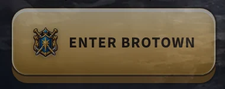
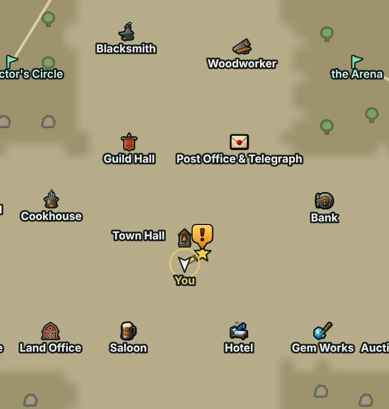
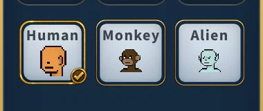

# BroTown, spelled one way, and the words a judge read (v2.3.3814)

Lane A's judge pass, 2026-10-29: player-visible words only. Ids, keys and
storage are untouched.

## 1. The town is "BroTown"

CLAUDE.md §1: players read "BroTown". The game said it three ways: "Bro Town"
(the creator's ENTER BRO TOWN, the welcome card, the chat's join line, the
connecting and reconnecting words, the room-full page, the About and Social
pages), "Brotown" (under the minimap, the world map, the town map, the clan
pages) and "BroTown". Now it is "BroTown" everywhere a player reads it:

- `src/networking/serverReady.js` (connecting, reconnecting, online only);
  `src/networking/wsClient.js` (the join line, and the refusal that takes it
  back, which must match it; the check before a character is made);
- `src/ui/panels/NameModal.jsx` (ENTER BROTOWN, its aria label, the logo's
  alt); `src/ui/panels/LoginScreen.jsx` (the title picture's alt);
  `src/ui/RoomFullScreen.js`; `src/ui/mobile/dash/AboutPanel.jsx`,
  `SocialPanel.jsx`, `ClanPanel.jsx`; `src/ui/panels/ClanInviteCard.jsx`;
  `src/game/welcomeBanner.js` (the welcome card's title);
- the world's plan (`public/tools/world/plan.js`: the town and "BroTown
  Commons", which the minimap's plate, the world map and the town map read;
  `core/wheelmap.js`'s fallback). The plan's fingerprint covers its names, so
  both Wheels were re-baked (`bake-wheel-spawns.mjs`, `bake-wheel-world.mjs`):
  the spawns, the objects and the pictures came out the same, only
  `core/placed.js`'s fingerprints new. No server change: nothing to deploy.

**Painted, left as drawn** (listed, not redrawn): the title pictures
`public/ui/welcome/title/logo-full.png` ("HEMI BROS / BROTOWN / MULTIPLAYER
AARPG") and `brotown-lockup.png` ("BROTOWN") already read BROTOWN as one word.
Code comments keep their spellings.

## 2. "MULTIPLAYER AARPG"

It is painted into the owner's own title picture (`logo-full.png`, v2.3.2642:
"I want the second one on the splash page to replace the current one"); the
code only repeats it as the picture's alt text. `git log -S AARPG` finds no
note of intent. A painted word is the owner's to change: flagged, not
redrawn. The alt text keeps the picture's words.

## 3. The town map names the Town Hall

The world map up close names every building by its picture (v2.3.3522: under
it, else over it). Your mark is kept first, and you arrive just south of the
Town Hall's door; with the Mayor's quest mark over its picture, its name had
nowhere to go and was left off. Now a name with no room under or over its
picture tries under your mark, then beside the picture, left or right, and at
the last goes under it all the same: every building on the screen is named. A
picture just past the screen's edge is not counted as unnamed
(`WorldMapOverlay.jsx`; `more.named` / `more.unnamed` for QA).

## 4. Every bro type wears its name

In the creator's Bro type tab only "Human" was labelled. Not by design: every
`none` tile (the plain bro, no hat...) wears a caption, and the Human is the
species strip's `none`; the Monkey and the Alien were pictures alone. Now each
is captioned with its name, above its picture as the Human's is (clear of the
check painted in the picked tile's corner) (`BroTown.jsx`).

## Checked

- `mp-townnames` (new, 3): the town map zoomed in, upright and wide, every
  building on the screen named, the Town Hall among them; no page errors.
- `mp-species` (29): + every bro type wears its name and the button reads
  "Enter BroTown".
- `mp-wheelhome` (19): the minimap's plate reads "BroTown · safe".
- `mp-questroad` (22): the welcome card names BroTown.
- test-world-core `--check` and `mp-wheelmap` (the map's words).
