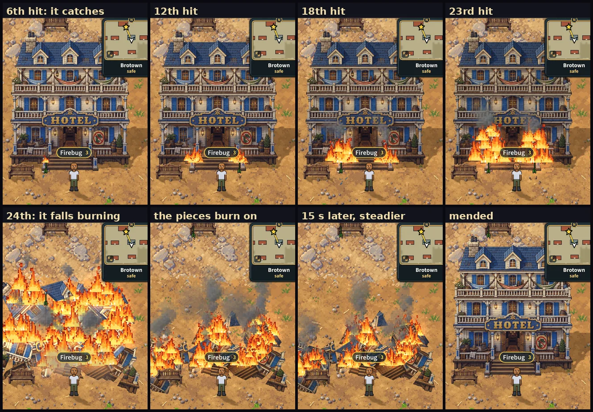

# A building you keep hitting catches fire (v2.3.3230)

> *"When attacking buildings add flame effects on the building after getting
> hit a while in the location where the building is getting struck and make the
> flames grow higher the closer it gets to falling apart. Keep the flames going
> as the building in pieces."* -- the owner, 2026-10-14.

## What there was

BroTown's seventeen buildings already take hits on your screen
(`src/game/wheelBreak.js`, v2.3.2995): each arrow, bolt or sword blow counts 1,
a special 3, and at 24 (the Town Hall 30) the picture shatters into 32 shards
of itself that fall into a heap where it stood (`src/rendering/wheelShatter.js`).
The heap lies there three minutes, then the building is mended. A count left
alone 30 s is forgotten. The worker knows nothing of any of it.

Nothing showed how near a building was to falling: it shook a little harder,
that was all.

## What it does now

**On your screen only**, like the hits (another player's shots that land on
your screen count, as they always have). Only the buildings burn; trees,
barrels and the rest break as before.

| Hits (of 24) | What you see |
|---|---|
| 1-2 | Nothing yet. The fire notes where each one struck. |
| 3 | It **smoulders**: thin grey smoke rises from where it was hit. |
| 6 | It **catches**, there: one small flame (~30 px), a few sparks. |
| 12 | Three flames a spot, ~60 px tall, darker smoke. |
| 18 | Six or seven a spot, ~90 px, the fire climbing the wall. |
| 23 | Ten a spot reaching ~200 px up the wall, thick dark smoke, the building darkened with soot. |
| 24 | It **collapses in flames**: the pieces nearest each fire, and the biggest, fall burning. |
| after | The pieces **burn on where they lie**, charred, the blaze settling from the collapse's flare to a steady fire over 14 s, until the mending. |

- **Where it was struck.** Every hit lands at a point on the building's picture
  (the arrow's, the bolt's, the blade's). Hits within 40 px of each other are
  one **spot**; a building has at most five, the next hits joining the nearest.
  Shoot its left side and its left side burns; shoot its right side too and
  there are two fires, with nothing burning between them.
- **The most-hit spot burns hottest**: a spot's heat is the building's damage,
  scaled from half (a spot hit once) to all of it (the spot hit most).
- **Higher the nearer it is to falling.** A spot's fire is a cluster of up to
  ten of the campfire's own pixel flames. The first five spread along where it
  was struck; the rest appear one by one as the damage grows, higher and higher
  up the wall above it, smaller the higher: the owner's "grow higher". Measured
  on the Hotel: the top of the fire 55 px above its foot at the 6th hit, 92 at
  the 12th, 132 at the 18th and 201 at the 23rd. No flame ever licks past the
  top of the picture.
- **Smoke and sparks** rise with it, the smoke darker and thicker the hotter it
  burns, all leaning the same way in one slowly turning wind. Its light warms
  the wall (the campfire's halo and its pool of light at the flames' feet), and
  the flames stand in a bed of glowing coals.
- **Soot**: the building darkens as its fire grows, up to 16% at the last hit,
  and is given back as it goes out.
- **Left alone**, the fire sinks from 12 s after the last hit and is out when
  the count is forgotten at 30 s. (`wheelBreak.js` now says so with a `heal`
  event: the count used to be reset only by the next hit, so nothing could tell
  it was gone.) Hit it again before that and it flares back up.
- **The fall.** At the break the fire flares (a burst of sparks), and nine
  shards carry fire as they fall: the one nearest each spot, the most-hit first,
  then the biggest. Each burning piece lies **charred** where it lands
  (`wheelShatter.js` reads `burnt`), and its fire burns on, its flames spread
  but not climbing (a piece of rubble has no wall), each at its own steady heat
  between a third and two thirds, breathing. They go out with the heap when the
  building is mended, or when the heap goes early (too many heaps at once).

## How

`src/rendering/buildingFire.js`, owned by `WheelObjects`
(`src/rendering/wheelObjects.js`):

- `WheelObjects.update` hands it every building's events -- `hit`, `break`,
  `repair` and the new `heal` -- AFTER handling them itself, so a break's heap is
  already made and its shards can be picked; then, after the shards have moved,
  `fires.update` draws them.
- **No new art, no memory.** The flames, coals, sparks, smoke and glow are the
  campfire's atlas (`campfireFx.js` `campfireAtlas()`, minted with the renderer
  since v2.3.2846): nothing is loaded or made when a building catches, which
  keeps the preloading law. `mp-buildingfire` checks that every fire sprite
  draws from that one picture.
- **Depth**: a fire rides what it burns on, as a building's moving pieces ride
  it (`worldLife.js`): in its layer, on its ground line, a quarter step after it
  (`depthSort.applyGroundSort`'s `_ridesOn`). So the fire on a building's face
  is drawn over the building and under you when you stand in front of it, and
  each burning piece of rubble sorts where that piece lies.
- **Cost**: the sprites are pooled per fire, and a fire away from the screen
  (160 px round it) is hidden and its sparks and smoke stand still. A burning
  building at the last hit is ~80 sprites; the heap ~9 fires of ~25.
- **Leaving the Wheel** destroys them all with the objects
  (`WheelObjects.destroy`); every fire Container is destroyed when its fire is
  out.
- `?nobuildingfire` turns it off.

## Tests

`mp-buildingfire` (18 checks, phone viewport, real worker, in BroTown, real
arrows through the game's own arrow code, the mending at 45 s):

1. two arrows: one spot where they struck, nothing burning or smoking;
2. the third: smoke, no flames;
3. the sixth: flames, at the spot the arrows struck, on the building's face;
4. hits on its other side: a second fire there, none in the middle;
5. the 12th, 18th and 23rd: more flames, taller, the top of the fire higher at
   every stage; the fire in the building's layer a quarter step after it; soot;
6. every fire sprite drawn from the campfire's atlas;
7. the 24th: nine fires riding the falling shards;
8. landed: nine burning, charred, each sorted with its own piece; 14 s on still
   burning, steadier;
9. mended: no fire left and no fire Container in the scene;
10. hit again and left alone: its fire sinks, and is out at 30 s, its count
    gone, no soot left, nothing of it in the scene;
11. no page errors.

Pictures in `tools/qa/mp/out/buildingfire-*.png`. `mp-wheelbreak` still passes
(the break, the heap and the mending are untouched).
