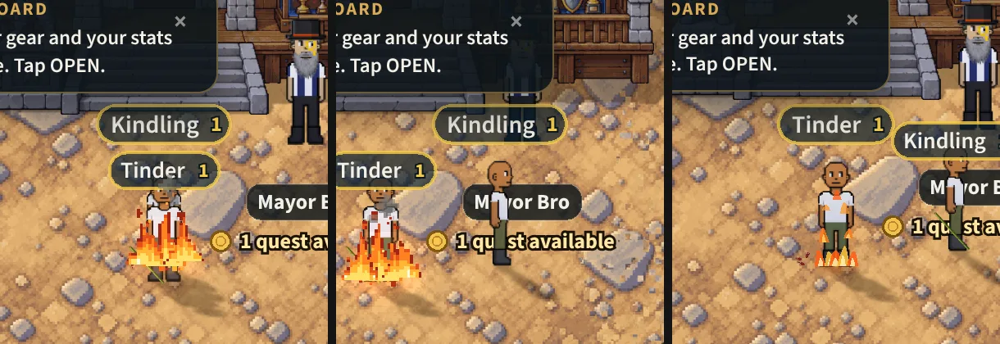

# A burn is the building's fire (v2.3.3878)

The owner, 2026-10-29:

> Make the fire effect more realistic from fire goblins when you take damage
> from them. I like the fire effect you drew from taking damage from the
> burning buildings.

## What a player sees

A fire goblin's blow sets you burning for a few seconds (the burn's ticks,
`docs/specs/stronger-elem-hits.md`). Until now that burn was drawn as shapes:
- an orange glow under you and up your body;
- a row of curved flames at your feet;
- tongues up your sides and front;
- embers.

Now it is the fire you get standing in a fallen building's burning heap
(`docs/specs/heap-burn.md`): the building's own pixel flames, glowing coals,
sparks and smoke, burning round your feet and sized with you.

Two more things come with it:

- **Running while you burn**, the sparks and smoke stay where they rose, a
  trail behind you. Before, they moved as one with you; the flames and coals
  still go with you. This holds for a burning heap's fire too.
- **Another player burning** (a fire goblin hit them where you can see) wears
  the same fire on your screen, where they had the drawn shapes.

Unchanged:
- the burn's length, its ticks and their numbers with the flame;
- the "Burning" chip in the HUD;
- its sound;
- the flinch on the blow, and none on a tick.

## How

`EffectsRenderer._updateElemStatusFx` (`src/rendering/systems/effectsRenderer.js`):

- **You**: the one `PersonFire` the heap made you (v2.3.3748) is now lit while
  `S._heapBurnUntil` OR `S._burnUntil` is ahead of the clock. The drawn burn
  is skipped while it is: the glow, the tongues and the embers alike, since the
  blaze has its own light.
- **Another player**: a `PersonFire` for each one burning, kept in a Map by
  their id. It is made as they catch and stepped at their drawn place while
  `_burnUntil` is ahead. When it ends it dies down where they stand, and once
  `done()` (its last sparks and smoke gone) it is destroyed and dropped.
  A player who leaves, falls, changes zone or is not drawn has theirs let go
  at once. At most six at a time (`PEER_FIRES`); past that, the drawn flames.
  The Map is emptied in `destroy()`.
- **The trail** (`buildingFire.js` `PersonFire.step`): when the figure moves,
  its sparks and smoke are shifted back by the move in the blaze's own
  coordinates, so they keep their place in the world. A move of 160 world px
  or more in one frame is a jump (a respawn, a door), and they go with you.

Nothing is loaded or made:
- every sprite is the campfire's atlas, minted with the renderer, as the
  building fire's and the heap's;
- each fire's sprites are pooled;
- the drawn shapes it replaces were a Graphics cleared every frame in the
  same overlay layer, so the layer's draw list is rebuilt no more often than
  before (TRAPS §218).

`?burnfire=0` draws the old shapes on that phone (no PersonFire for a burn;
a burning heap's fire is unchanged).

## Tests

`mp-burnfire` (a phone in the world, a second player on `?burnfire=0`):

1. A burn on you lights the building's flames, every sprite of them from the
   campfire's atlas.
2. Running while burning leaves its sparks and smoke behind you.
3. The burn over, the flames go out and soon nothing of them is left.
4. The other player burning wears their own fire on your screen, and it is let
   go once it has died down.
5. `?burnfire=0` draws the old flames and no PersonFire.

No page errors on either phone. Pictures: `burnfire-1-you.png`,
`-2-running.png`, `-3-peer.png`, `-4-off.png`.

`mp-elemhits`' looks (the burn's frames drawn) and `mp-heapburn` (the heap's
fire on you, from the atlas, out when you walk out) still hold.
