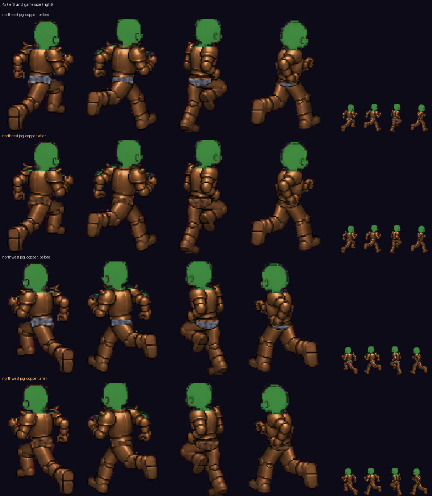

# The chain at the waist in the armour's own metal (v2.3.3733)

The owner, 2026-10-28, testing the live game before the judges: "Northeast and
northwest jog while wearing full copper armor the midsection with the belt is
either gray (matching iron) or leaves gaps (northwest jog)".

## What was wrong

In full copper, jogging north-east or north-west (the second is the first
mirrored), the band between the plate and the greaves was a steel-grey chain
on every frame of the stride. On the frames where the chain is thin, the grey
line reads as a gap between the two copper pieces.

## Where it came from

Copper armour is not its own art. It is the steel plate and greaves drawn with
a copper tint, a colour multiply on their sprites (`materialTints.js`).

North-east has no painted knight figure (the full set is drawn as one figure
only on east, north, south and south-west). So that jog draws the player's own
body, cut away under the armour by the masked bake (`maskedBake.js`), with the
plate and greaves on top, and the chain belt **painted into that body** at the
waist (v2.3.1347). The body is drawn untinted, so the chain kept the colour it
is drawn in, steel grey, under a copper plate. The same grey under iron
(slightly brighter than the iron plate) and under black steel.

The other directions were right because the knight figure carries the tint on
the whole figure, chain included.

## The fix

`maskedBake.js`: before the paint copies chain pixels into the body, it
multiplies them by the worn chest's tint (`gearTint`), the same multiply the
plate sprite gets. Copper chain under a copper plate, iron under iron, black
steel under black steel; the native steel's tint is white, a no-op. The bake's
cache key already holds the worn ids (`chest:copperplate`), so every metal
bakes its own waist. No art changed, no new texture, no switch: it is today's
drawing path. The GPU recolour (phase 2's armour lane) inherits it: whatever
tint that path gives the plate, the chain's paint reads the same `gearTint`.

## The checks

- `mp-copperwaist`: a bro in pink trousers wears copper, then iron (the kit's
  pieces, worn the real way), and jogs in place in every direction, his clock
  held and stepped. In copper north-east and north-west, every frame of the
  stride: grey pixels at the waist went from up to 256 a frame to 0-1, and no
  trousers show at the waist in either metal, any way (the other ways a few
  frames each; `BT_CW_ALL=1` for every frame). Black steel is not in it: the
  kit has no black steel piece, and drawing the worn iron as black steel on
  the phone alone does not hold (the game puts the worn piece's look back).
  The suite below covers it: black steel's plate takes black steel's tint,
  and the chain takes the plate's.
- `server/test/copper-waist.test.mjs`: each plate's tint is its metal's, the
  bake tints the chain by the chest's metal before painting it, and the bake's
  key holds the worn ids.

One thing seen and not changed: on the first direction jogged after putting
armour on, one or two frames can show the plain body under the armour for a
moment while the worker bakes that frame (`mp-wornbake`'s subject). It is the
same on the build before.
