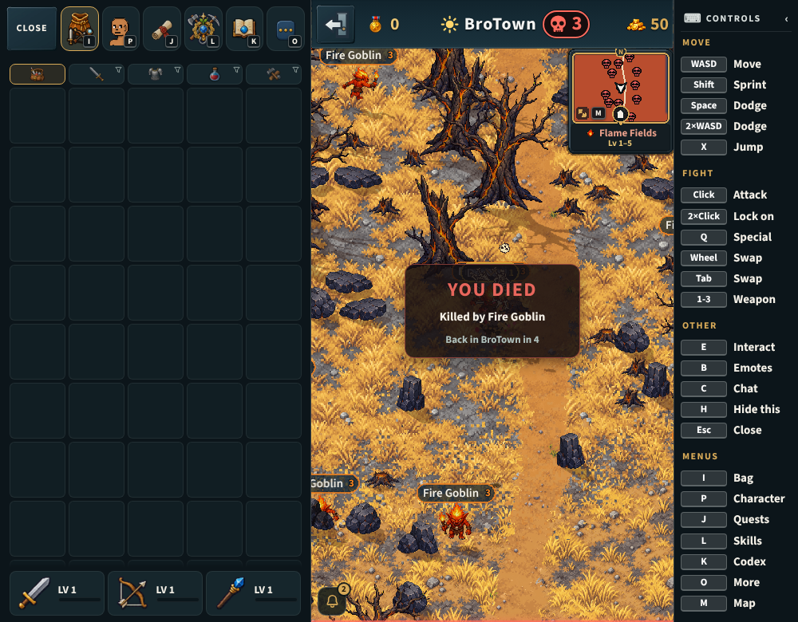
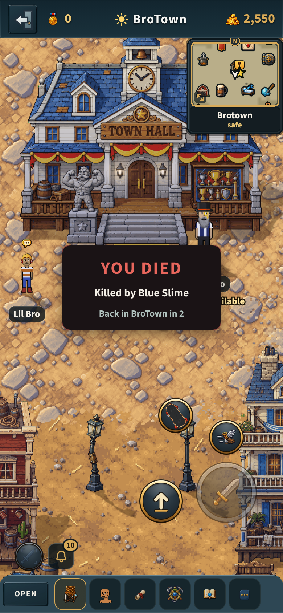

# The death card (v2.3.3817)

## Why

A judge's pass on a computer: a level-1 bro died in the first quest's slimes
and "just reappeared in BroTown". No capture showed a death. A death showed only
things that pass in a moment:

- the body's fall (held 3.5 s, `SELF_DEATH_HOLD_MS`);
- a screen shake, a half-second dark flash, the camera knocked away from the
  killer, and the death sound;
- a floating "YOU DIED" over the head, the same kind of text as a hit number.

The worker brings you back in BroTown five seconds after it decides you died
(`server/src/index.js` `_handlePlayerDeath`: `respawnAt = now + 5000`, then
`player_respawned`). Nothing, during the five seconds or after them, said what
killed you or where you were going.

## What it does

- **The card**, over the scene for the five seconds (`src/ui/mobile/DeathCard.jsx`):
  - "You died";
  - what killed you: "Killed by Blue Slime" (the monster's name as its plate
    reads it, with its stage, "Boss " on a boss), "Killed by a burning heap",
    a player "Raider killed you" -- "Raider killed you in No man's land" only
    when you died there (the worker's `pvp:<id>` is a duel's, a spar's and a
    war's death too: `noteDeath`'s `inNml`, read while you lie where you
    fell);
  - in No man's land, what went, once the worker has said it (`nml_loss`):
    "They took what you carried", or with a red skull "You lost what you
    carried and wore"; in a dungeon, "Your bag is safe";
  - "Back in BroTown in 5", counting down from the worker's `respawnInMs`.
  It sits in the middle of the play area, above the controls' band, z 22 with
  the banners. It never takes a tap or a click (`pointer-events: none`) and
  has nothing to close.
- **One line in the chat** once you are back (`src/game/respawn.js`, so the
  watchdog's respawn says it too): "You were killed by Blue Slime, and came
  back in BroTown." A card from a death the worker never brought you
  back from says nothing at a later respawn (`DEATH_LINE_STALE_MS`).

What killed you is read when you die: the respawn empties the monster list,
and the card outlives it.

## Where it is

- `src/game/deathCard.js`: the rules, no imports (`server/test/death-card.test.mjs`).
- `src/networking/wsClient.js`: `player_died` notes it (`noteDeath`), `nml_loss`
  adds what went (`noteDeathLoss`).
- `src/game/respawn.js`: the chat's line (`deathLine`).
- `src/ui/mobile/DeathCard.jsx`, mounted in `BroTown.jsx` beside `NmlBadge`.

Client only: no new message, no cap. Against any worker the card says what
`player_died` carries (`cause`, `respawnInMs`, `keptBag`), all of which every
worker since v2.3.3556 sends.

## Tests

- `server/test/death-card.test.mjs`: the killer from each cause, the card's
  words and countdown, the losses, the chat's line, the wiring.
- `tools/qa/mp/mp-deathcard.mjs`: an upright phone and a computer (sideways)
  die to a Flame Fields goblin; the card comes and names it, counts down,
  never takes a tap, goes with the respawn, and the chat says it once.
- The UI review's `death-card` screen.

