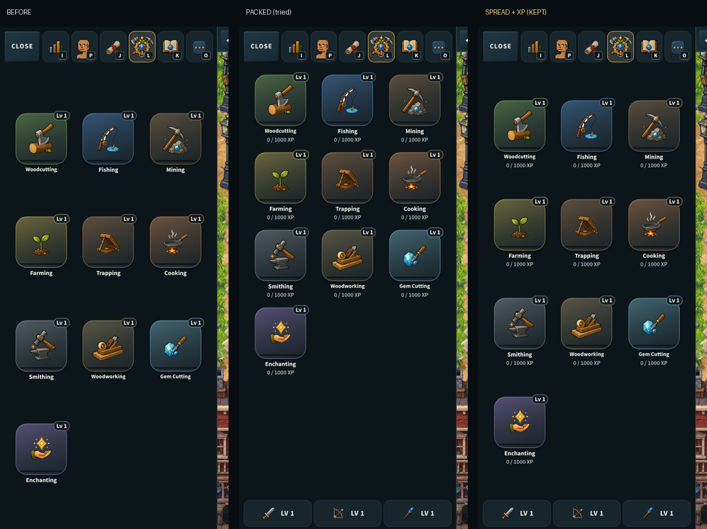
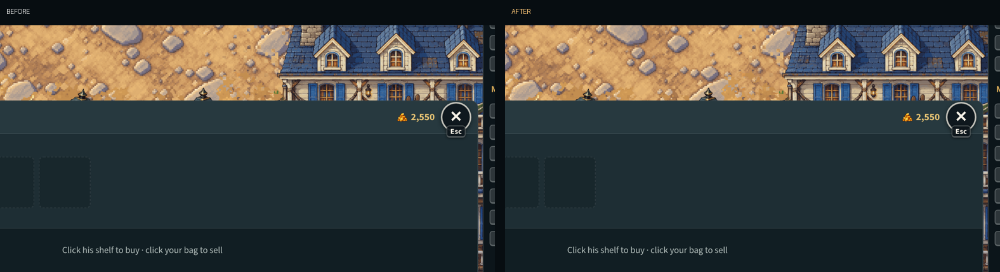

# The computer's empty space, put to use (v2.3.3769)

The owner, 2026-10-28, before the judges' showing (the judges play on
computers): "As you find improvements you can make to the empty space on the
desktop version go ahead and make your changes to better it". Then, of two of
the screens: "Make the left long strip black bar the same gray color as the top
bar but have an arrow centered in the middle pointing towards the screen play
area" and "For the trait picker desktop only you can make the trait picker area
and buttons proportionally larger".

Computer only. Phones, upright and sideways, do not change: every change here
is behind the computer's wide layout (`deskWideActive`, `deskFoldStripW`,
`html.bt-desk-wide`) or the computer's CSS block
(`@media (pointer:fine) and (min-width:1000px)`).

## 1. The closed dashboard's strip

CLOSE folds the dashboard's column to a strip at the edge. It was a black band
the screen's height with OPEN alone at its top. It is the top bar's grey now
(`zone-header-bar.svg`'s face, #152A34, its rim at the edge), with one arrow at
its middle pointing into the world, and a click anywhere on it opens the
dashboard (as OPEN and the I key do). `BottomDashboard.jsx`
(`bt-desk-foldstrip`).

A first version made the strip a toolbar (the six buttons and the weapons); the
owner's design replaced it the same night.

## 2. The creator's Trait Picker

- It is as tall as its tab: on Bro type it ended three tiles in with some 60% of
  the pane an empty navy box; now it stops under its content and the painted
  backdrop shows below. A long tab (Hair, Hats, Shirt) still reaches the foot
  and scrolls inside.
- It is drawn 1.3 times larger, in proportion (`zoom`), in a creator 1.4 play
  columns wide (still sized from the window's height, TRAPS §214). The bro's
  column (the bro, the name plate, ENTER) is exactly as it was.

`game.css`, the computer's blocks.

## 3. Quests with nothing active

A new player has no active quest, so the Active tab was one line over a column
three quarters empty. On a computer the quests on offer are listed under it,
the Available tab's own rows (a click opens the quest). `QuestsPanel.jsx`.

## 4. Skills

Each tile carries its XP to the next level in numbers now (the worker's price,
as the skill's own page shows it). The tiles keep their spread down the column
(v2.3.3687, the owner's "Every menu needs to look like it fits the space"):
packed at the top was tried, as the desktop review found the gaps between the
spread rows wide, and it left a third of the column empty below, which is
worse by the owner's own rule. The weapons row (5) now takes the column's foot.
Both pictures are in the PR. `SkillsPanel.jsx`.

## 5. The weapons at the foot of every page

The dashboard's own page ended in the three weapons; every other page ended in
empty column. Now each page does (`DashColumns.jsx` `DeskRailWeapons`, pinned
under the page, which scrolls above them when it needs the height). A click
opens the dashboard, where the full card is. `combatSkillLevel` is the level
rule the card and the chip share.

## 6. The building windows

Every building's window is one card (BroTown's `bt-inspect-card`; each panel's
`LS_WRAP` bleeds to it, the Town Hall's board included). It was a phone's
360 px in a ~1170 px world, its lists scrolling after two rows. On a computer
it is 470 px wide and up to 82% of the world's height. The Blacksmith keeps its
low place and height (the smith is seen working above it) and gains the width.

## 7. Nothing to click under a strip (v2.3.3793)

With Diego's shop strip or a trade's drawer across the world's foot, the
world's own buttons in that corner (a door's "E Enter ..." prompt, the
skateboard) were drawn under the strip, and a click on them landed on the
strip. While one is up, on a computer, they step aside; E and Z still work.
`game.css`, the computer's block.

## Checks

- `mp-deskwide`: the strip's grey, its arrow at the middle, I on it, a click
  opening the dashboard; the Quests page ending in the three weapons at the
  column's foot.
- The UI review: a new state, `hud-folded` (the dashboard closed), and a new
  view not in the default run, `desk720` (1280 x 720). Every creator tab at
  1440 x 900 and 1280 x 720, every building window at 1440 x 900; the upright
  phone's creator, HUD, Quests and Skills before and after, the same.
