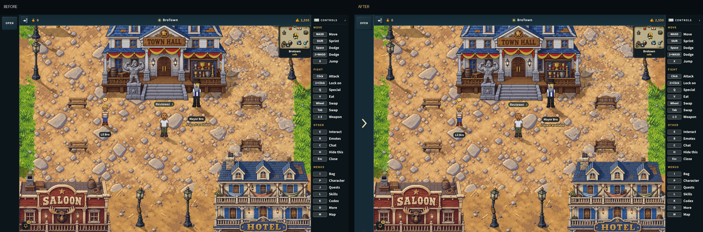
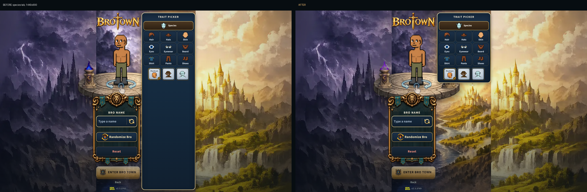

# The computer's empty space, put to use (v2.3.3769)

The owner, 2026-10-28, before the judges' showing (the judges play on
computers): "As you find improvements you can make to the empty space on the
desktop version go ahead and make your changes to better it".

Computer only. Phones, upright and sideways, do not change: every change here
is behind the computer's wide layout (`deskWideActive`, `deskFoldStripW`) or
the computer's CSS block (`@media (pointer:fine) and (min-width:1000px)`).

## 1. The closed dashboard's strip is a toolbar

On a computer the dashboard is a column at the left edge. CLOSE folds it to a
strip at the edge, which was a dark band the screen's height with OPEN alone
at its top.

Now the strip holds, under OPEN:

- the dashboard's six buttons stacked (Dashboard/Bag, Character, Quests,
  Skills, Codex, More), the open row's own, each wearing its key (I P J L K O);
  a click opens the dashboard on that page;
- at its foot, the three weapons and their levels, as the open column shows
  them at its bottom; a click opens the dashboard, where the full card is.

The strip is the width it was: the world does not lose a pixel.
`BottomDashboard.jsx` (`bt-desk-foldrail`), `NavRail.jsx` (`vertical`),
`DashColumns.jsx` (`DeskRailWeapons`, and `combatSkillLevel`, the level rule
the card and the chip share), `sheetGeometry.js` (`DESK_RAIL_BTN_H`,
`DESK_RAIL_ICON`: a little shorter than the open row's, so all of it fits a
720-high screen).

## 2. The creator's Trait Picker is as tall as its tab

The picker ran to the screen's foot whatever its tab held: on Species, three
tiles and some 60% of the pane an empty navy box. On a computer it is now as
tall as its tab, and the creator's painted backdrop shows below a short one; a
long tab (Hair, Hats, Shirt) still reaches the foot and scrolls inside. The bro
does not move. `game.css`, the computer's block.

## Checks

- `mp-deskwide`: the folded strip's six buttons with their keys and the three
  weapons, inside the strip and on the screen; a click on Quests opens Quests,
  a click on a weapon opens the dashboard.
- The UI review: a new state, `hud-folded` (the dashboard closed), and a new
  view not in the default run, `desk720` (1280 x 720). Every creator tab at
  1440 x 900 and 1280 x 720; the upright phone's creator and HUD before and
  after, the same.
