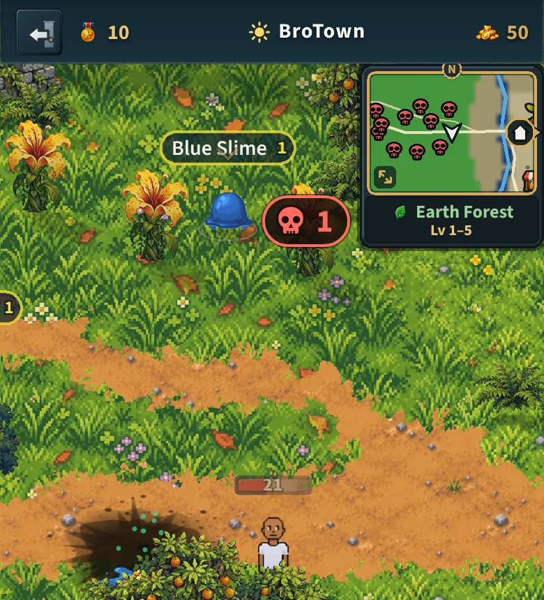

# The Verdant Wilds is now the Earth Forest (v2.3.3778)

The owner, 2026-10-28: "Rename verdant wilds to something like earth forest
(that's floral elemental type)". The land is the **Earth Forest**.

## What changed (everything a player reads)

- The land's name in the world's plan (`public/tools/world/plan.js`: the world
  map, the minimap's label, the zone banner, the signposts) and its short name
  ("the forest"), and in the zone table (`src/data/zones.js`).
- The Mayor's first quest ("Into the Blue": "Bring 4 Slime Remains from the
  Earth Forest") and his dungeon quest (the Goo Grotto "off the West Road in
  the Earth Forest").
- A townsperson's line, the Blue Slime's codex story, the daily rewards' land
  names, the Sound Studio's label, the old map's gate label.

## What stays

- Every id and key: `verdant` (the land, its files, its art, its ground,
  storage, the server's tables). Players never read them.
- The flora element's own word "Verdant" on items (`src/data/elements.js`:
  a Verdant fishing spot, the meadow's "Verdant Shard"): items players
  already hold keep their names (`src/data/shards.js` says why).
- No painted text: the land's banner, the zone banner's art and the world
  map's art carry no name.

## The bakes

The plan's fingerprint covers the whole plan, its names too, so both Wheels
were re-baked (`tools/world/bake-wheel-spawns.mjs`, `bake-wheel-world.mjs`):
the spawns came out byte for byte the same and the placed objects and
pictures the same, only their fingerprints new (`core/placed.js`). The server
reads no land name, so nothing under `server/` changed and no worker deploy
is needed.
