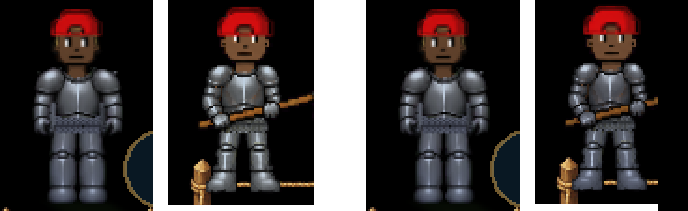

# The farmer's iron is the walking iron (v2.3.3628)

The owner's list of 2026-10-26 (docs/OWNER-LIST-2026-10-26.md, item 12):

> The armor while performing farming gestures is noticeably different color
> (iron). Try to make it match more exactly.

(Left pair: the game before this version. Right pair: after. In each pair the
bro stands beside the bed, then works it with the hoe, in a full iron set.)

## What was different

While you dig, plant, water or fertilize a bed, your bro is swapped for the
farmer: separate sprites drawn from the farm's own animation strips, dressed in
your armour (v2.3.3439). v2.3.3472 had already given them the walking armour's
metal tint, its shine and its greys. Two things were still different:

1. **The light.** The walking figure is *form-shaded* (src/rendering/formShade.js,
   v2.3.2767): one gradient over the whole figure, as painted at the head and a
   cool shade at the boots (red x0.72, green x0.75, blue x0.90 at the bottom of
   its frame). The farmer's sprites live in the gesture layer, belong to no
   figure, and were not shaded at all. So his iron was brighter and warmer from
   the knees down than the same iron a moment before.
2. **The greys.** The farm strips' steel was graded to the walking JOG sheets.
   A bro standing beside a bed wears the STANDING sheets, and the standing
   greaves are drawn brighter than the jogging ones (middle grey 0.557 against
   0.513).

Measured as a player sees it (`mp-farmiron`, a phone on the farm in a full iron
set, the figure alone on the canvas's own colour). Each band's median colour,
farmer over walker, red/green/blue:

| Band | Before | After |
|------|--------|-------|
| boots | 1.15 / 1.13 / 1.00 | 1.00 / 1.00 / 0.99 |
| the chest | 1.09 / 1.06 / 0.97 | 0.96 / 0.95 / 0.93 |
| head and shoulders | 0.99 / 1.04 / 0.97 | 0.89 / 0.92 / 0.89 |

The head and shoulders read about 10% darker on the farmer because of his pose.
His steel forearms cross his chest holding the hoe, where the standing figure
shows bright shoulder plates. The art's own top third is 11% darker whatever it
is graded to (measured on the sheets alone). That is the drawing, not the colour.

## The fix

- **Lit as the walking figure is.** Each of the farmer's sprites (body, greaves,
  shirt, plate, tool) is shaded across its own quad with the walking figure's
  gradient at those heights:
  - `standShadeSpan` (entityRenderer) gives where the standing figure's shade
    runs when its boots are where yours are, using the rows and scales the
    body is drawn with;
  - `spanSpec` (formShade) lays that gradient on the farmer's quad.

  It uses a shade object of its own, never `SHADE.figure` itself:
  sharpPixels takes that object to mean a pixel-art figure and would resample
  him. Other players' farmers get the same shade, at their build.
- **Graded to the standing sheets.** `tools/make_farm_anims.py` `STEEL_REF` is
  now `stand-south` for the plate and the greaves. Re-running the tool rewrote
  only the six armour strips. An unchanged re-run is byte-identical, which was
  checked first. Their stale `.webp` copies are deleted (the asset workflow makes
  new ones), and `GEARLAYER_VER` is 1038 so phones fetch them again.

## Tests

- `mp-farmiron` (new): the walking figure standing by bed 0 and the farmer at
  the same spot, the hoe's rest frame held, each pictured alone on the canvas's
  colour. Boots and chest are each within 8% of the walker, channel by channel
  (the code before this version: 15% and 9% over); head and shoulders within
  14%. The farmer carries the walking figure's own
  shade at his boots and crown, read from his sprites (to 0.01).
  `BT_FARMIRON_SHADE=0` runs it with the form shade off everywhere;
  `BT_FARMIRON_QUERY=sheen=0` with the metal's shine off.
- `mp-farmanim` §5: the six strips' middle grey within 0.03 of the standing
  sheets' (it read the jog's).
- `mp-farmpeer`: another player's farmer, still drawn and dressed.
