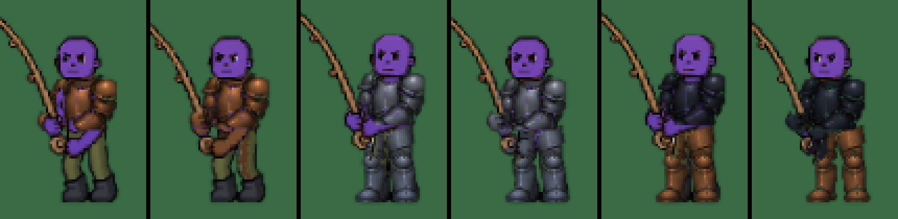

# An armoured angler's hands (v2.3.3623)

The owner's list of 2026-10-26 (docs/OWNER-LIST-2026-10-26.md, item 10):

> The fishing animation gets messed up around the hands when the character is
> wearing torso armor

## What was wrong

The fishing pose is drawn in three layers: the body (with the parts under the
armour erased, the masked bake), the armour over it, and on top an OVERLAY
(`_fishTopFrame` in src/rendering/systems/entityRenderer.js). The overlay holds
the head (so the plate's collar does not hide it, v2.3.1123), the rod, and the
GRIP: every body pixel within about 7 px of the rod. The grip is there so the
hand holding the rod rides over the shirt (v2.3.1914) and over greaves
(v2.3.2278) instead of disappearing behind them.

A torso plate draws its own arm and hands: a steel gauntlet on the rod and a
forearm guard crossing to the reel. The grip laid the bare arm and hand straight
back over them: a strip of skin a hand wide along the rod, cut square where it
ended, over the gauntlet and the guard. Measured on a phone with the bro's skin
purple (so nothing else reads as skin): 77-182 px of bare skin over the plate in
every frame of the cast, for copper, iron and black steel alike.

(The test's bro has purple skin so the bare skin stands out; each pair is the
game before this version, then after.)

## The fix

With a torso plate worn (its frame and its metal, `_chestFrameOf`):

- **Nothing of the grip but the rod is drawn over the plate.** The plate's own
  pixels, and one more round them (a pinhole in the art, its soft edge), keep
  what the plate drew there.
- **What the plate leaves bare is drawn as a gauntlet in its metal**: a finger
  past the plate's gauntlet, the reel hand, the forearm reaching down to it, the
  skin right at the plate's edge. These are the skin the grip touches and all the
  bare skin joined to it below the head. Each pixel becomes the plate's own
  steel at the skin's own shade (shadow to lit: the plate's steel from its 15th
  to its 85th percentile), times the metal's tint, so a copper plate has copper
  gauntlets and black steel black ones.
- The skin is found on the RAW frame, where every player's skin is the same
  colour, so it works for any skin tone. The skin's darker rim, where it shades
  into its outline, is included; the outline itself stays as drawn.
- **Never the rod.** The rod is pine, which a skin test passes. So the fill never
  steps onto a pixel the rod's recorded shape claims, except where that shape
  takes a pixel or two of the fingers at the seam. Skin is redder than any pine:
  red over green is 46 at most for pine and 68 and up for skin.
- **Under greaves only at the rod.** The grip has always lifted the reel hand
  over greaves (v2.3.2278), so that hand becomes a gauntlet there. The arm under
  the greaves stays under them. The first cut followed it down and painted a dark
  streak over the greaves.
- The body layer is not touched, so no gap opens round the hand.

A tee or greaves without a plate: exactly as before (the bare hand rides over
them; there are no gauntlets to draw).

`?fishgrip=1` lays the grip over the plate as before, for comparison.

## Cost

The overlay is built once per body frame, plate frame, metal and greaves frame,
and kept in its cache (64 at most, as before). Building one reads the plate's
and the greaves' frames once (two 128 x 128 canvases, let go at once) and makes
a few passes over the frame's 16,384 pixels; nothing is drawn per frame that was
not drawn before.

## Tests

`mp-fisharmour` (a phone in the world, the bro's skin purple, the cast held):
the figure drawn with the overlay and without it, the skin the overlay lays over
what is under it, below the head band (whose chin rides over the plate's collar
on purpose, v2.3.1123):

- a. a copper plate alone, b. an iron plate and iron greaves, c. a black steel
  plate and copper greaves: 0-3 px a frame (a blend at an edge; 4 allowed), where
  it was 77-182; the rod still lifted; the gauntlet drawn.
- d. the tee alone and e. greaves alone: the hand still rides over them.

`BT_FISHARM_DUMP=1` writes each outfit's worst frame with the overlay, without
it, and with the skin it lays in red. `mp-fishhand` (the older test of the grip
over the shirt and greaves) still passes.

## v2.3.3642: the grip lifts the hand, not the trousers

The owner, 2026-10-27: "check all the animations for ghost remnants of either a
body beneath or areas for cleanup". `mp-ghostaudit` photographed an angler in
pink trousers under iron armour, and every reel frame had a patch of pink on the
greaves beside the reel hand, up to 54 px.

At the reel the rod runs down past the hip, and the grip is every body pixel
within GRIP_R of the rod. So the trousers there rode over the greaves with the
hand (v2.3.2278 lifted the grip over the greaves for the hand alone).

Now a grip pixel that lies on the greaves' own pixels and is a trouser on the
raw frame (the recolour's own trouser test, on the art before any colour) is
left out of the overlay, and the greaves show. The hand still rides over the
greaves. This holds with a plate and with greaves alone: `_chestFrameOf`
carries the greaves' frame either way now.

`?fishgriptrousers=1` is the grip as before. `window.__btFishGripTrousers(on)`
flips it on a running page, and `window.__btFishTop.legsHeld` counts the
trouser pixels the last overlay left to the greaves.

**Test.** `mp-fisharmour` dresses the bro in pink trousers too. In each outfit
with greaves (b, c, e) the overlay lays at most a blend's worth of pink over the
gear, and the same frames with the grip as before lay the patch the test guards
against.

Its run, 17 checks of 17:

| outfit | trousers laid over the gear, most in a frame | with the grip as before |
|---|---|---|
| b. an iron plate and iron greaves | 0 | 17 |
| c. a black steel plate and copper greaves | 1 | 6 |
| e. greaves alone | 1 | 41 |

The hand on the rod still rides over the greaves alone (185 px of skin over 8
frames), and every plate's gauntlet is drawn as before.
