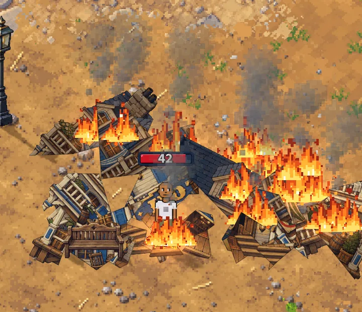

# A burning heap sets you on fire (v2.3.3748)

The owner, 2026-10-28:

> And if you stand in a burning pile of flames from a building prop getting
> destroyed you get on fire and take damage (same flame effect as the building)

## What a player sees

When one of BroTown's buildings is brought down burning (the building fire of
v2.3.3230), its pieces burn on where they lie. Step into a burning piece and:

- **you are on fire**: the building's own flames, the same pixel flames, coals,
  sparks and smoke, burning round your feet;
- **you take damage**: a burn tick about once a second, 3% of your health,
  with the flame on the number and your health bar dropping;
- **walk out** and the ticks stop at once and the flames on you die down.

A heap never kills: it burns you down to 1 HP and no further, so BroTown keeps
no deaths. It hurts in BroTown although BroTown is safe ground (no monster hurts
you there): the owner asked for it.

## How

The fire is on each phone's screen only (`docs/specs/building-fire.md`: the
worker knows nothing of it), but damage is the worker's. So the phone says so:

- **The phone** (`src/game/heapBurn.js`, `BroTown.jsx`'s loop): while your
  boots stand within 34 px of a burning, landed piece of a fallen building's
  heap (`rendering/buildingFire.js` `burningAt`), it sends `heap_burn` (no
  fields) about once a second and sets `S._heapBurnUntil` for the look. Only
  against a worker that says `caps.heapburn`. `wsClient.js` lets the type out
  (TRAPS #18).
- **The look** (`buildingFire.js` `PersonFire`, owned by `EffectsRenderer`):
  one of the building fire's own `Blaze`s, a burning piece's spot of flames at
  your feet, sized with you, in the effects' overlay layer. Made the first time
  you burn and kept; its sprites are pooled, all from the campfire's atlas
  (nothing loaded or made); shown and hidden by `visible` only as you step in
  or out.
- **The worker** (`server/src/heapburn.js` `_handleHeapBurn`): it burns the
  SENDER only, through the one door (`hits.js` row `heap`: flame, nothing to
  block, roll or hide behind, no shelter), and only:
  - in the world, alive, on BroTown's ground (`_wheelSafeAt`, where every
    building stands), not harvesting;
  - one tick a second at most, however often it is asked;
  - 3% of max HP, held under your HP less 1 (with room for a fracture), so
    never the last point.
- **Honest enough**: a phone that lies can only hurt itself. It names nobody
  else, and a tick pays no XP, no kill credit and no loot. A phone that never
  says so spares only itself. So it is no honesty check, and test mode is
  untouched. The worker does not check each building's own footprint (it holds
  none of them); the town check and the rate are the guard.
- **Cost**: one small message a second, only while you stand in fire; the
  vitals' coalesced save, as every hit. Nothing new is stored.

## Kill switch

`heapburn: false` in the live flags: `caps.heapburn` is false (the phone sends
nothing and draws no fire on you) and the worker burns nobody.

## Tests

- `heap-burn` suite (17): a tick through the wire (3%, flame, at your place,
  nobody else touched); the rate (thirty asks over three seconds, three
  ticks); never the last point (from 10 HP down to no lower than 1, nothing at
  2 or 1); refused dead, off BroTown's ground, outside the world; the switch,
  and the cap at the next join.
- `hit-door` §11: the `heap` row lands on the safe ground and through a raised
  shield, leaves a harvester alone, kills no one.
- `mp-heapburn` (8, a phone in BroTown, a real worker): the Hotel brought down
  burning (four slime blasts through the game's own `blast`), its pieces
  burning where they lie; standing in one, the building's flames on you (from
  the campfire's atlas) and the worker's ticks (8, 8, 8) taking your health,
  about a second apart; walked out, no more ticks and the flames out; no page
  errors.
