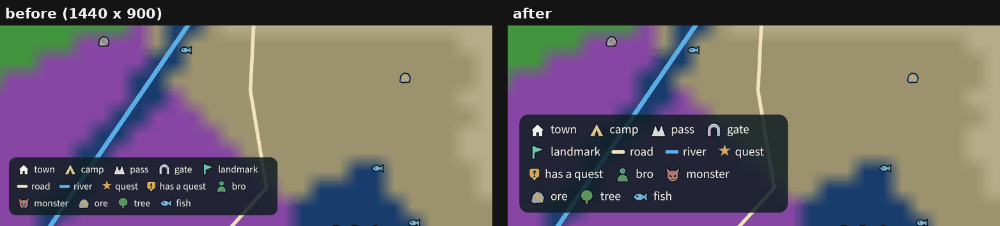
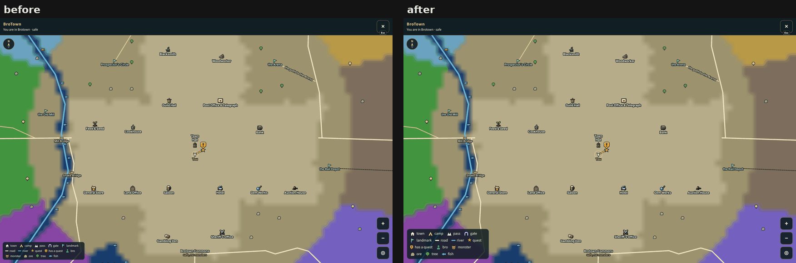
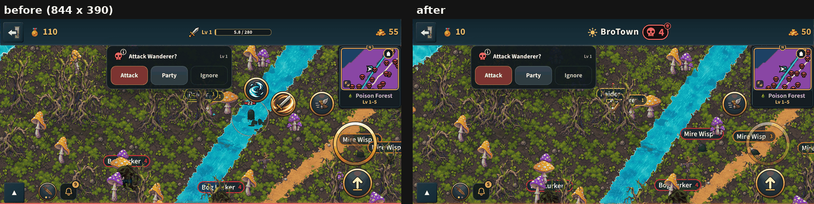

# Two layout fixes from the judges' passes (v2.3.3830)

## 1. The world map's key on a computer

On a computer the world map fills the whole window, and its key (the little
pictures and their names, bottom left) was drawn at the phone's 11 px: small
on a big window (the judges' pass at 1440 x 900). It is sized from the play
column now, never the window (TRAPS §214): the column a computer gives the
phone's layout, the smaller of the width and 390/715 of the height (game.css
`--cc-colw`), over the phone's 390. That is 1.26 times at 1440 x 900, 1.5 at
1920 x 1080, never more than twice, and unchanged at 1280 x 720 (a step under
5% is not taken: it would only blur the words). The words, the pictures and
the rows grow together (`zoom`), and the key keeps to the same margin left of
the Wheel. Phones never change: only the computer's wide layout
(`WorldMapOverlay.jsx`, `keyK`).

## 2. The "Attack?" window held sideways

In No man's land, a phone held sideways (844 x 390) puts the "Attack <name>?"
window beside the minimap, centred in the strip left of it: right over you,
its foot a few px above your head. Once the top bar grew (v2.3.3765,
`--bt-bar-grow`, with No man's land's pill in it) it came 2 px into the space
kept clear over you (mp-nmlask step 9, H's finding); the camera leads you by up
to about 12 px as you walk, so it could come further. It cannot go higher (the
top bar) or shorter (its buttons are already under Lantern Slate's 44 px), so
when it would come down that low it slides LEFT, off the middle of the world
where you stand, its right edge 36 px left of you (`NmlAskCard.jsx`
`clearOfYou`). Upright and on a computer it is far above you and never moves.

## Checks

- `mp-nmlask` step 9: clear of you with 12 px to spare for the camera's lead
  each way, and it prints how far: "-3 px above your head, 20 px left of you"
  (the window's foot is below your head's line, and it clears you to the
  side). Step 7's "HP unchanged" reads "not lowered" now: a raider a bog
  lurker had scratched healed while the swing was held (203 -> 224, nothing
  sent), which failed it once.
- The UI review's world map at 1440 x 900 (bigger), 1280 x 720 and the upright
  phone (both unchanged).
