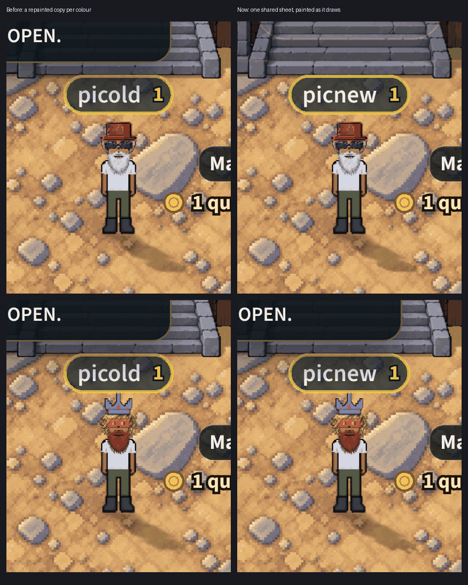

# The head pieces kept once, coloured on the graphics chip (v2.3.3753)

Phase 2 of the look palette (`docs/specs/look-palette.md`), lane P4. The owner:
*"The game needs to be extremely memory efficient"*, *"Make it so phase 2
finishes in a few hours. By sampling etc"*, and memory work lands **on by
default** (`?lookpalette=0` in the address is the old way, for that page).

## What the page held

A hair, hat, beard, pair of glasses or eye style in a colour was its own
recoloured copy (`traits/*ColorCatalog.js`, `recolorHairToCanvas`): the whole
128 frame of every facing, about **430 KB on the graphics chip a copy** (five
facings with mipmaps), made the first time anyone wearing it came into view,
up to twelve kept a category. Twelve coloured hats measured 5 MB on the chip
(`mp-lookheads` §5). While a copy was being made, the piece showed in its
native colour.

## What it does now

Every recolourable piece (59: hair 7, hats 39, the beard, 7 pairs of glasses,
5 eye styles) is kept **once** as colour numbers, the set `heads`
(`public/sprites/look/heads/`, `tools/art/head-bake.mjs`). All 59 together are
**0.82 MB on the chip** (16-bit numbers and their tables), loaded behind the
loading screen. A colour is one entry of a palette row, in the head range of
the row (64-127):

| entry | piece |
|---|---|
| 64 | hair |
| 65 | hat |
| 66 | beard |
| 67 | eyewear |
| 68 | eye style |

A row is one (category, colour), so the rows in use are the colours on screen,
whatever the number of players.

### The roles (decided by the game's own recolour)

The bake runs `recolorHairToCanvas` with each catalog's own profile and four
probe colours, and asks of every pixel which rule explains what came out:

- **keep**: the art's colour (outlines, the Kermit hat's eyes, the faint fringe
  at alpha 30 or less, the materials a profile spares);
- **paint**: `min(255, round(target x luminance / ref))`. The ref is pooled
  over a hat's, a pair's or an eye style's facings, and is each facing's own
  for hair and the beard (one role a facing);
- **flat**: the target itself (One Eye, WTF, the Alien Eyes).

No pixel goes unexplained in any of the 59 pieces. The refs are fractional
(a mean luminance x 1.15), so a role's ref is carried in 1/64ths (the
manifest's `refScale`, the last header value; the body's is 1).

- **Exact.** Every pixel keeps its own colour (a facing has up to 771 of
  them), so the sheets are 16 bits a number; 8 bits would mean reducing the
  art's colours.
- **Cropped.** A piece is 2-9% of its frame. Each facing is cut to its art, with
  two see-through texels round it, on even texels, so the chip's blend and
  the first mip level see what they saw in the old frame. A texture's `orig`
  is the whole 128 frame, so `_placeTrait` places it exactly as before.

### What does not change

- Which pieces take a colour, and which of their pixels: the catalogs still
  decide. Each `getColored*Textures` asks `headLook.js` only after its own
  checks.
- The placement: `_placeTrait`, the hair's clip, the flip's head table.
- A piece in its own colours: the native art, as before.
- Where the numbers cannot draw a piece (`?lookpalette=0`, no WebGL2, the set
  not loaded, no palette row free), the catalog makes its copy exactly as
  before. **A piece is never left without a picture.**
- The loading screen's colour waits (`coloredHairReady`, ...) wait for the
  numbers first, so your own colours are drawn from them and never copied.

The same two looks on two phones, `?lookpalette=0` on the left and the
default on the right (`LH_PICTURE=1 node tools/qa/mp/run.mjs lookheads`).

**A wait it removes.** Taking that picture showed the old way's white beard
still brown 5 s after the colour was picked. The old copy is stored only once
every facing has loaded or failed, and the beard has no north or northeast
picture, so each of those is retried after 2 s and 6 s (`traitImg.js`) before
it gives up. A coloured beard therefore showed brown for about 8 s after any
change, and for anyone who walked into view. The numbers need no copy, so
the colour shows at once.

## How it was proven

(`mp-lookheads`, a phone at 390 x 844, dpr 3, in the Wheel's BroTown.)

- **The oracle**: 8 hair colours on every recolourable hair, 8 hat colours on
  6 hats, 2 on every other hat, the beard in all 7, every pair of glasses and
  every eye style in 3. That is 213 pieces in a colour and 1,611 facings, the
  three flipped facings drawn flipped as the game draws them. Each is drawn
  the old way (the catalog's copy) and from the numbers, 1:1, through the sharp
  read: **0 pixels more than 1 level of 255 apart** (646,742 pixels).
- At a phone's 2.6 screen pixels a texel and a computer's 0.8: see the PR.
- `head-bake.mjs` checks its own bake against `recolorHairToCanvas`: three real
  colours, every texel of every facing, 1 level at most.
- `precheck` `look-heads`: a piece's art changed without a re-bake FAILS; the
  recolour code or a catalog changed WARNS (`head-bake.mjs --check`).

## Where it is not exact, and why

- **The quad.** The old coloured copy is the whole 128 frame, and the numbers
  are cropped. At a zoom that is not a whole number (a phone's 2.6), the two
  quads' corners land on different fractions of a pixel, which the rasterizer
  snaps to its own sub-pixel grid. An edge's one-pixel blend moves by that
  much (about 1/32 of a screen pixel). That is geometry, not colour. The
  game's native pieces have been cropped the same way since v2.3.2776
  (`loadCroppedStrip`), so a piece in its own colours and the same piece
  coloured already differed by exactly this. The oracle compares the colours
  through the same quad (`sameQuad`).

## Not in this change

- **The species overlays** (the monkey's and the alien's fur, recoloured by
  the skin). The fur is fully opaque over opaque art, so its roles are keep +
  skin (the body's arithmetic, and `poseSkinTarget` for the hit, mine and fish
  strips): the next step.
- Long hair is always drawn in its native colour, as before.
