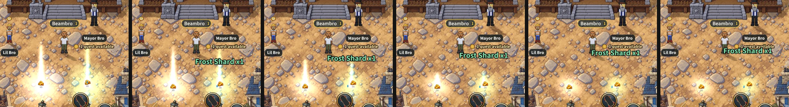

# The loot shine (v2.3.3746)

**The ask** (owner, 2026-10-28). First: "Wondering what method will give visual
cue that the loot message still means you need to walk over and pick up the
pile". Then: "I'd prefer a bright shine the moment it drops that lowers to a
glow", "Shine color same color as rarity tier (uses best)", and "I'd rather
the gear in the drop just match the rarity tier ... I want the loot message
font color to match the loot shine effect color".

**What it is.** The moment YOUR pile lands, a bright shine on it eases down
over 1 s (`SHINE_SETTLE_S`) to a soft, steady glow. The glow stays while the
pile lies there and goes when it's picked up or gone (`_disposeLoot`).
Another player's pile has none: it keeps the watcher's grey.

**Its colour is the pile's best drop line's** (`game/dropLines.js`
`pileShine`), so the words and the shine always match:

- coins and remains: white;
- a shard: green;
- a rare gem: blue;
- a mystery gear piece: rare blue (`QUALITY_COLOR.rare`, the armour's own);
- a normal gear piece: white.

The killing blow's nugget and raw gem go straight to the bag, so they don't
count. `notePileShine` sets it on the pile at its `loot_drop` (`gameEvents`).
A pile that reaches the phone another way first (a tick, a zone's list) gets
it the first time it's drawn.

**Gear on the drop line.** A mystery piece was purple; it is now rare blue
(see `rarity-reveal.md`). The reveal on pickup still climbs to elite's orange
or godly. Godly never shows at a drop: the pile only promises "rare or
better".

**Drawn** (`effectsRenderer` `_renderPileShine`):

- one soft round picture, 64 px, made in code by each effects renderer;
- its canvas let go once drawn (`_gpuWaiting`, `gpuOnly.js` `emptyOnceDrawn`);
- one sprite of it per pile, tinted, added (light, not paint, so it shows on
  dirt, grass and water alike), just over the remains and under the coins,
  shard and gear;
- size: 260 world px at the landing, 150 settled; alpha 1, then 0.7;
- each frame changes only its alpha, size and place (TRAPS §218); the blend
  is set once, when the sprite is made.

No new art files; one 16 KB picture on the chip.

**Tests.**

- `drop-lines.test` §2: `pileShine` and `notePileShine`.
- `mp-droplines` §7: bright then steady, white, the shard's green, none on
  another's pile, gone on pickup.
- `mp-droplines` §8: a mystery piece, through the real `loot_drop` handler
  (`__btDispatch`), has a blue line and a blue shine, which is drawn: the
  screen around it changes with `window.__btShineOff`. Its reveal lands on
  elite (`__btReveal`).

`BT_QA_SIDEWAYS=1` runs it sideways. Probe: `window.__btLootShine()`.

## v2.3.3805: a beam comes down into the glow

The owner, 2026-10-29: "for the loot drop add a vertical shine that starts at
its peak and climbs downward to just end at the normal glow".

- **What a player sees.** The moment YOUR pile lands, a narrow column of light
  stands on it in the shine's colour (the pile's best line's), 230 world px
  tall (a pile is ~60). Its top comes down to the pile over the shine's own
  second (`SHINE_SETTLE_S`), easing in and out, fading a little as it comes,
  and it is gone just as the round shine settles into the glow. Then nothing
  of it is left but the glow.
- **Only a pile seen landing.** A pile already lying when it reached your
  phone (a zone's list on the way in) glows, with no beam (`_shine.late`, set
  where a pile is given its shine on first drawing rather than at its
  `loot_drop`). Another player's pile has neither.
- **How it is drawn.** ONE soft column picture per effects renderer
  (`makeBeamTexture`: 32 x 128, a bright core and soft sides, fading toward
  its top), kept on the graphics chip only (`_gpuWaiting`, its canvas let go
  once drawn). A sprite of it per landing pile, anchored at its foot, added
  light like the shine; each frame changes only its height and alpha (TRAPS
  §218). At the settle it is destroyed, once; `_disposeLoot` takes it with
  the pile if the pile goes first. The picture goes with the renderer.
- **Off for one phone:** `?lootbeam=0`.
- **Checked:** `mp-lootbeam` (7, a phone in BroTown, piles through the game's
  own `loot_drop` handler): the beam at its peak as the pile lands (the first
  frame drawn at the height due at its age); its whole fall, the page's clock
  held at each 100 ms (230, 224, 206, 180, 149, 115, 81, 50, 24, 6 px, gone
  at 1 s), never rising; destroyed after, the glow still there; none on a
  pile already lying; two rarity colours side by side; no page errors.
