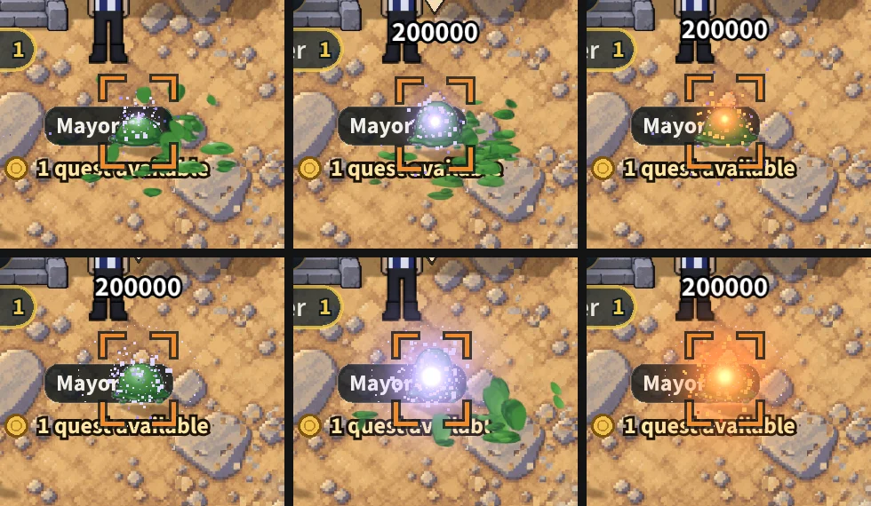

# A staff bolt explodes on a hit (v2.3.3892)

The owner, 2026-10-29: "Magic attacks need a mini explosion upon impact with
monsters and a larger explosion for the special attack. Right now it just
disappears upon impact."

Top row: before, a plain bolt after, a flame staff's bolt after. Bottom row:
before, the special after, a flame staff's special after.

## What was there

The crash (v2.3.2841, `rendering/staffCastFx.js`): a white flash two 55 ms
steps long, a spray of sparks and two small pixel rings. Over in about a
tenth of a second, it read as the bolt vanishing.

## What it does now

On every crash a staff bolt makes (a hit on a monster, and a bolt stopped by
a rock, which uses the same crash), an EXPLOSION blooms where it landed, in
the bolt's heat ramp (its element's colours; lavender for a staff with no
element):

- a painted fireball in the element's own colour, swelling out fast and
  darkening as it cools;
- a dim cloud round it, wider;
- its light on what is round it, and a small white-hot core that shrinks;
- a harder, thicker throw of sparks.

A bolt's is small (its fireball reaches 42 world px from the hit) and
over in 340 ms; the special's is big (96 px) and lasts 540 ms, with its blast ring
as before. Painted (normal blend) under the added light, so the colour reads
on sand and snow, where added light alone only whitens.

## How

`StaffCastFx._onCrash` adds a flash of kind 4 (a bolt's) or 5 (the
special's), drawn smoothly over its own time in the flashes loop with the
same pooled glow sprites as every light there, plus one small pool of painted
glows (`glowN`, 24 at most). Nothing is loaded or made per hit; the sprites
are given back each frame (`begin`/`end`), and the pools go with the
renderer. Over the monster (the front layer).

Another player's bolt makes the same crash where it is already drawn for you
(a bolt stopped by a rock: `visualSystems.js`); a peer's hit on a monster is
not drawn on your screen, as before.

`?magicburst=0`: the crash as it was, for one phone.

## Checked

`mp-magicburst` (7, a phone in the world and a computer, a staff out and a
pinned slime locked in front of you):

1. a bolt's hit explodes, small, plays out and is gone (about 330-390 ms on
   this box), and after it nothing is drawn (no explosion playing, every glow
   given back);
2. the special's hit explodes big, gone after (about 850 ms of this box's
   frames);
3. `?magicburst=0`: the crash as it was, no explosion;
4. the same on a computer;
5. no page errors.

`mp-staffcast` (36) passes as before. No sound added: the crash keeps its own
(`magicHit` and the monster's hit voice). No body pose touched.
