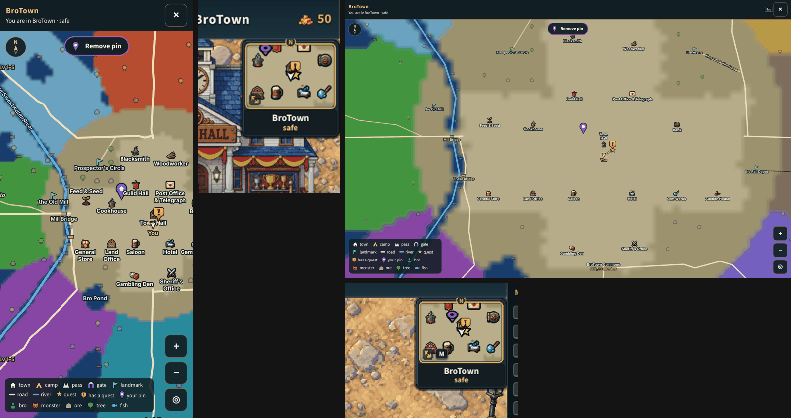

# Your own pins on the map (v2.3.3879; two pins and their lines, v2.3.4027)

The owner: "It would also be good to add the ability to drop a pin to the map
for where you want to go after opening it. It can be confusing trying to
remember where a building is but if you had a pin similar to a star that would
help. You just need to also have an easy way to remove it afterwards".

- **Drop**: in the World map (opened from the minimap), a tap on a phone or a
  click on a computer on open ground drops your pin there; a tap elsewhere
  moves it. The map did nothing on a plain tap before (a drag looks round, two
  fingers or the wheel zoom, its buttons are their own), so a plain tap was
  chosen over a "Pin" mode button. A press that moves more than 8 px or lasts
  longer than 0.6 s is a drag and drops nothing; two fingers drop nothing. With
  no pin, the top of the map says "Tap the map to drop a pin" ("Click" on a
  computer, deskWords).
- **See**: a purple map pin with a white dot, the Town Hall board's pin shape,
  so it is neither the quest's gold star nor the board's red and blue pins. On
  the World map at every zoom (at the screen's edge toward it when it is off
  the screen), in the map's key as "your pin", and on the minimap, riding the
  box's edge toward it when it is off the box, as the board's pins do. The
  quest star and your pin show together.
- **Remove**: a tap on the pin lifts it, and "Remove pin" at the top of the
  World map lifts it while one is set.
- **Kept**: one pin a character, on this device (`localStorage`
  `bt_droppin:<id>`), back after a reload; never sent to the worker. Only in
  the world: the World map and the Wheel's minimap are the only places that
  draw it.
- `?mappin=0`: no pin, nothing drawn, no hint, for one tab. QA probe:
  `window.__btMapPin` (`at`, `on`, `set`, `clear`).

Code: `src/game/dropPin.js` (the pin's rules, no imports),
`src/ui/WorldMapOverlay.jsx` (the tap, the drawing, the hint and "Remove
pin"), `src/rendering/systems/wheelMinimap.js` (the minimap's mark).

A fix on the way: the World map kept every finger it saw go down until it saw
it lift; a lift it never heard made the next tap look like a second finger (a
pinch), and on a phone every other tap was ignored. A primary press now
starts the count afresh.

## Two pins, blue and red, with a line to each (v2.3.4027)

The owner: "Add a line path when you drop pins on your minimap. When you get
near the pin (in game) make a window pop up asking if you want to remove pin.
A no just makes it stay up until you drop a new pin and get close to it again.
To turn off the pin just tap it on minimap and choose remove pin. If there's
already 2 pins on map ask if you want to remove one of the pins (give choice
of which to remove - blue or red)."

- **One store, two slots.** The purple pin above and the Town Hall board's
  red and blue pins (`game/mapPins.js`, v2.3.3766) are one pair of pins now,
  BLUE and RED (`src/game/pinSlots.js`). A slot holds a PLACE (dropped on the
  World map) or a board ROW (the board's buttons; its place found where it
  stands each time, `mapPinPlaces.js boardPlaceAt`). The purple pin is gone:
  `src/game/dropPin.js` was removed. The board keeps its API (`loadPins`,
  `pinsOf`, `pinsVersion`, `togglePin`, `pinsOn`, the colours), re-exported
  by `mapPins.js`; `pinsOf` names rows only.
- **Dropping.** A tap on open ground fills a free slot, blue first. With both
  up the map asks "Replace which pin? [Blue] [Red] [Cancel]" (a white ghost
  pin on the spot; a second tap moves it). The board's "Red pin" / "Blue pin"
  fill their own colour without asking (a press there is already a choice).
  A tap on a pin's head lifts it; one chip at the top of the map for each pin
  up ("Remove pin" for one, "Remove blue" / "Remove red" for two).
- **The lines.** From you to each pin, in its colour, cased dark: SOLID on
  the minimap, to the pin's point, or to its mark on the box's edge with a
  small arrow past it when it is off the box (one Graphics, redrawn only when
  a line moved, came or went: `pinSig`, TRAPS §218; the probe's
  `pinLineDraws`); DASHED on the World map (`src/ui/worldMapPins.js`). Straight
  lines: there is no pathfinding (the quest's gold road is straight too).
- **Arriving.** Within 160 game px of a pin, after being seen further than
  240 px from it (since it was put there or the page loaded: a pin dropped
  where you stand waits until you walk off and come back), a card: "You
  reached the blue pin. Remove it? [Remove] [Keep]". Keep (or its ✕) marks
  the pin ASKED, stored with it: it never asks again, and a new pin in that
  colour starts unasked. Never while you are fighting (a blow taken or landed,
  or a pvp hit, in the last 5 s), never while the World map is open, and never
  over another card (it waits; one that comes up sends it away). Walking off
  past 240 px unanswered lets it go unasked.
- **The minimap's tap.** A tap on a pin on the minimap (within 13 px of its
  head, the box's scale counted) puts up "Remove the red pin? [Remove]
  [Cancel]" instead of opening the map; anywhere else on the box opens the map
  as before, and so does M.
- **The cards** (`src/ui/PinCards.jsx`) are placed as No man's land's
  "Attack?" window (`NmlAskCard.jsx cardPlace`); each ✕ is `data-esc="up"`
  (Esc), the main button `data-enter` (Enter), each wears its key on a
  computer; every button acts on the lift with `swallowTapClick` (TRAPS §247);
  words through `deskWords`; 44 px buttons.
- **Kept.** `localStorage` `bt_pins:<id>`, now `{ v: 2, red, blue, at, asked }`:
  `red` / `blue` stay the board rows, so an older page still reads its board
  pins. An old purple pin (`bt_droppin:<id>`) is read once as the blue pin (the
  red if the board's blue is up; dropped if both are) and its key removed.
  Never sent to the worker; no server change.
- `?mappin=0`: no dropping, no lines, no cards, no hint; the board's row pins
  are still drawn, as before this version. QA probe `window.__btMapPin`:
  `on`, `slots`, `at`, `set(x, y, color?)`, `lift`, `clear`, `ask`, `open`,
  `close`; the minimap's probe `mapPins` (each with its `line`) and
  `pinLineDraws`; the World map's `more.mapPins` (each with its dashed `line`).

## Checks

- `node tools/qa/mp/run.mjs mappin` (v2.3.4027), on an upright phone and a
  computer: a drag drops nothing; taps drop blue then red, a dashed line to
  each, a chip for each; a third asks "Replace which pin?" (Cancel / Esc keep
  them, Red moves red); a tap on the blue pin and red's chip lift them; the
  minimap's solid lines, the far pin on its edge with its arrow, no redraw
  standing still; a tap on a minimap pin asks to remove it (Cancel keeps,
  Remove lifts), elsewhere opens the map; a reload keeps them; walking up to a
  pin asks (Keep never asks again; a new pin asks afresh, Remove / Enter lifts
  it).
- `server/test/map-pin.test.mjs`: the slots, the old pins read, the board's
  API, the asked mark, arriving, the minimap's hit test, nonsense and broken
  stores, `?mappin=0`, the ask bus, and the wiring (the cards' keys and
  swallowTapClick, the redraw guard, the UI review's states, nothing sent).
  `server/test/town-board.test.mjs` still holds the board's pins.
- The UI review: `world-map-pin`, `map-pin-replace`, `map-pin-arrive`,
  `map-pin-remove`.
