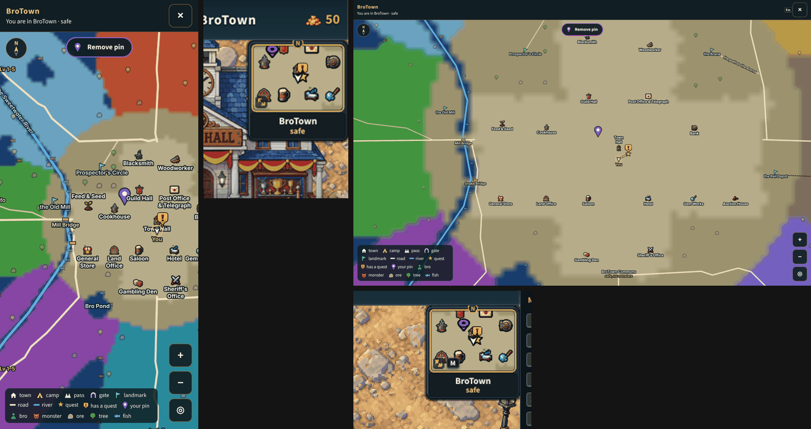

# Your own pin on the map (v2.3.3879)

The owner: "It would also be good to add the ability to drop a pin to the map
for where you want to go after opening it. It can be confusing trying to
remember where a building is but if you had a pin similar to a star that would
help. You just need to also have an easy way to remove it afterwards".

- **Drop**: in the World map (opened from the minimap), a tap on a phone or a
  click on a computer on open ground drops your pin there; a tap elsewhere
  moves it. The map did nothing on a plain tap before (a drag looks round, two
  fingers or the wheel zoom, its buttons are their own), so a plain tap was
  chosen over a "Pin" mode button. A press that moves more than 8 px or lasts
  longer than 0.6 s is a drag and drops nothing; two fingers drop nothing. With
  no pin, the top of the map says "Tap the map to drop a pin" ("Click" on a
  computer, deskWords).
- **See**: a purple map pin with a white dot, the Town Hall board's pin shape,
  so it is neither the quest's gold star nor the board's red and blue pins. On
  the World map at every zoom (at the screen's edge toward it when it is off
  the screen), in the map's key as "your pin", and on the minimap, riding the
  box's edge toward it when it is off the box, as the board's pins do. The
  quest star and your pin show together.
- **Remove**: a tap on the pin lifts it, and "Remove pin" at the top of the
  World map lifts it while one is set.
- **Kept**: one pin a character, on this device (`localStorage`
  `bt_droppin:<id>`), back after a reload; never sent to the worker. Only in
  the world: the World map and the Wheel's minimap are the only places that
  draw it.
- `?mappin=0`: no pin, nothing drawn, no hint, for one tab. QA probe:
  `window.__btMapPin` (`at`, `on`, `set`, `clear`).

Code: `src/game/dropPin.js` (the pin's rules, no imports),
`src/ui/WorldMapOverlay.jsx` (the tap, the drawing, the hint and "Remove
pin"), `src/rendering/systems/wheelMinimap.js` (the minimap's mark).

A fix on the way: the World map kept every finger it saw go down until it saw
it lift; a lift it never heard made the next tap look like a second finger (a
pinch), and on a phone every other tap was ignored. A primary press now
starts the count afresh.

## Checks

- `node tools/qa/mp/run.mjs mappin`, on an upright phone and a computer: a
  drag drops nothing; a tap drops the pin where tapped, drawn, "Remove pin"
  up; the minimap shows it, and on its edge when the pin is far; a reload
  keeps it; a tap on the pin lifts it; dropped again, "Remove pin" lifts it
  and the minimap shows none.
- `server/test/map-pin.test.mjs`: dropped, moved, lifted, per character, a
  broken store survived, a tap told from a drag, `?mappin=0`, the wiring, and
  nothing sent to the worker.
- The UI review: `world-map-pin`.
