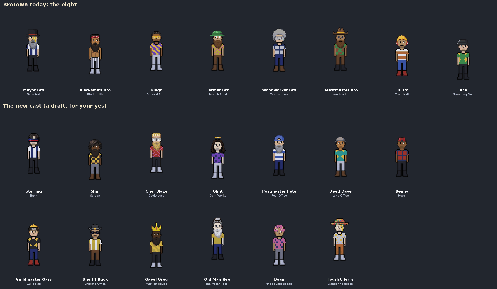

# BroTown's new cast: a draft for the owner (v2.3.3811)

The owner: *"I also want to add more npcs to brotown and the ones already there
to walk a little, do some animations etc / After phase 2 and all that"*.

This is a **draft for your yes**. Nothing here is in the game yet.

*The eight townsfolk today (top) and the thirteen proposed (below). Each is
photographed in the game wearing his look in the character creator's own
pieces, the way the existing eight were made.*

## Who and why

Ten of BroTown's sixteen buildings have nobody at the door: the Bank, the
Saloon, the Cookhouse, the Gem Works, the Post Office, the Land Office, the
Hotel, the Guild Hall, the Sheriff's Office and the Auction House. Each gets a
keeper. Three locals just live in town.

Each keeper is a sharp stereotype in the satire pass's voice
(`docs/specs/npc-dialogue-v2.md`), as the eight are. The sample line is one tap
of chatter: a dry joke that tells you who is talking.

| Who | Where | The joke | A sample line |
| --- | --- | --- | --- |
| **Sterling** | Bank | a crypto bro who somehow runs a bank | "Your coins are safe here. Safe is a strong word. Your coins are *here*. I put the rest in a coin named after my dog." |
| **Slim** | Saloon | a craft mixologist | "This one's barrel-aged. The barrel is that one. It used to hold nails, which is why it's called the Tetanus." |
| **Chef Blaze** | Cookhouse | a shouting TV chef | "Welcome to Flavor Country, population: me! The fish is raw. That's not a mistake, that's a *choice*." |
| **Glint** | Gem Works | a crystal-healing influencer | "This amethyst cures stress. It's also forty coins, which causes stress. Balance." |
| **Postmaster Pete** | Post Office | the slowest government clerk alive | "Your letter's in the back. The back is closed. The back has been closed since the telegraph." |
| **Deed Dave** | Land Office | a real-estate agent selling the swamp | "Waterfront property! The water's not there yet, but it's coming. It's coming *fast*. Sign here." |
| **Benny** | Hotel | a bellhop who upsells everything | "Every room has a view. Of the next room. Late checkout is extra. Early checkout is also extra." |
| **Guildmaster Gary** | Guild Hall | a raid leader who takes it too seriously | "Guild meeting at eight. Attendance is mandatory. Fun is optional. Fun was voted out." |
| **Sheriff Buck** | Sheriff's Office | a mall cop with a badge he bought | "I've got my eye on you. The other one's on the snack machine. It's been acting shifty." |
| **Gavel Greg** | Auction House | an auctioneer who never stops selling | "Going once, going twice, sold to the man who sneezed! Sir, that's your sword now. Sir, sit down." |
| **Old Man Reel** | the water's edge (a local) | a fisherman whose fish grow every telling | "Caught one *this* big yesterday. Threw it back. Out of respect. It had a family. It told me." |
| **Bean** | the square (a local) | a kid streamer with no viewers | "I'm streaming right now, say hi to chat! Chat is my mom. Hi, Mom." |
| **Tourist Terry** | wandering (a local) | a tourist who is in BroTown and can't find it | "Excuse me, which way to BroTown? ...I'm *in* it? Huh. The brochure had more dragons." |

The lines are a sketch of each voice. The full chatter (four to six lines
each, as the eight have) comes once you pick who stays.

## What they would do (P5's walking and animations)

Only moves the player already has, so nothing new needs drawing.

| Who | His move |
| --- | --- |
| Sterling | the pickup: stacking his coins |
| Slim | the bow's draw: pulling a tap |
| Chef Blaze | the mining swing: his cleaver |
| Glint | the pickup: a gem held up to the light |
| Postmaster Pete | the sword swing, slowly: a stamp |
| Deed Dave | the pickup: planting a SOLD sign |
| Benny | the pickup: luggage |
| Guildmaster Gary | the sword swing: rallying the guild |
| Sheriff Buck | the bow's draw: aiming at nobody |
| Gavel Greg | the sword swing: the gavel |
| Old Man Reel | fishing (he stands at the water) |
| Bean | the dodge roll, and dancing |
| Tourist Terry | walking about, the jog |

## Their looks (the creator's own pieces)

In the `NPC_LOOKS` form of `tools/qa/npc-looks.mjs`, ready to bake once
approved:

| Who | Skin | Hair | Hat | Beard | Eyewear / eyes | Shirt | Trousers, shoes |
| --- | --- | --- | --- | --- | --- | --- | --- |
| Sterling | ivory | split-hair, black | none | none | laser-glasses | navy tee, pinstripes (stripe-v:2) | black, black |
| Slim | deep | wavy, black | none | black | none | black tee, checks (check:5) | gray, brown |
| Chef Blaze | rosy | flat-top, blonde | none | blonde | white-glass | red tee, flames (chevron:11) | black, white |
| Glint | porcelain | long | halo | none | none | purple tee, polka (dots:9) | white, white |
| Postmaster Pete | fair | none | red-cap, blue | gray | none | blue tee, bands (stripe-h:2) | navy, black |
| Deed Dave | tan | none | gray-hat | none | none | teal tee, diamonds (diamond:5) | white, brown |
| Benny | brown | none | fez-hat | none | none | red tee, windowpane (grid:9) | black, black |
| Guildmaster Gary | pale | blonde-hair | naruto-headband | none | none | black tee, diamonds (diamond:5) | navy, red |
| Sheriff Buck | sand | none | cowboy-hat-2, black | none | thug-life | yellow tee, stripes (stripe-v:2) | brown, black |
| Gavel Greg | ebony | none | crown | black | none | yellow tee, diagonal (diag:5) | black, white |
| Old Man Reel | alabaster | none | beanie, gray | white | sleepy eyes | yellow tee (his slicker) | navy, black |
| Bean | honey | split-hair, pink | cat-ears, pink | none | none | pink tee, polka (dots:9) | gray, white |
| Tourist Terry | porcelain | none | sombrero | none | golden-monocle | white tee, polka (dots:5) | orange, white |

Bean is a child like Lil Bro (`figureSize` 0.8).

## Their dialogue portraits (Hemi Bros traits)

Each portrait is a Hemi Bros bust built from the collection's own trait art
(`docs/specs/npc-creator-looks.md`), the game's skin recoloured on.

| Who | His traits |
| --- | --- |
| Sterling | Split Hair, Laser Glass, Suit |
| Slim | Beard, Black Shirt (his hair is the game's; the collection has no wavy hair, so Light Brown Hair recoloured black) |
| Chef Blaze | Flat Top Hairstyle (blonde), Thug Life Glasses, Beard (blonde), Red Shirt |
| Glint | Halo, Light Brown Hair (recoloured dark), Dutch White Robe |
| Postmaster Pete | Blue Cap, Beard (grey), Gray Shirt |
| Deed Dave | Flat Cap, Light Brown Fashion |
| Benny | Fez, Normal Eyes, Suit (recoloured red) |
| Guildmaster Gary | Naruto (the headband), Blonde Hair, Black Shirt |
| Sheriff Buck | Sheriff Hat, Thug Life Glasses, Yellow Shirt |
| Gavel Greg | Crown, Beard (black), Golden Jacket |
| Old Man Reel | Red Beanie (recoloured grey), Old Wiseman Mustache, Yellow Raincoat |
| Bean | Cat Ears, Happy Eyes, Gray Zipper Hoodie (recoloured pink) |
| Tourist Terry | Mexican Hat, Golden Monocle, White Striped Shirt |

## Silhouettes

No new townsperson wears what one of the eight wears on his head. Three pairs
are the nearest; say if any is too near:

- **Sheriff Buck and Beastmaster Bro**: both wear cowboy hats, but Buck's is
  black with aviators, and he has no beard.
- **Deed Dave and Old Man Reel**: both wear grey hats. Dave's is a short brim
  over a loud teal shirt; Reel's is a beanie over a long white beard.
- **Sterling and Mayor Bro**: both wear navy pinstripes, but Sterling has the
  laser visor and no hat.

## Questions for you

1. Which of the thirteen stay? Any to cut, rename, or recast?
2. The three locals (Old Man Reel, Bean, Tourist Terry): keep all three?
3. Should any of them give quests later, or is chatter enough for now?

Nothing is built until you say. Once you pick, the looks are baked with
`tools/qa/npc-looks.mjs --bake` and the portraits with
`tools/qa/nft_portraits.py`, and P5 puts them on their spots with their moves.
