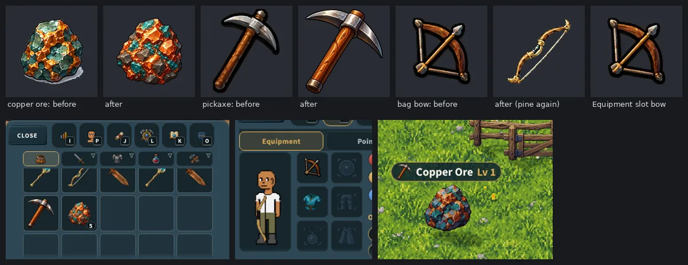

# The owner's chosen icons (v2.3.3481; the land scenes moved under the minimap, v2.3.3511)

The owner, 2026-10-19, uploaded thirteen ChatGPT sheets of game UI art. Most of
what is on them is ChatGPT redrawing pictures the game already shows (it drew
from the review screenshots), so a review page set the nine places where one of
them fills an empty spot or replaces a wrong picture beside what the game shows
today, at the size it would be drawn. The owner answered: *"Icon picks: 1b, 2a,
3, 4, 5, 6, 8, 9"*.

## What changed, place by place

| Pick | Where | Was | Now | Drawn at |
|---|---|---|---|---|
| 1b | Crossing into one of the Wheel's eight lands (the land banner) | The owner's animated ornaments for Frost Ridge, Flame Fields, Wind Dunes and Verdant Wilds; the name plate alone for the other four | Every land's **scene** from the sheet, all eight matching ("pick 1b and I'll use the sheet's eight for every land"): over the game's own name plate until v2.3.3511, small **under the minimap** since (below) | v2.3.3481: half the banner's width (~176-211 CSS px upright). v2.3.3511: one picture px a device px (~64 CSS px on a 3x phone), never more |
| 2a | The Gladiator Arena window's header (from the Sheriff's Office) | The Saloon's beer mug, left over from when the arena lived in the Saloon | The gladiator **helmet** | 24 x 28 CSS px |
| 3 | The trade request card, "*name* wants to trade" | No picture | The **handshake**, as the duel challenge card shows its swords | 40 x 26 CSS px |
| 4 | The quest marks over a townsperson | Drawn discs: a gold "!", a still yellow "?", a green disc with a drawn check | The owner's **pins**: a gold "!" pin, the "?" pin baked **grey** (still), a gold ring with a green check | 32 x 38 world px (the disc was 32) |
| 5 | The Gambling Den's weekly jackpot | Words only | The **sack of gold** beside the pool's number | 64 x 69 CSS px |
| 6 | The Pets page's "Pet House: 10 more places for ... gold" row | No picture | The **pet house** at the start of the row | 40 x 33 CSS px |
| 8 | The Daily Rewards window's free daily spin row | A small wheel drawn in code (`SpinGlyph`) | The **prize wheel** | 34 x 37 CSS px |
| 9 | The Journey page before you have done anything | The Journey button's own icon, 40 px, dimmed to 0.4 | The **treasure map**, not dimmed | 120 x 69 CSS px |
| (v2.3.3524) | The Blacksmith's Upgrade tab (the owner's playtest note: "Make the upgrade tab icon different for smithing.  Like a hammer") | The currency strip's gold gem | The **hammer** off the crafting sheet's gold "Craft" button, cut by the tool's `card` mode (the button is a gradient, so it is keyed row by row; docs/specs/blacksmith-2026-10-19.md) | 22 x 21 CSS px |

Not picked: **7**, the world map's compass (the owner kept today's). **10**, the
leg armour and the chest to match: not answered yet; a new entry in the cutter's
`PIECES` is all it would take.

Kept as they were:

- the closed lands' own zone banners (`?trial=off`, walking into Frost Ridge as a
  zone of its own) keep the animated ornaments;
- the Saloon's own window keeps its beer mug;
- the drawn wheel still marks a bonus spin elsewhere in the Daily Rewards window
  (a reward's picture, the season's lines), and every other trade drawer (open,
  waiting, review, receipt) has no picture;
- the No man's land banner is still the plain plate.

## How

- **Cut once, by a tool.** `tools/ui/cut-owner-icons.py` reads the thirteen
  sheets in `assets/icons-source/owner-2026-10-19/` (moved there from the top of
  the repo, their names lower case with hyphens) and writes WebP. It uses the
  review page's own cuts, which the owner approved by eye:
  - **alpha**, a piece on a transparent ground: its solid core grown a few px is
    its own region (which keeps its soft edge and drops a neighbour's glow), the
    alpha lifted from the background remover's ~250 to solid, the faint halo
    under 40 dropped;
  - **key**, an icon painted on a flat card (the helmet, the handshake): the
    card's fill is the median of a ring of points inside the box, and pixels near
    it turn see-through.
- **The lands' plate is cut off.** Each vignette is cut whole and only the scene
  above its painted plate is kept. The plate starts at the first row of its
  parchment under its dark top edge; the review measured four by eye (Stone
  Hollows 104, Poison Forest 89, Electric Foundry 101, Water Caves 98) and the
  tool refuses to write anything unless it measures the same four. The other four
  measure Flame Fields 104, Frost Ridge 107, Wind Dunes 98, Verdant Wilds 110.
  The dark row kept at the scene's foot reads as its ground line.
- **The helmet's box** is the review's, tightened: the review's took two pixels of
  the card's rounded corner (a speck at the top left) and cut the helmet's chin
  off five rows short of the line under it.
- **Sizes as drawn.** A window's picture is written at three times its CSS size
  (a 3x phone) but never stretched past the sheet's own pixels (a picture is held
  decoded at its own size, and stretching it adds nothing): the sack 191 x 207,
  the pet house 119 x 99, the prize wheel 102 x 110; the helmet (44 x 51), the
  handshake (80 x 53), the treasure map (256 x 148) and the land scenes (~190 x
  100) stay at the sheet's own size, the browser drawing them up. The quest pins
  are canvas textures, each one 72 x 86 frame (2.25 times their 32 x 38 world
  px, as the 64 px talk bubble is for 28 world px: a much bigger texture only
  shimmers as the view slides).
- **The grey "?" is baked**, its own file (`pin-waiting-grey.webp`, plain
  luminance, red, green and blue equal): the canvas never filters a picture. The
  gold "?" is on disk beside it and not loaded. The grey is neutral, not
  v2.3.3047's teal grey, which read as green on the grass; green is still only
  the ready pin's check.
- **A contact sheet** (`--contact out.png`) shows every cut on the game's slate
  and on a light ground. The tool refuses to overwrite a file without `--force`;
  `--dry` cuts and reports; `--only a,b` cuts those.
- **Where the game finds them:** `src/data/ownerIcons.js` (no imports):
  `LAND_SCENE` / `landSceneUrl` (a null-prototype table keyed by the land), the
  six window pictures in `OWNER_ICON` with the CSS size each is drawn at, and
  `QUEST_PIN` with `QUEST_PIN_WORLD`.

### The land banner

- (v2.3.3481) `noteWheelLand` (src/ui/zoneBannerOverlay.js) asked
  `playZoneBanner` for the land's `scene`, which stood 2 px over the plate, half
  the banner's width (~191 CSS px on a 390 phone).

### v2.3.3511: the land's emblem, small, under the minimap

The owner, after a playtest (2026-10-19): *"new land emblems look bad enlarged
(revert or show below minimap)"*. A scene is about 190 x 100 picture px; drawn
191 CSS px wide on a 3x phone it was three times its own pixels, soft, and the
painted plate's gold scroll ends showed at its foot. Of the two ways offered,
the second:

- **The banner is the plain plate again** for every land: the element icon and
  the name in the land's colour, docking into the minimap's plate
  (`playZoneBanner(region, S, { title, plain: true, icon, color })`). `plain` is
  the plate alone: never the ornament strip of the closed zone with the same id
  (the strips stay out of the Wheel: 15.7 MB), never a picture over it; the
  `.is-scene` rules are gone.
- **The scene is an emblem under the minimap** (src/ui/landEmblem.js), shown as
  the plate docks (`ZONE_BANNER_PLAY_MS + LAND_HOLD_MS`, 1.35 s; 0.9 s with
  reduced motion), for `EMBLEM_HOLD_MS` 3.6 s, then fading over 0.6 s:
  - its size is ONE PICTURE PX A DEVICE PX: its width over `devicePixelRatio`
    (~62-68 CSS px on a 3x phone, ~93-103 on a 2x), never wider than
    `EMBLEM_MAX_W` 112 (a computer at 1x draws it a little under its pixels),
    so it is never blown up (`emblemSize`);
  - its place: centred under the minimap's box, `EMBLEM_GAP` 8 px below it, on
    whole device px; where that lies on a control, beside the box at its top
    (sideways the attack disc is 34 px under the box);
    where neither is clear it is not shown, the plate naming the land
    (`emblemPlace`). A control is anything that takes a tap, the sticks, the
    sprint button, the quest card, a No man's land or party card, the coach, the
    map's own button, a prompt -- kept 6 px clear (its soft halo reaches that
    far); a control that comes up under it while it shows (or the minimap
    moving, or leaving the Wheel) sends it away at once;
  - transient, not a fixture, because the owner keeps the room round the
    minimap clear (*"It'll free up more room around the minimap"*, v2.3.3009;
    the plate made by shrinking the map *"rather than enlargen it further"*,
    v2.3.3108) and the plate already names the land; and it shows only when the
    banner does (not again within 45 s, not on a walk along a border);
  - a soft dark halo painted behind it (a radial gradient, no filter: TRAPS
    §42) so its thin outline reads on bright ground; z 21, takes no touch;
  - nothing new to load: the held, decoded scene and its own address
    (`landSceneHeld`), never a load of its own.
- **The scroll ends are cut off.** `cut-owner-icons.py` cuts each scene again
  just above them (`rim_cut`: in the outer quarter each side, the highest of the
  last nine rows holding a gold or brown px with the scene's dark outline right
  above it) and makes the new last row its dark ground line (`ground_line`);
  every land had them (ember's at rows 96-100, x 8-16). The eight files are
  smaller by 4-12 rows (186 x 96 to 205 x 103) at a new address
  (`SCENE_V` `?v=2.3.3511`).

### The quest pins

- The pin is a Sprite in the marker's container (entityRenderer.js `qmPin`),
  bound from `_questPinTex` each frame until its picture is in. The drawn disc and
  glyph stay as the fallback, so a picture that never came still marks the quest.
- 38 world px tall where the disc was 32, its tip 3 px over the hat as the disc's
  edge was; the talk bubble keeps the old disc's centre (`_talkBaseY`). Offer and
  ready still bob; waiting holds still.
- The zones' 52 px minimap (today's town, the farm, a dungeon) marks a waiting
  quest in the same neutral grey (`C_QUEST_WAIT`), as its comment promises the map
  and the world agree. The Wheel's maps draw no townsfolk pins.

## What loads where, and its memory

| What | Loaded | Let go | Files | Decoded |
|---|---|---|---|---|
| The eight land scenes | behind the Wheel's loading screen (`preloadZoneAssets('wheel')` -> `preloadLandScenes`, zoneBannerPreload.js), held | on leaving the Wheel (`freeLandScenes`) | 64 KB | 0.56 MB (v2.3.3511: cut above the scroll ends) |
| The four animated strips | **no longer in the Wheel**: only with the closed lands' own zones | as before | -- | **-15.7 MB in the Wheel** |
| The three quest pins | on the loading screen (`preloadWorldAnimations` `questPins`), global | -- | 9 KB | 0.07 MB |
| The handshake | warmed with the controls (`controlsPreload.js`): the card pops up mid-play | -- | 2.5 KB | 0.02 MB |
| The helmet, sack, pet house, prize wheel, treasure map (v2.3.3524: and the Upgrade tab's hammer, 2.4 KB, 0.02 MB) | with their window, as every window's pictures | with the window | 49 KB | 0.41 MB at most |

The Wheel held the four strips decoded (2,205 x 410 to 2,268 x 474 each, 15.7 MB)
while you walked it; it now holds eight scenes of about 190 x 100 (0.61 MB). They
are DOM images, not Pixi textures, so no line of the memory budget
(`tools/qa/mp/memory-budget.mjs`) measured them and none moves.

## v2.3.3526: the legs and chest, and five more ("Go recommended on everything")

Asked whether to use the sheet's leg armour (card 10, with the chest to match)
and anything from card 11, the owner answered "Go recommended on everything":

- **The bag's legs and chest** (card 10's 10a and 10b): the sheet's iron legs
  and the chest beside them on the same armour row
  (`brotown-rpg-ui-asset-sheet-1.png`), cut inside each card's light rim (the
  review's boxes took two px of it, a line under the legs) and framed as
  today's were (the art's larger side 0.89 of the square for the legs, 0.78
  for the chest), written over `icons/items/greaves.webp` and
  `chest-plate.webp`, the steel pictures every metal is made from:
  `node tools/gear/make-metal-icons.mjs --only greaves,chest-plate` made
  copper, iron and black steel from them with the renderer's own multiply.
  The sheet has no black steel; this is how the game made its own. The catch
  said on card 10 stands: the sheet's legs read as trousers with knee pads,
  the bro wears plate greaves.
- **Card 11's clearer five** (my note on each: "Sheet's is clearer"), each
  under a new name the code points at, so a re-run of the tool that made
  today's can never put the old one back:
  - the orange paw (`icons/ui/pets-paw.webp`): More's Pets tile, the Pets page
    and the Pet House row; the brown paw was muddy at 30 px on the dark tile;
  - the gold crown and the blue pin (`party-crown.webp`, `party-pin.webp`,
    64 x 64 as every small mark, `SMALL_ICON.partyLeader` / `partyAway`): the
    party window's leader and "elsewhere" marks; the winged figure with a star
    and the pin on a map were busy at 13-15 px. Blue, the party's colour on
    the maps (the sheet also had a red one);
  - the gavel (`bldg-auction-gavel.webp`): the Auction House's window header
    and its door's Enter prompt; the market stall could have been any shop. A
    gavel is half again as wide as tall, so it fills 0.84 of its square's width
    (the stall's square shape filled 0.62);
  - the plain no-entry sign (`ui/welcome/cc/cc-none.webp`): the creator's None
    tile where None means nothing (hair, hats, eyewear, beard, the clothes);
    the bald head said "no hair" on the glasses' and shirts' rows too. The
    Skin tab's "Human" and the Eyes tab's "Normal" keep the bald head: there
    the first choice is a plain human, and a no-entry sign over "Human" read
    as "no human".
- **Not used**: the five card 11 marked "worth a look" (the bow, the bag's All
  tab, Ranks, Element Burst, Journey's lifetime gold), and the ones it called
  "slightly clearer": the black steel bar is one of five bars one tool makes,
  the settings gear one of More's eleven tiles, the farm's plant, feed and
  harvest three of its five steps, and one picture in another hand would not
  match the rest.
- **The tool's trap, found on the way**: `make-metal-icons.mjs` ran
  `tools/webp_icons.py --convert`, which converted and DELETED every .png under
  `public/icons` -- the app's home-screen icons (which must stay PNG), the
  badges and the stat icons: 45 files, restored before anything was committed.
  `--convert` now takes the files to convert (`--all` is the old sweep), and the
  generator names the six it wrote.

## v2.3.3526: card 11, as the owner picked it

The owner went through card 11 (every icon on the sheets the game already has a
picture for, each with its candidates T<n>.1, T<n>.2...) and answered: *"Icon
picks: 1b, 2a, T3.3, T20.2, ... T128.1"* -- 72 codes (1b and 2a were #1020's).

- **The list** is `tools/ui/owner-picks-card11.json`: each code, what it is, the
  sheet, the review page's own cut (the page the owner picked from by eye) and
  the file it is written over. `tools/ui/cut-owner-icons.py` cuts them with that
  page's own methods: key (the box's border colour), alpha, a slate **disc**
  keyed out round the art, an **outline** flooded from the edge (the anvil on
  its gold button), `erase` for a count badge painted over a corner.
- **Written over today's files, sized as today's are**, so every place that
  shows one shows the new one at the same size, with no code change:
  - `frame`: today's canvas, the art's larger side the share of it today's art
    fills, centred (the bag's 256 squares, the pickaxe's and axe's 192s, More's
    tiles, the 64 px marks, the 160 px stick pictures);
  - `tight`: the stat glyphs and the gold coin, which are tight today;
  - `disc`: the four round ability buttons (Jump, the generic Special, the
    sword's and the bow's specials). Only the disc INSIDE the owner's own ring
    is kept, as sheet 5's specials were (v2.3.3336): 0.85 of the outer radius,
    the stone or gold ring and its dark inner line measured on 72 rays, a
    circle fitted to them without the rays a sword's tip, an arrow, a spark or
    a stone pokes through. Edge to edge, because the game's ring carries the
    cooldown arc. Jump and the generic Special are drawn as the button's face
    now (`AbilityFace`, as `SpecialFace`); at abilityArt's 1.18x they would
    have covered that ring.
  - The five controls with greyed states get a baked `-grey` copy (the
    controls' palette, cut-small-icons.py's own): never a CSS filter.
- **Two are new files the code points at:** the Blacksmith's **Forge tab** wears
  the anvil (`icons/ui/tab-forge.webp`; the tab wore the copper great sword,
  which is an item's own picture and stays the item's), and the chat box's
  **emotes button** the owner's smiley (`icons/ui/chat-emotes.webp`; it was a
  brass line smiley drawn in SVG).
- **Already in the game** from this version's first cut, the five called
  clearer (the file's `done`): T61.1 the paw, T114.2 the blue pin, T124.1 the
  gavel, T129.1 the none sign, and T112.2, the crown. The first cut had taken
  the FIRST sheet's crown, though; it is the one the owner picked now, sheet 3's.
- **Set aside:** the owner ticked both luck stars, **T69.1 and T69.2**, the same
  four-point star from two sheets. The game has one luck picture, so T69.2 is
  used, from the sheet the other stat picks come from.
- **The Points grid's cell outlines** are measured off the stat glyphs
  (`tools/glyph_edge_colors.mjs`, v2.3.2687). The nine new glyphs' colours were
  measured again into prog3.js, so each cell's frame matches its picture.
- **The pictures are asked for again:** the stick's eight and the ability
  pictures at a new `?v=` (2.3.3526). Everything else is served with no long
  cache (public/_headers keeps only the hashed and world trees), so a phone
  fetches the new file at its next load.
- **Kept the owner's:** the cutter records the SHA-256 of each of the 71 files it
  writes in `tools/ui/owner-picks-card11.sha256`. `owner-icons.test` §6 fails if
  any of them changes, whether `process_icon_sheets.py`, `cut-small-icons.py`,
  `cut-bag-icons.py` or another older tool that made today's is run again.
  The fix is `python3 tools/ui/cut-owner-icons.py --force --only <code>`.

| Where | Codes |
|---|---|
| The bag | T3.3 bow (since v2.3.3571 the menu's alone, below: the bag keeps the pine bow), T6.1 garden stew, T7.2 pine log, T29.1 maple, T30.1 hardwood, T31.1 cedar, T32.1 softwood, T8.3 copper bar, T19.2 iron bar, T20.2 black steel bar, T9.4 minnow, T33.1 cooked fish, T11.1 titanium ore, T24.1 wheat seeds, T26.1 strawberry seeds, T36.1 pickaxe (replaced by the owner's own in v2.3.3571, below), T37.1 axe, T38.2 the Potions tab |
| More and the dashboard | T54.4 Ranks (the gold trophy), T52.2 Character (the magnifier), T55.2 Dashboard, T59.1 Journey, T60.1 Codex, T62.1 Friends, T63.2 Login Key, T64.1 Settings, T65.2 Feedback |
| The Points window and the Equipment pills | T69.2 luck, T70.2 special, T71.2 element, T72.2 Max HP, T74.2 Max Mana, T75.2 stamina, T76.2 dodge, T77.1 move speed, T78.1 elemental resist |
| Buffs, elements, the HUD | T84.3 cursed, T85.3 bleed, T90.3 XP, T91.3 speed, T92.1 flame, T97.4 Jump, T98.3 Element Burst, T107.2 the sword's special, T108.2 the bow's, T109.1 the generic special |
| The right stick | T99.2 talk, T100.3 door, T101.3 sleep, T102.1 dig, T103.2 plant, T104.3 water, T105.1 fertilize, T106.1 harvest |
| Marks and windows | T50.2 the duel card, T51.1 the player card's close, T111.1 the party badge, T113.1 the threat skull (still tinted red), T115.3 the gold coin, T116.1 Journey's coin pile, T118.1 the chat's smiley, T121.1 the Forge tab, T123.1 the Bank, T125.1 the Market, T127.1 the mail, T128.1 the Saloon |

## v2.3.3571: the owner's copper ore and pickaxe, and the bag's bow pine again

The owner, 2026-10-22, with one picture of a copper ore lump and a pickaxe:
"Ok change the art style of the copper ore and the pickaxe to this.  Also
revert the inventory art of the bow back to the original one (pine) because I
think you mistook the bow icon to replace inventory art when I only wanted it
to replace the menu art for the bow."

**The copper ore and the pickaxe.** `tools/ui/cut-owner-items.py` cuts both out
of the owner's picture (kept as supplied in
`assets/icons-source/owner-2026-10-22/`). The two are found by their columns
(it refuses to write unless it finds exactly two), each cut as card 11's
`alpha` mode cuts (the haze of alpha 1-4 round them dropped, the remover's
~252 lifted to solid), and written over today's files on today's canvases at
the share today's pictures fill:
- `icons/items/ore-copper.webp`, 256 x 256, its larger side 200 px;
- `icons/items/mining-pickaxe.webp`, 192 x 192, its larger side 190 px.

So everything that drew them draws the new ones at the same size:
- the bag;
- the Smelting rows and the quest cards;
- the ore flying to the bag;
- the mining gesture's cue;
- the label over every rock. Its crop box in nodeLabels.js is the pickaxe's
  measured opaque box, `[9, 1, 174, 190]`; it had been left at an older
  pickaxe's.

**A broken copper rock pops the bag's copper now.** Every other tier already
popped its bag picture. Copper popped an older pixel nugget of its own
(`icons/ore/ore-copper.webp`), though its comment said it was the bag's.

**What is NOT this picture:**
- the copper rock in the world. It is pixel art at the world's own scale
  (`public/sprites/ore/`, tools/world/add-ore-art.mjs).
- the iron, black steel and obsidian ore icons. They were recoloured from the
  OLD copper lump by `tools/make_tier_art.py`. That lump is kept at
  `assets/icons-source/ore-copper-lump.webp`, and the tool reads it now, so a
  run never recolours the owner's copper.
- titanium. It is card 11's T11.1.

All four of those still look as they did.

**The bow.** Card 11 described T3.3 as "Bow (bag, Equipment slot)". v2.3.3526
wrote it over the bag's `icons/items/bow.webp`, the one file both used. Now:
- `icons/items/bow.webp` is the pine bow again, byte for byte the file before
  v2.3.3526. It is drawn in the bag (a spare bow's tile), the item card, a
  drop's reveal, loot on the ground, the quest reward lines and the
  Blacksmith's hardening row.
- T3.3 is cut to its own file, `icons/ui/equip-bow.webp` (the same bytes as
  before). `wpnIconSrc` draws it for the menu: the Character window's
  Equipment slot, the weapon button under the stick (which v2.3.3005 keeps the
  same as that slot) and the player card.

**The record.** `tools/ui/owner-items.json` keeps each new file's SHA-256, size
and opaque box. Card 11's JSON lists T36.1 as `replaced`, and its cutter no
longer writes the pickaxe. Its `.sha256` keeps 70 files: the bow's line now
names `equip-bow`.

## Tests

- `server/test/owner-icons.test.mjs` §8 (v2.3.3571): the copper ore and the
  pickaxe byte for byte the new cut, on today's canvases; the rock's label
  cropped at the pickaxe's box; a copper rock popping the bag's copper; the
  other ores from the old lump; the bag's bow the pine bow by its SHA-256 and
  the menu's its own file; every place drawing the right one. Three mistakes
  made on purpose (the old bow back in the bag, the old box, the menu on the
  bag's file) each fail it. `mp-copperpick` shows it on a phone: the bag's
  ore, pickaxe and spare bow as served, and the Equipment slot and the weapon
  button wearing the new bow.
- `server/test/owner-icons.test.mjs` §6 (v2.3.3526, card 11): every one of the
  owner's 72 codes cut, already in the game, set aside with its reason, or
  (T36.1, v2.3.3571) replaced by the owner's own later picture; the 70
  files the cutter wrote still byte for byte its own; each at its rule's size;
  the anvil and the smiley pointed at; Jump and the generic Special drawn as
  faces at a new address with their greys; the crown the owner's T112.2.
  `small-icons` §3h pins the stick's pictures as files, whatever their `?v=`.
- `server/test/owner-icons.test.mjs`: (§5, v2.3.3526) the legs and chest the
  sheet's with every metal made at their size, the five new pictures in place
  and used where the old ones were (the old ones nowhere); and every file in
  place at its size (each window
  picture's CSS size its own shape, the pins one 72 x 86 frame, the grey "?"
  beside the gold), the thirteen sheets kept and none at the top of the repo,
  `landSceneUrl` for the eight lands and nothing else, each place using its
  picture (the Saloon keeping its mug, only the invite drawer with an icon, the
  drawn wheel kept for bonus spins, the disc kept as the pins' fallback), and the
  loading: the pins on the loading screen, the scenes behind the Wheel's and let
  go on leaving, no strips in the Wheel, the handshake warmed.
- `mp-wheelmap`: the Wheel holds the eight scenes and none of the strips; since
  v2.3.3511 Frost Ridge's banner, played again, is the plain plate (the icon and
  the name, no picture, no ornaments), and as it docks the frost emblem comes
  up under the minimap at one picture px a device px, centred under the box,
  on no control, and goes after its few seconds (`wheelmap-04c-emblem.png`);
  none of the eight pictures keeps a scroll end at its foot; and turned to 320,
  375, 390 and 430 wide and on its side (844 x 390, 667 x 375) the emblem
  never lands on a control -- under the box upright, beside it sideways
  (`wheelmap-04d-emblem-<size>.png`).
- `owner-icons` §4d/§4f/§5 (v2.3.3511): the plain plate, the emblem's size on
  every screen from 1x to 4x, its place and its time, the cut.
- `mp-questguide`: Mayor Bro's offer is the "!" pin (38 world px), the waiting
  mark the grey "?" pin, the ready mark the green check pin
  (`window.__btNpcMarks`: `badge` is now the pin's state, `badgeArt`, `badgeSrc`,
  `badgeH`; the fallback disc's colour moved to `badgeFill`).
- `node tools/qa/ui-review/capture.mjs --only=trade-request,building-arena,building-gamble,daily-rewards,more-pets,more-journey,near-mayor`
  retakes the screens these changed.
