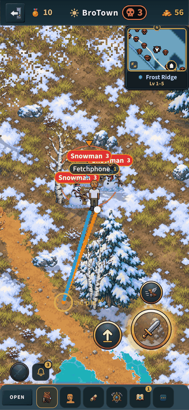
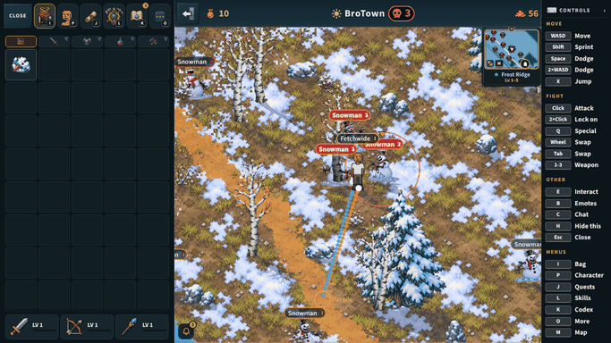

# The pet's fetch (v2.3.3806)

The owner: "Also make pets run towards loot drops and pick them up for you".

## What a player sees

- When a monster you fought drops its loot up to **450 px** from you (a little
  under half a sideways phone screen, so only loot you can see), your pet
  leaves your heels and **runs** to it: its walking frames, faster (70 ms a
  frame where a walk is 105), at **1.5 times your run** (your own step that
  frame, never under the base walk).
- It reaches the pile, the pile goes into your bag (the coins and the pickup
  sound, as the pet's 80 px vacuum always did), and it runs back to your heels.
- Several piles: one at a time, the nearest to you first.
- It goes round a bush, a rock, a tree or a wall on the way (it tries a few
  turns either side). It never sets off across water. A pile dropped against
  a wall is taken from as close as it can get (70 px).
- It gives up and comes back when the pile goes (someone else's hand, its
  time up), when you walk 550 px from the pile, after 4 seconds of running, or
  when it is boxed in. A pile it gave up on is left alone for 8 seconds (one
  behind water for 1 second, as you may step round). Leaving the zone ends it.
- Only your own pet, only on your screen; everyone else sees your pet follow
  you as before.
- Never a death drop or an item someone (you included) put down: the pet
  still only vacuums those at your heels (240 px from you).

## How it works

- **The phone** (`src/game/petFetch.js`, no imports so node tests it;
  hooked in `BroTown.jsx`'s pet follow, §18.1): each frame `petFetchStep`
  either moves `S._petX/_petY` (running) or hands the pet back to the follow.
  It asks for nothing itself: the vacuum below the follow sends the one
  `loot_pickup {viaPet: true}` as it always has, but holds it for the pile
  the pet runs to until the pet is there (`petFetchHolds`), so the pet touches
  what it fetches; the pet waits at the pile for that ask. Walls are the
  walk's own (`isSolid` at the pet's feet), the world's water
  (`wheelWaterAt`) and the objects' footprints (`zoneBlockers`).
- **The worker** (`server/src/pets.js`): a `viaPet` pickup reaches
  `PETS.FETCH_RANGE` (**600 px** from where the worker has you) for a pile
  that is not a death drop and lists you as a recipient
  (`_petPickupRange`), else the vacuum's 240. 600 is the phone's 550 leash
  plus about 50 px the worker's place for you lags your walk. Everything else
  in `_handleLootPickup` is unchanged: the recipient list, one claim a player
  a pile (`claimedBy`), an active pet in the record (`no-pet`).
- **Nothing new on the wire**, nothing stored, no new message.
- **Deploy order**: `caps.petfetch`. Against a worker without it the pet
  never runs (an old worker would refuse the far ask). Kill switch:
  `petfetch: false` in the live flags un-advertises the cap AND puts every
  pile back on the 240 (`liveops.test` §8k).

## Why the wider reach is safe

It widens only a pickup you could already make: a pile you are a recipient of
(your share of a monster you fought), with a pet out. Someone else's pile is
`not-recipient` at any range; a death drop or a dropped item keeps 240, so a
pet cannot reach farther for things that could be someone else's. The bot lab
(`tools/qa/load/bot-lab.mjs`, `loot-walk-fighter` against `loot-pet-fighter`,
a 20-minute sample) shows a script asking from where it stands gains nothing
measurable over walking to each pile: 2,916 coins an hour against 2,898, the
same kills, because a fighter's piles land at its feet.

## Tests

- `server/test/petfetch.test.mjs`: the cap and the switch; a far pet pickup
  of your monster pile taken (450, 590) and refused past 600; your own death
  pile and a dropped item refused at 400 (max 240) and taken at 200; someone
  else's pile refused near and far; the switch back on 240; no pet; one
  pickup a pile; and the phone's rules (the nearest pile, skips, a run out
  and home, the leash, water, a bush gone round, a wall by the pile).
- `server/test/pets.test.mjs`: the vacuum's old reach check moved past 600.
- `node tools/qa/mp/run.mjs petfetch`: a phone upright and a computer, each
  with a pet, a snowman ~300-400 px away killed for them: the pet runs (3.75
  px a 60 Hz frame, the follow is 2), the pile lands in the bag by the pet,
  you never moved, it comes home. Pictures: `tools/qa/mp/out/petfetch-run-*.png`
  (the run drawn over the screen; a strip of screenshots catches one or two
  frames of a one-second run on the test box).
