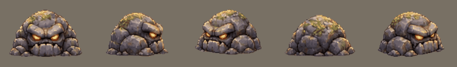
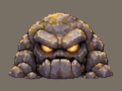

# The rock golem: the Stone Hollows' monster (v2.3.4358)

The owner, 2026-11-09: *"Also this to replace the rock monster that's there
now."*

## What players get

- The Stone Hollows' monster is the **Rock Golem**: a low, wide heap of mossy
  boulders with a face and burning eyes. Past level 20 it is the **Amethyst
  Golem**, as before.
- It **grinds along** on four frames when it moves and when it stands, and
  turns to face the way it goes. The rock monster it replaces was one still
  picture that slid.
- When it dies **its eyes go out, it cracks and falls to rubble**: its own
  thirteen frames, on every kill.
- It fights exactly as the rock monster did. Nothing on the server changed:
  the same health, damage, slam, daze, drops and experience. Its pet is still
  the **Pebbling**, drawn as a small golem.
- **The Thorn Shambler** (the Verdant Wilds' heavy monster) was always the
  rock monster's pictures in moss green, so it is the golem in moss green
  now, with the same walk and death.
- **The Great Cave's boss** is the land's own monster made big, so it is a
  big golem. It stands lower than the old boss did (the golem is a heap where
  the old one was a tall egg): about one and a half bros tall and very wide.
  I did not play that dungeon (it needs a level-26 character): untested.

## What was uploaded, and what was made of it

One picture, `assets/monster animations/rock-golem/rock-golem-sheet.png`: five
rows of four frames (facing you, side on, front-left, from behind,
back-right), a row for its death, and name plates down the left side.
`python3 tools/art/cut_rock_golem.py --preview` cuts it again:

| Strip | Cells | What |
|---|---|---|
| `walk.png` | 20 | the five sides, four frames each. The other three sides are mirrors. |
| `death.png` | 13 | its eyes go out, it cracks and falls to rubble, 85 ms a frame. The plate says twelve frames; the sheet has thirteen, and all are used. |
| `codex-walk.png` | 4 | the front-left row alone, for the codex page |

The cutting is `tools/art/sheet_rows.py`, shared with the rotcap's sheet
(which is laid out the same way): each frame found by the gaps round it,
hardened, kept to its biggest joined-up piece, stood on its row's ground line
at one scale for the whole sheet, written on 256 colours. Two things are this
sheet's own: its death keeps **all** its pieces (the stones that fly as it
breaks are the picture), and two of its rows are only two lines apart.

## How it is wired

- The variant keys stay: `rockmonster` is the server's name for the Stone
  Hollows' brute, `thornShambler` for the Verdant Wilds'. Both are drawn from
  `rendering/rockGolemSprites.js`, one module.
- `MONSTER_VARIANTS.rockmonster` and `.thornShambler`: `liveScalePx` 108
  (about 124 px across and 80 tall), the four frames walking (by distance)
  and standing still (by the clock), the death its own strip on every kill.
  The sheet draws the dying golem a little bigger than the walking one, so
  `deathScalePx` 100 and `deathOffsetY` -1 draw it at the living golem's size
  with its base where it stood (the unit suite works both out from the
  pictures).
- Gone with the old look: `rockmonsterSprites.js`, its four pictures, and the
  five stones its death was cut into (`DEATH_ZONES.rockmonster` and
  `.thornShambler`). The pet sheet's `rockmonster` row became `rockGolem`.
- A shot is aimed at the middle of its heap (`MONSTER_TORSO_Y` 44, it was 64
  on the tall egg).
- It still dies with the stone's crack and its hits are still stone.

## Memory

The two strips are 33 cells, loaded once for the golem (and the thorn
shambler) as you walk toward the Stone Hollows and let go behind you, held as
colour numbers: **1.0 MB on the graphics chip** (measured, `mp-rockgolem`
section 1; as plain pictures they would be 4.0). Its pictures share one list
of 256 colours, which is what lets the game hold them that way
(`tools/art/strip256.mjs --shared`, `docs/specs/water-frog.md` Memory). The
old rock monster was four still pictures, about 1 MB, so the Stone Hollows
hold no more than before. No memory-check line moved: `mp-membudget`
fights at the Flame Fields and reads none of it.

## Tests

- `server/test/rock-golem.test.mjs`: the strips (nothing loose in a walking
  cell, none of the name plates, one size, the death ending as rubble with
  its flying stones kept); that both keys draw one module and each is still
  the brute it was to the server; the death's size from the pictures; the
  name, codex page, pet row and aim.
- `node tools/qa/mp/run.mjs rockgolem` (`mp-rockgolem.mjs`): a phone in the
  world; the eight ways, the four frames standing still, the thorn shambler's
  green, three deaths; then out to the Stone Hollows for the server's own.
  Pictures in `tools/qa/mp/out/rockgolem/`.
