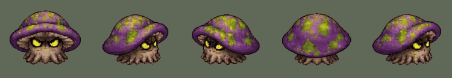
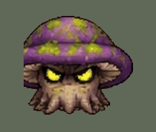

# The rotcap: the Poison Forest's two monsters (v2.3.4357)

The owner, 2026-11-09: *"Also this for poison land"*. Asked which of the
Poison Forest's two stand-in monsters it replaces, the violet slime or the old
fishman picture in murk: *"Both"*.

## What players get

- Every monster of the Poison Forest is a **Rotcap**: a toadstool with eyes,
  shuffling on its roots.
  - The **Rotcap** (the Mire Wisp before) is the ordinary one. It spits venom
    from a distance and lunges, as the wisp did, and its spit is the sick
    green of its own spots.
  - The **Great Rotcap** (the Bog Lurker before) is the same mushroom half
    again as big, in the dark of old rot. It walks up and slams, as the lurker
    did.
  - Past level 20 they are the **Spectral Rotcap** and the **Shade Rotcap**,
    in the cyan and violet their second stage always had.
- They **shuffle** when they move and when they stand, and turn to face the
  way they go. When one dies it **sags, folds and rots down flat**: its own
  twelve frames, on every kill.
- They fight exactly as before. Nothing on the server changed: the same
  health, damage, spit, lunge, slam, poison, drops and experience.
- Their pets are little toadstools: the **Sporeling** (the Wisplet before)
  and the **Capling** (the Lurkling before).
- **The old fishman picture is gone from the game.** The Bog Lurker was the
  last thing wearing it.

## What was uploaded, and what was made of it

One picture, `assets/monster animations/rotcap/rotcap-sheet.png`: five rows of
four frames (facing you, side on, front-left, from behind, back-right), a row
of twelve for its death, and a name plate down the left side.
`python3 tools/art/cut_rotcap.py --preview` cuts it again:

| Strip | Cells | What |
|---|---|---|
| `walk.png` | 20 | its shuffle: the five sides, four frames each. The other three sides are mirrors. |
| `death.png` | 12 | it sags, folds and rots down flat, 75 ms a frame |
| `codex-walk.png` | 4 | the front-left row alone, for the codex pages |

Each frame is found by the gaps round it in its row, hardened (a pixel is
there or it is not), kept to its biggest joined-up piece (the sheet has stray
specks, and the name plate touches the first frame), stood on its row's ground
line at one scale for the whole sheet, and written on 256 colours. The death
stands where the living one stood: its first frame's base is on the ground
line, and as it folds it spreads a little below it.

## How it is wired

- The land's two variant keys stay: `mireWisp` and `bogLurker` are the
  server's names for its fodder and its brute, on the wire and in every saved
  codex and pet. What they are **drawn from** changed:
  `rendering/rotcapSprites.js`, one module for both keys.
- `MONSTER_VARIANTS.mireWisp`: no longer on the slime's sheets
  (`useSlimeSheets` and its violet tint are gone), `liveScalePx` 66 (about 68
  px across), its spit's colour said outright (`shotColor` 0x9bd43f).
- `MONSTER_VARIANTS.bogLurker`: `liveScalePx` 104 (about 107 px across), a
  dark `tint` (0x8f86a8).
- Both play the four frames walking (by distance) and standing still (by the
  clock: `idle` is the same strip), and die their own death on every kill
  (`deathStripOnly`), as the water frog and the storm eye do.
- Gone with the old looks: `fishmanSprites.js` and
  `public/sprites/monsters/fishman/`; the bog lurker's death zones (it sank
  into a puddle of mud, cut from the fishman picture); the mire wisp's place
  among the slime-sheet deaths. The pet sheet lost its `fishman` and plain
  `slime` rows (no pet wears them now) and gained `rotcap`: eight rows, 0.12
  MB more than before these three monsters.
- A shot is aimed at the middle of each one's cap (`MONSTER_TORSO_Y`: 24 and
  44).
- Both die with the bog's deep squelch (`dieLurker`). The ordinary one's hits
  sound soft and wet; the great one's still squelch like mud.

## Its poison

Nothing new is drawn in code for it. It already had the venom element's
wind-up (fumes rising as it winds up, `elem-windup.md`) and the poison's own
look on you when it hits. Say if you want more for it, as the frog has its
water and the eye its lightning: a puff of spores as it spits would be the
same kind of work.

## Left as it was, for the owner to decide

- **What they drop** is still what the wisp and the lurker dropped (the
  server's items).
- **The server's names for their tier moves** are the old ones ("Bog Combo",
  "Mire Quake"); players do not read them.

## Memory

The two strips are 32 cells, loaded once for both monsters as you walk toward
the Poison Forest and let go behind you, held as colour numbers: **0.87 MB on
the graphics chip** (measured, `mp-rotcap` section 1; as plain pictures they
would be 3.5). Its pictures share one list of 256 colours, which is what lets
the game hold them that way (`tools/art/strip256.mjs --shared`,
`docs/specs/water-frog.md` Memory). The Poison Forest used to hold the old
fishman's four pictures (about 1 MB) and the global slime's sheets (held
everywhere anyway), so this is no more there than before. No memory-check line
moved: `mp-membudget` fights at the Flame Fields and reads none of it.

## Tests

- `server/test/rotcap.test.mjs`: the strips (nothing loose, none of the name
  plate, one size, the death sinking flat where the living one stood); that
  both keys draw one module; that each is still the monster it was to the
  server; the names, codex pages, pets, shot colour and aim.
- `node tools/qa/mp/run.mjs rotcap` (`mp-rotcap.mjs`): a phone in the world;
  the eight ways, the shuffle standing still, the great one's size and tint,
  three deaths; then out to the Poison Forest for the server's own and a real
  spit. Pictures in `tools/qa/mp/out/rotcap/`.
