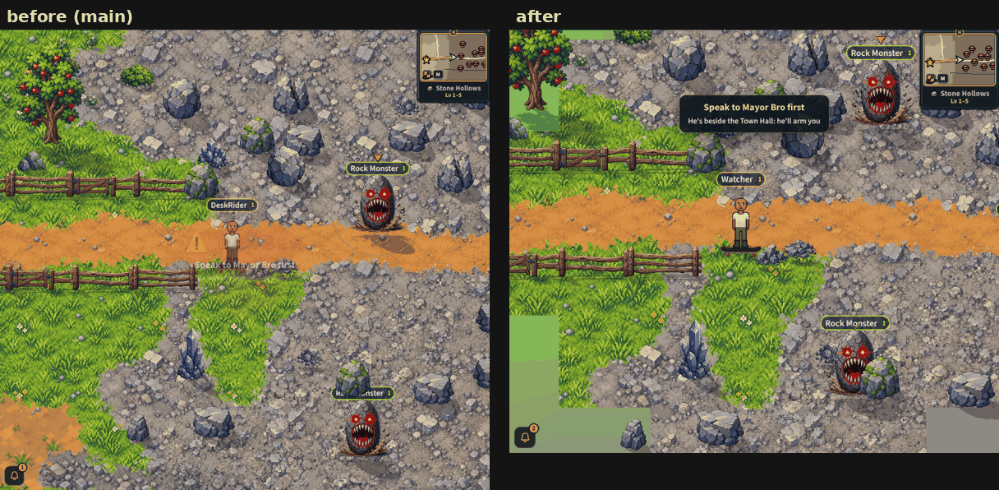

# The skateboard (v2.3.3776)

The owner, 2026-10-28: "I just added a skateboard to the root. I want to be
able to ride around on this just in the safe Brotown area. You can tap it to
ride (maybe a button somewhere on screen). When outside of town it makes you
get off." And on the owner's list (docs/OWNER-LIST-2026-10-26.md, item 26):
"faster than sprinting, off when you fight, swim or get hit".

## What a player sees

- In BroTown and its safe commons, a round button with the board on it. A tap
  gets you on, a tap again gets you off. On a computer the button shows too,
  wearing **Z**, and Z does the same.
- On the board you roll at **twice** your walk (the owner: "It can maybe be
  about twice as fast as run speed"; a sprint is 1.33x), stacking with the
  speed potion and the move stat as the walk does. There is no sprint while
  riding: the board is the faster.
- The board is drawn under your boots, in the owner's three views: from above
  going north or south, from the side going east or west, angled on the
  diagonals (mirrored for south-west and north-east). A jump lifts the board
  with your feet (an ollie), and it stays level in a lean or a flip.
- **How he stands** (the owner: "I also don't know if it's better to just use
  the idle bro sideways staying positions or if jog legs can be used to
  'push' every once in a while (or just constantly)"; the orchestrator's
  call): SIDEWAYS in the idle stand pose, like a skater -- the board going
  east or west, he faces south (to the camera); north or south, he faces
  east; on a diagonal, the diagonal across it that faces the camera -- and he
  PUSHES: setting off, and every 2 s while he rolls, he turns to face the way
  he goes for 0.4 s of the jog's legs. One switch, `RIDE_LOOK` in
  `src/game/ride.js`: `PUSH: false` never pushes, `PUSH_EVERY_MS: 0` pushes
  all the time. The facing a phone sends stays the way you go; each phone
  turns it (entityRenderer, `rideLook`).
- Everyone near you sees you on your board.
- You get off, with one short line, when you:
  - roll out of BroTown's safe ground ("Off the board: boards stay in BroTown.")
    or leave the world for a dungeon, a building's room or the farm;
  - are hit ("Knocked off the board!"), fight (a swing, an ability, a burst, a
    roll, the shield up, a harvest, a pose: "Off the board to fight."), or
    start a duel or an arena match;
  - go into the water, or die.
- The button is not shown while a fight is near (the shield up, the Block
  button showing, a monster targeted), in the water, dead, or anywhere but the
  safe ground.
- **The wheels are heard** (v2.3.3791): the owner's "Drive Over Border"
  (freesound_community, Pixabay 82185, uploaded 2026-10-29) as a seamless
  4.65 s loop of the board rolling on the town's stones, its knocks over the
  cracks inside it -- the recording has one every 0.2-0.7 s, so there is no
  separate clack for a push (the push is a foot; the knocks are already in the
  roll). Your own board only (a loop for every rider in a busy town would be a
  pile of noise, and more decoded sound held), low under the music on the
  music bus, rising as you roll and falling as you stand on the board; the
  frame the ride ends, for any reason, it falls silent in a tenth of a second
  and its source stops 1.5 s later (`src/game/rideSound.js`).

## How it works

- **The worker decides** (`server/src/ride.js`). The phone sends `ride` {on:
  1 | 0}; the worker answers `ride_state` {on, why} (privileged), and sends one
  when it puts you off. It lets you on only in the world, on its own safe
  ground (`wheelzone.js` `_wheelSafeAt`, where IT has you), alive, and not in a
  duel, a race, a harvest, a pose, a roll or a block; a toggle within 400 ms of
  the last is answered `soon`.
- **The speed**: while `ps._ride`, `RIDE.MULT` (2.0) is folded into
  `movement.js` `_moveSpeedK`'s `moveMult`, so every bound that reads it -- the
  move budget, the follow, the glide's cap (`movepath.js`), the join's judge
  (`lastplace.js`) -- agrees by construction (lane D's review). `_rideK` is a
  pure read of the worker's own `ps._ride` (1 dead, off the board or switched
  off). No sprint on the board: the worker pays for no sprint step while you
  ride (`sprint.js` `_sprintAllowed`), so the two never multiply. Getting on
  or off clears a glide in flight (`ps._mp`). The phone's `RIDE_MULT`
  (`src/game/ride.js`) mirrors it (`mirror-audit.test`).
- **What ends it on the worker**: an accepted move off the safe ground, out of
  the world or a zone change; death (`_handlePlayerDeath`); a hit that lands
  (`combat.js` `_applyDamage`, after the dodge); a fighting, gathering or
  posing message (`RIDE_ENDS_ON`, before its handler in `_onMessage`); the
  shield, a roll, a harvest or a pose on a move; a duel or arena match made
  (`duel.js` `_makeDuel`); the kill switch.
- **The phone steps off itself**, a beat ahead of the worker
  (`game/ride.js` `rideCheck`, every frame in BroTown.jsx): past the safe
  ground's edge (`game/rideGround.js`: the world's middle and `zones.js`
  `wheel.safeR`, never a coordinate in code), out of the world, in the water,
  dead or fighting. The worker's word then agrees.
- **The others**: the tick's player carries `brd: 1` while the worker has you
  riding (`tick.js` `playerWire`, the one builder both tick paths use),
  absent otherwise; `wsClient.js` reads it into `other._brd`.
- **Nothing is stored**: `ps._ride` is an underscore field, no storage key; a
  reconnect or a worker restart leaves you on foot, and the phone forgets the
  board on every join.
- **Deploy order**: `caps.ride`. The button shows only against a worker that
  says it; an old worker refuses the unknown message (deny by default). Kill
  switch: `ride: false` in the live flags un-advertises the cap AND ends every
  ride (no board on the tick at once; the rider is told on their next move).

## Where the button is

Shield Bash's place (`ctlColumn`, `CTL_SLOT.bash`): upright beside Sprint, up
and left of the attack disc; sideways and on a computer beside the disc, level
with its middle. It can share that place because it never shows while a fight
is near: Bash shows only with the shield up, TRAP only with a monster
targeted, Block only with a fight near. `mp-skateboard` checks it lies on no
other control, upright and sideways.

## The art

The owner's picture is kept in `assets/prop-source/skateboard/skateboard-views.png`.
`node tools/art/cut-skateboard.mjs` cuts it again:
- the black ground is taken away by a flood from the border (the deck is
  near-black too, so a global black key would eat it);
- the three views are found by the empty columns between them;
- each is shrunk to 2 picture px a game px, the board 88 game px long (about four fifths of a bro: 70 read small under him);
- each gets its own 32 colours (`public/tools/style/process.js` ownPalette
  and mapPixels: hard alpha, despeckled) and is written as a see-through
  palette PNG, `public/sprites/ride/skateboard-{top,angled,side}.png`;
- `src/data/skateboardArt.js` is GENERATED with each view's size and deck line.

They load behind the loading screen (`rendering/rideFx.js` preloadRideArt in
`preloadWorldAnimations`), about 105 KB on the graphics chip in all
(docs/MEMORY-MAP.md, "the skateboard"). A rider's board is one small Sprite
added to their figure when they get on and destroyed when they get off.

## The sound

- Cut by `tools/audio/cut_owner_sounds.py` (its LOOPS row `skate-roll`;
  `--only=skate-roll` cuts just it and rewrites just its row of
  `src/data/ownerSoundClips.js`): measured first, by its own channels (TRAPS
  §230) -- its two sides are the same samples, so it is mono; a ramp in to
  0.5 s and out after 6.2 s, between them a rumble at about -22 dB with
  knocks peaking at -0.6 to -7 dB -- then 0.55-6.2 s, its last second folded
  over its first (equal power), levelled to the river's loudness, 24 kHz mono,
  48 kb/s: 28 KB.
- Never in `SFX_MANIFEST` (a loop): decoded as an `amb-` key (24 kHz mono,
  ~0.45 MB) where a board could be ridden -- the board button's own rule,
  BroTown's safe ground -- so it is in before the first tap; let go 20 s
  after you leave that ground on foot, at once out of the world.
- Its volume: 0.9 of the river at its bank (`ROLL_K`, `rollVol()`), on the
  music bus, so the Settings music slider sets it with the world's loops.
- The Sound Studio's "Moving" section plays three seconds of it
  (`BT_AUDIO.skateRollDemo`). `CREDITS.md` has its row (Pixabay Content
  License, CONFIRM).

## Tests

- `server/test/ride.test.mjs`:
  - caps, and `ride_state` privileged;
  - getting on and off, and each refusal (off the safe ground, out of the world, dead, the switch off, mid-harvest, too soon);
  - the widened bound, and the walk's again after;
  - every way it ends (the edge, a zone change, death, a hit, a swing, the shield, a duel, the kill switch);
  - `brd` on the real tick and absent otherwise;
  - the phone's rules.
- `liveops.test` §8j (the switch), `mirror-audit.test` (the speed).
- `node tools/qa/mp/run.mjs skateboard`: a phone upright and a computer, against
  a real worker:
  - a real tap gets on;
  - the other player sees the board;
  - off at the edge, and the button gone;
  - Z on and off;
  - the button on no other control, upright and sideways;
  - (v2.3.3791) the roll heard while the computer's rider rolls, silent at once
    and stopped after Z takes them off.
  - (v2.3.3839) the computer's new character rides D into the Mayor gate
    (below), held inside and the warning seen; the first quest taken, the same
    ride rolls out, off the board with its line.
- `sound-cues` §20: the loop's file, level and length, never in
  `SFX_MANIFEST`, its source kept, its studio row and its credit, and
  `rideSound.js` ticked by the game loop.

  Pictures: `tools/qa/mp/out/skateboard-*.png`; the owner's are in
  `docs/specs/skateboard/`: the 8 directions, a ride as frames and a GIF
  (`ride.gif`: setting off with a push, the sideways glide, a turn), and the
  button upright, sideways and on a computer.

## The Mayor gate and the board (v2.3.3839)

The owner, on a laptop with a new character: "On desktop it doesn't force you
off the skateboard. It just has an invisible wall up if you're on skateboard
and try to go into no man's land."

That wall is the Mayor gate, not the board. A character who has not spoken to
Mayor Bro stays inside the safe ground (the owner's rule, v2.3.1676;
`game/wheelHome.js` `wheelCommonsGate`), held 60 px inside its edge, on foot or
on the board, and the board's step-off line is the edge itself, so the board
stays on. The same on a phone. Once the first quest is taken, the board rolls
out and puts you off with "Off the board: boards stay in BroTown.", as before.

The gate does say why ("Speak to Mayor Bro first / He's beside the Town Hall --
he'll arm you"), but its banner was never seen: its fade was worked out once,
when the game happened to redraw, a few ms after it was set, so on a quick
computer it froze almost clear (about 0.04) until the next message. It keeps
its own clock now (`ui/TimedBanner.jsx`, as the level-up burst does), and a
warning holds at full strength instead of fading from the moment it comes:
in a quarter second, full, out over its last 0.7 s. The gate says it again
every 2.5 s you lean on it, so it stays up while you do.

## v2.3.3857: the wheels roll

The owner, 2026-10-29: *"use code to make the skateboard wheels appear moving
using lighting or wobble just a bit whatever you think looks good"*.

- **No new picture.** Each wheel wears small light spots, the engine's own
  white texture tinted a warm white at 75%, one game px across
  (`rendering/rideFx.js`, THE WHEELS ROLL):
  - from the side and at an angle, two on opposite sides of each hub;
  - from above, a glint sliding along each tread.
- **They turn with the ground covered**, about 2.5 turns a second at the
  board's 300 game px a second (`TURNS_PER_PX`). That reads as a roll, not a
  strobe. Rolling backward turns them back.
- **The deck dips** half a game px (one picture px) once every 90 game px
  rolled, as over the cobbles.
- **Still when stopped:** a step under 0.3 game px is the settle after a stop,
  not a roll.
- **The same for every rider:** yours, and every other player the tick says
  rides.
- **Cheap on a phone's frame:**
  - four small sprites a board, made when the board is and destroyed with it;
  - a change of view only moves and sizes them;
  - so no frame changes a layer's draw list (TRAPS §218).
- **Off for one tab:** `?boardroll=0` draws the board as it was.
- **Proof** (`node tools/qa/mp/run.mjs boardwheels`, a computer): the turn
  grows and the spots move while rolling; it holds still when stopped; it is
  gone with the board. Pictures: `docs/shots/boardwheels.md`.

## v2.3.3875: the line says what you got off the board to do

The owner, playtesting on a computer: *"the message 'off the board to fight'
appeared when I pressed E near fish to just fish. Technically the message
wasn't correct."*

The worker ends a ride with one word, `fight`, for every action that ends it
(`server/src/ride.js` `RIDE_ENDS_ON`: a swing, an ability, a harvest, a pose,
a trap). The board already steps off by itself and the action goes ahead (E
on a fishing spot fishes), so only the words were wrong. The phone knows what
it has just started, so the line names it (`rideActVerb` in
`src/game/ride.js`):

- a harvest under way names its skill: "Off the board to fish.", "...to
  chop.", "...to mine.", "...to cook.", "...to gather.";
- a pose: "Off the board to strike a pose."; a trap: "Off the board to set a
  trap.";
- a swing, an ability, or anything else is still "Off the board to fight."

**Why not ask the player to step off first:** stepping off and doing the
thing is what already happens, and it is the kinder of the two. A refusal
would make every gather on the board take two presses.

Client-only: the worker's word is unchanged. Test: `server/test/ride.test.mjs`
§6b (each skill's line, a pose, a trap, a swing, a harvest long over, and the
worker's `fight` mid-harvest reading "Off the board to fish.").
