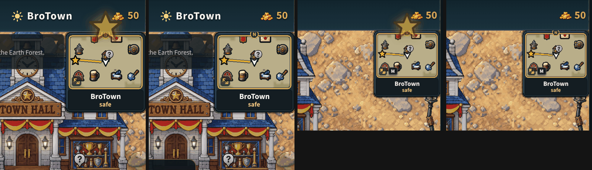

# A new quest star, shown (v2.3.3872)

The owner, playtesting for the showing: "One other point of confusion might be
that they miss the star on the minimap pointing them where to go. Maybe you can
make a giant star appear above the minimap and shrink down to just catch
attention each time there's a new star?"

Each time the minimap's quest star gets a NEW target (the quest's place moved
more than 96 game px, not every redraw), a gold star about four times the
minimap's comes up over the box with a soft glow and shrinks onto the star in
one second, then is gone. Once a target: the same target never plays it again,
not even when the minimap is rebuilt on the way back into the world. Not while
the loading screen is up (it plays once the world shows).

- `src/ui/starCue.js`, called each frame by the Wheel's minimap
  (`rendering/systems/wheelMinimap.js`) with the target and the star's place on
  the page. One SVG element on the body, animated by the browser and removed
  when it ends: nothing per frame after, nothing to preload (the star is drawn
  in the SVG), nothing in the renderer.
- Under the OS's reduced motion it appears on the star and fades, with no
  flight.
- `?starcue=0` turns it off for one tab.
- Phones upright and sideways and a computer alike (the box's place is the
  screen's, `window.__btWheelMini`).

## Checks

`node tools/qa/mp/run.mjs starcue`: on a phone upright and on a computer, a new
character's first star plays it once; the first quest taken, its new target
plays it once more, ending on the minimap's star (0 px off), nothing left on
the page after, and never again for the same target; sideways, the same end on
the star there. QA: `window.__btStarCue`.
