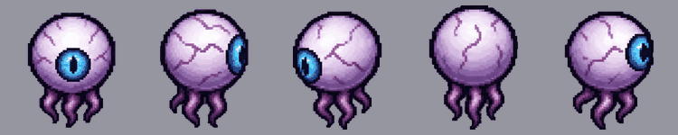
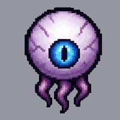
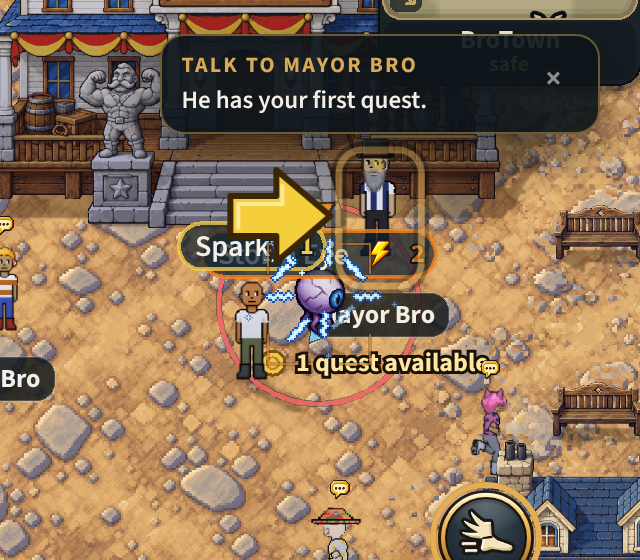

# The storm eye: the Electric Foundry's monster (v2.3.4356)

The owner, 2026-11-09: *"Also add this electric eyeball monster instead of the
stand-in electric slime. You'll use code to make the electric effects"*.

## What players get

- The Electric Foundry's monsters are **Storm Eyes** (past level 20, **Tempest
  Eyes**, in the stage's teal): an eye the size of your head, floating on its
  tentacles. The plain green slime that stood in for them is gone from the
  Foundry; the other lands' slimes are untouched.
- It **floats**, bobbing a little, and turns to face the way it goes: front,
  front-left, side, back-right or back.
- It **crackles**: arcs of lightning jump over it, drawn in code.
- It **spits balls of lightning**: the same shot the slime spat, in the pale
  blue of its lightning, with arcs round it. As it lets go, and as its lunge
  lands, **lightning is thrown off it**.
- When it dies it **cracks, tips over and breaks up**: its own twelve frames,
  on every kill.
- It fights exactly as the slime did. Nothing on the server changed: the same
  health, damage, spit, lunge, shock, drops and experience. Its pet is still
  the **Sparklet**, drawn as a small eye.

## What was uploaded, and what was made of it

One picture, `assets/monster animations/storm-eye/storm-eye-sheet.png`: the
eye from five sides, still, and its death in twelve frames, on a grid of 6 x 3
cells. `python3 tools/art/cut_storm_eye.py --preview` cuts it again:

| Strip | Cells | What |
|---|---|---|
| `views.png` | 5 | one still picture a side: facing you, side on, front-left, from behind, back-right. The other three sides are mirrors. |
| `death.png` | 12 | it cracks, tips over and breaks up, 75 ms a frame |
| `codex-idle.png` | 1 | the front-left view alone, for the codex page |

The cells are cut by the grid (so the death's pieces stay where they are from
frame to frame), hardened (a pixel is there or it is not: the sheet's ghost of
a faint edge goes), scaled to 256 px and written on 256 colours.

**It has no walk, idle or attack frames**, so the game makes it move:

- **It hovers** (`MONSTER_VARIANTS.stormEye.hover`): its picture is lifted 5
  and bobs 2.5 either way every 1.7 s, each eye from its own start. Only the
  picture moves; the monster's place, its hit circle and its shadow stay
  where the server has it.
- **Its attacks are its electricity**, below. If you make frames of it
  blinking, or its tentacles swaying, they drop in as an idle strip the way
  the water frog's breath did.

## Its electricity, drawn in code

`data/stormSparks.js` (what each look is made of), `game/stormSparks.js`
(where every piece is, from the time alone: no randomness, the same on every
phone), `rendering/stormSparksFx.js` and `stormSparkShapes.js` (drawing it).
Built the way the element wind-ups and the water frog's water are.

| Look | When | What is drawn |
|---|---|---|
| **aura** | all the time it is alive and on screen | two arcs and a spark that jump to a new place on its body every 110 ms, each lit about a third of the time: a crackle, never a steady glow |
| **zap** | the moment a blow of its lands: the end of the server's warning for its spit, its lunge and its other moves | nine bolts jumping out from its body to 62 px, flickering, and five sparks thrown clear: 14 pieces over 320 ms |
| **ball** | round every shot of its in flight | the same arcs, small, riding the ball |

Its wind-up already crackled in code (the storm element's, `elem-windup.md`),
so an attack reads: sparks gather, lightning is thrown off it, a ball of it
flies.

- **Pixels, as the flames are** (the owner, 2026-11-10: *"avoid marking
  cartoonish shapes ... pixelation similar to how you made the flame
  effects"*). The first cut drew smooth glowing lines and turned and scaled
  them. Now a bolt is a jagged line of hard pixels, white at its core and
  the pale blue of its lightning beside it (`stormSparkShapes.js`), baked
  three ways (upright, lying, on the slant) and flipped for the rest: never
  turned, never scaled, on the world's own 2 px grid, and either lit, half
  lit or out, never faded smoothly.
- **Cheaply:** 112 sprites in one container, made when the eye's look is
  loaded (as you walk toward the Foundry) and destroyed when it is let go
  (v2.3.4361: they were held in every land; `docs/specs/water-frog.md`,
  Memory, has the measurement), every
  one a cell of one 86 x 19 px picture written pixel by pixel on the loading
  screen (7 KB). A frame only places, flips and lights them: nothing is
  added, removed or hidden, so no draw list is rebuilt (TRAPS §218). At most
  8 eyes crackle at once (the nearest), 4 zaps, 8 shots.
- **Off:** `?nostormfx` for one phone. The probe is `window.__btStormSparks()`.

## How it is wired

- `ZONE_VARIANT_MAP.thunder = { fodder: 'stormEye' }`: the phone draws the
  Foundry's `fodder` as the eye. **The phone's alone**, like the Water Caves'
  and the Stone Hollows' looks: the server has no entry, so to the server it
  is the slime it always was (mirror-audit §9 holds the exemption).
- `rendering/stormEyeSprites.js` loads the two strips, cropped, as one bundle,
  as you walk toward the Foundry, and lets them go behind you.
- Its death is its own strip on every kill (`deathStripOnly`), as the frog's.
- Its shot is the slime's glob in `shotColor` 0x9fe3ff (`monsterShots.js`).
- Names: "Storm Eye", "Tempest Eye"; its codex page rewritten (type Winged: a
  flying thing); the codex stage plays its own picture and throws its blue.
- The pet sheet has a ninth row, `stormEye`, for the Sparklet (0.19 MB more
  decoded, everywhere a pet is).
- A shot is aimed at the middle of its ball (`MONSTER_TORSO_Y.stormEye` 48).
- It dies with the stone's crack (`DEATH_CUES.stormEye: 'dieRock'`) until it
  has a recording of its own. It makes no idle noise (the slime bounced).

## Left as it was, for the owner to decide

- **What it drops is still "slime remnants"**: the server's item, not a
  picture.
- **The Foundry Dome's boss** is the land's own monster made big, so it is
  drawn as a giant storm eye now. I did not play that dungeon (it needs a
  level-26 character): untested.
- **The server's names for its tier moves** are the slime's ("Goo Volley",
  "Belly Flop"); players do not read them.

## Memory

The eye's two strips are 17 cells, held as colour numbers: **0.47 MB on the
graphics chip** while you are near the Foundry (measured, `mp-stormeye`
section 1; as plain pictures they would be 1.9). Its three pictures share one
list of 256 colours, which is what lets the game hold them that way
(`tools/art/strip256.mjs --shared`, `docs/specs/water-frog.md` Memory). The
slime it replaces there cost nothing extra (its sheets are the global
slime's, held everywhere), so this is about half a MB more in the Foundry.
The lightning's picture is 7 KB, the pet's row 0.19 MB. No memory-check line
moved: `mp-membudget` fights at the Flame Fields and reads none of it.

## Tests

- `server/test/storm-eye.test.mjs`: the strips; the facings; that the Foundry's
  fodder is the eye and nothing else is; the hover; the electricity (the
  crackle's share of the time lit, that an arc holds a slot and moves, the
  zap's reach and end); the wiring; the names; the codex stage's numbers
  measured off the pictures.
- `node tools/qa/mp/run.mjs stormeye` (`mp-stormeye.mjs`): a phone in the
  world; the eight ways, the hover, the arcs, the zap, three deaths; then out
  to the Electric Foundry for the server's own eyes and a real spit. Pictures
  in `tools/qa/mp/out/stormeye/`.
