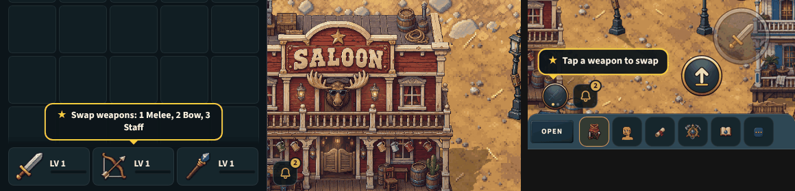

# "Swap weapons", said once (v2.3.3877)

The owner, playtesting: "it might be good somehow to bring more attention to how
to swap weapons because I completely forgot about it and nothing said anything
to me about swapping weapons".

The first time a character holds more than one weapon (Mayor Bro's first
hand-in gives the bow and the staff), a short gold callout pulses over the
weapon buttons, in the minimap star cue's family (docs/specs/star-cue.md):

- on a computer, over the three weapons at the dashboard's foot: "Swap weapons:
  1 Melee, 2 Bow, 3 Staff" (the keys in the keys column);
- on a phone, over the weapon chip: "Tap a weapon to swap" (through deskWords).

It waits while a talk or a building's window is up, goes on the first swap or
after 8 seconds, and never comes again for that character (the browser's
store, by its id). It takes no taps. `?swaphint=0` turns it off for one tab.
`src/ui/SwapHint.jsx`; QA `window.__btSwapHint`.

## Checks

`node tools/qa/mp/run.mjs swaphint`: a computer handed a second weapon shows
the callout over the weapons, 2 swaps, it goes for good; a phone shows it over
the chip and, left alone, it goes after about 8 s for good.
