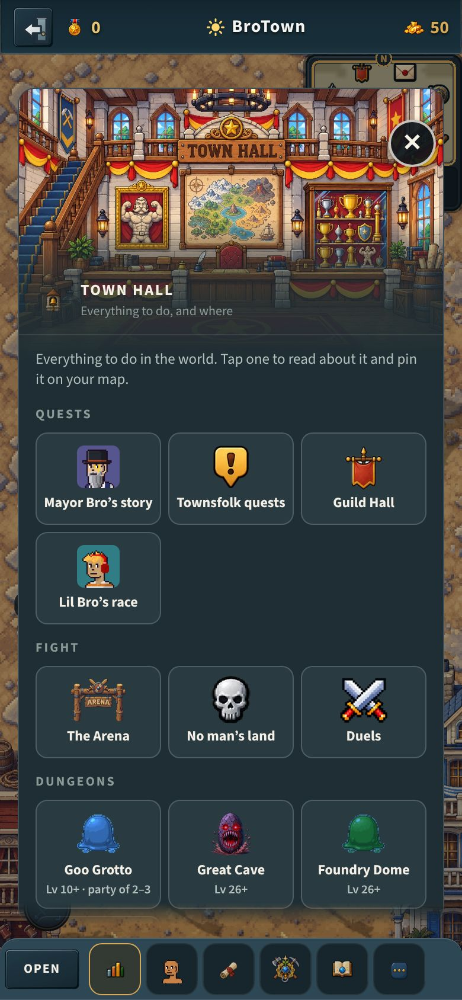
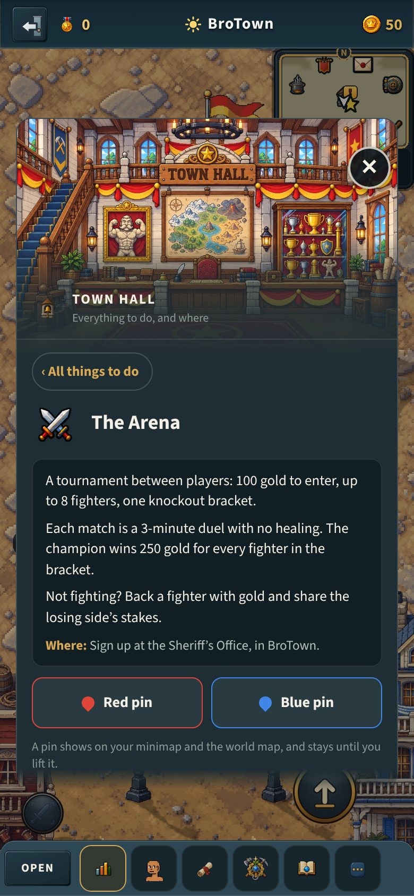
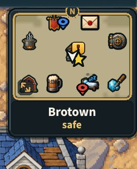
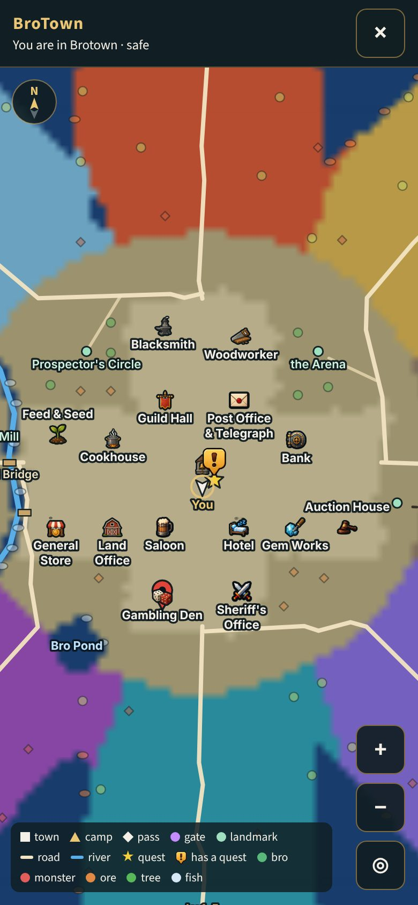
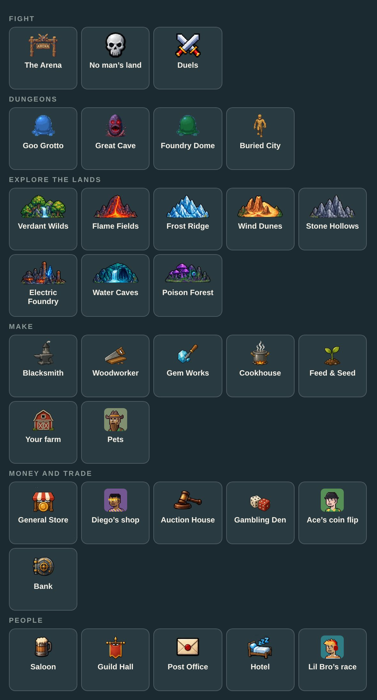

# The Town Hall's board and the map pins (v2.3.3766)

> The owner, 2026-10-28: *"I was also thinking it would be cool if at the town
> hall it was just a big menu board of all the things to do (dungeon,
> gambling, arena, woodworking, etc) with a page that describes what each
> thing does and pin drop you can put on the map to go to the one you want
> (two pins can be active at once - red pin and blue pin). When you "enter it"
> it brings up the board."*

Client only: nothing on the server changes.

| The board | A page | The minimap, two pins | The world map |
|---|---|---|---|
|  |  |  |  |

Every tile (v2.3.3779): 

v2.3.3788, Quests and the dungeons' levels: [320 px upright](town-board/board-320.jpg), [sideways](town-board/board-sideways.jpg), [computer](town-board/board-computer.jpg).

## What it does

- **Entering the Town Hall opens the board**: a tile a thing to do, under
  eight headings: Quests, Fight, Dungeons, Explore the lands, Make, Money
  and trade, Gambling, People (v2.3.3779, the owner: "it should be
  classified by 'dungeon' not by 'fight'"; v2.3.3788: "'Gambling' should be
  another category ... (quests should've be another one)"). Quests: the
  Mayor's story (an `npc` pin on Mayor Bro, found at the hall he keeps until
  he is spawned), the townsfolk's quests (no pin), the Guild Hall, Lil Bro's
  race; their numbers are the worker's (town-board.test 1t).
- **A dungeon's levels on its tile** (v2.3.3788): "Lv 10+ · party of 2–3",
  "Lv 26+", "Lv 41+" -- `data/wheelDungeons.js` `dungeonBoardLine` (the
  party row and the level it is for, else the lowest of the place's levels:
  the world map's landmark, the plan's tier), through
  `mapPinPlaces.js` `boardDungeonLine`.
  Only what is built and reachable, and only what this worker opens (a row
  with `cap` waits for it; a dungeon for `wheelDungeonOpen`).
- **A page a tile**: 1-4 short sentences (what, what you do, what you get,
  the level or cost, from the code), where it is in words, and two buttons,
  **Red pin** and **Blue pin**.
- **The pins**: both may be up at once; a press puts one on this place,
  moving it; the same press there lifts it. Tiles wear their pins. On the
  minimap the pin's point is on the place, or a smaller pin rides the box's
  edge on the line to it; on the world map at every zoom, at the screen's
  edge when off it. Kept per character in localStorage (`bt_pins:<id>`)
  until lifted.
- **The Leaderboard and World map** stay, as two buttons at the board's foot
  (the owner's v2.3.3258 choice).

- **Every tile its own picture (v2.3.3779)**, the owner: "use better icons
  for each one". A dungeon its boss and the Arena its gate
  (`public/icons/board/`, baked by `tools/ui/bake-board-icons.py` from the
  monsters' and the arena's art in their colours, palette PNGs of 255
  colours, 4-6 KB each); a land its scene (`ownerIcons.js` LAND_SCENE, drawn
  2:1); a townsperson his head; a building its map icon; No man's land the
  skull; Duels the crossed swords. Loaded as the board's ``s were.
- **A land's name is the world's** (v2.3.3779): a row writes `{verdant}`,
  filled from the world map's `names` (plan.js `regions[id].name`) by
  `boardWords`; without the map, "the flora land". Lane K's rename of a land
  lands in plan.js alone.

## How

| File | What |
|---|---|
| `src/data/townBoard.js` | the rows: tile, page, where, and `at` (how the place is found); `boardWords`, `boardName` fill a land's name |
| `tools/ui/bake-board-icons.py` | the dungeons' and the Arena's tile pictures (`public/icons/board/`) |
| `src/game/mapPins.js` | the two pins: an id of a row, never a position |
| `src/game/mapPinPlaces.js` | a row's place AT RUNTIME: a door (`wheelTownDoors`), a townsperson (`S.npcs`, or his door and offset in `WHEEL_TOWNSFOLK`), a dungeon's mouth (`wheelDungeonDoors`), a land's first stretch (the world map's `lands[].ticks`); never a coordinate in code (CLAUDE.md §1) |
| `src/ui/panels/buildings/TownBoard.jsx` | the board and its pages (Lantern Slate), from `WheelHallPanel.jsx` |
| `src/rendering/systems/wheelMinimap.js`, `minimapRenderer.js` | the pins as pooled marks (a `mappin` glyph minted once), never a Graphics change a frame |
| `src/ui/WorldMapOverlay.jsx` | the pins on the world map |

## Tests

- `server/test/town-board.test.mjs`: the rows (ids, headings, the Dungeons
  heading, pictures that exist, each its own, the new ones 256 colours,
  no land name spelt, places found at runtime, pages, no "Wheel" or "tap") and the pins
  (place, move, lift, both at once, kept per character, bad ids dropped).
- `tools/qa/mp/mp-townboard.mjs`: an upright phone and a computer in the
  world's BroTown: the board, a page, red and blue on the minimap, red
  moved, blue lifted, a reload keeping red, the world map.
- UI review: `building-townhall`, `building-townhall-page`.

## Not on the board

No man's land IS on the board (under Fight) but without pins: it is every
land past the safe ground, not one place (`at: null`, `nopin`). The Dungeon
Workshop's paid packs (dormant). A pin is lifted from the board, not yet from
the map.
