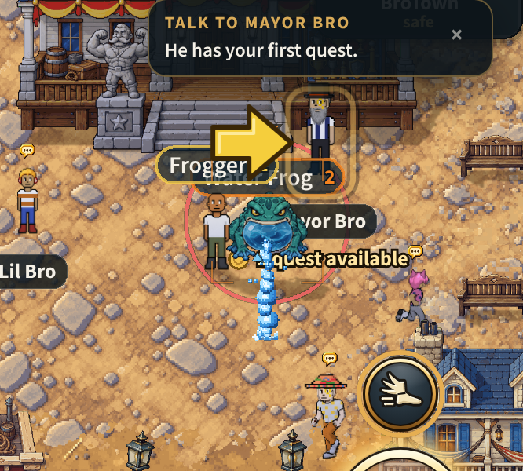
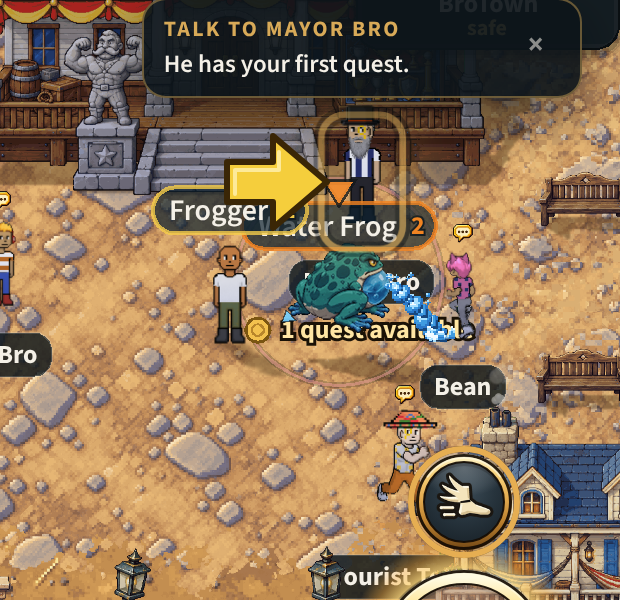
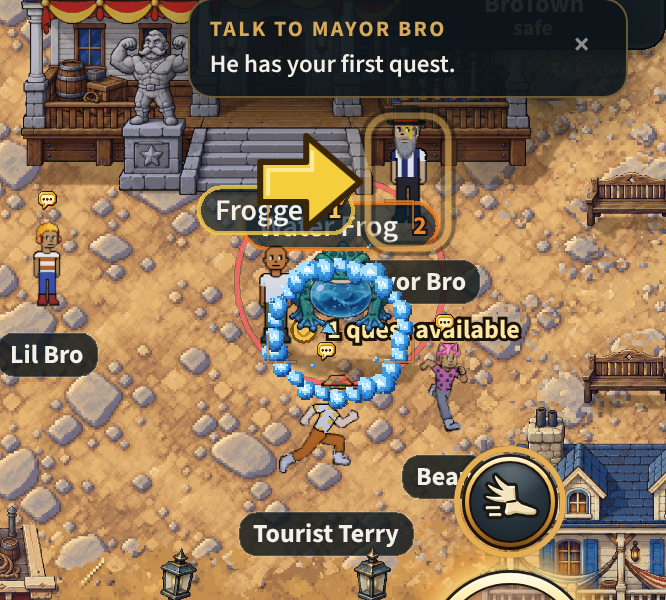

# The water frog: the Water Caves' monster (v2.3.4355)

The owner, 2026-11-09: *"I added new monster (water frog) on GitHub. It
included videos of 5 directions: idle, attack, movement, and death animation
(only South). Can you cut it into the right amount of frames to make it look
smooth and wire it into the game? I want to replace the fish man monster."*

And the same day: *"the northeast attack is slightly messed up (the face
turns southeast during the 2nd half of the attack). Thats just AI drift ... I
intend for you to draw the water attacks in code actually. Don't use the
water in the drawings. (Either cover over it or remove)"*.

## What players get

- The Water Caves' monster is the **Water Frog** (past level 20 the **Coral
  Frog**): a fat toad with a sac of cave water under its chin.
- It **breathes** standing still, **hops** to move, **winds up** before every
  blow (its sac swells, its mouth opens), and as the blow lands **its water is
  drawn in code**: a jet out of its mouth the way it faces and the splash
  where it comes down, or, for its slam, a wave thrown out from under it to
  the ring it hits in. When it dies its sac spins up and **bursts**, leaving
  it flat in the puddle.
- It fights exactly as the fishman did. Nothing on the server changed: the
  same health, damage, slam, soak, drops and experience.
- Its pet is the **Froglet** (the Finling before), drawn as a small frog.
- The **Bog Lurker**, which went on wearing the old fishman picture in the
  bog's colour, became the Great Rotcap one version later (v2.3.4357,
  `docs/specs/rotcap.md`): the fishman picture is gone from the game.

## What was uploaded, and what was made of it

Ten videos and one picture, moved from the top of the repository to
`assets/monster animations/water-frog/`. Each video is 10 seconds at 24
frames a second on flat magenta.

| File | What it shows | Used for |
|---|---|---|
| `frog-s-idle-hop.mp4` | facing you: it breathes, then one hop | idle and hop, south |
| `frog-s-attack.mp4` | facing you: it leaps, mouth open | attack, south |
| `frog-s-death.mp4` | facing you: the sac spins up and bursts | the death |
| `frog-sw-hop.mp4` | front-left: one hop | idle and hop, south-west (mirrored: south-east) |
| `frog-sw-attack.mp4` | front-left: the sac swells, its mouth opens | attack, south-west (and south-east) |
| `frog-ne-hop.mp4` | back-right: one hop | idle and hop, north-east (mirrored: north-west); **and the hop east and west** |
| `frog-ne-attack.mp4` | back-right: the sac swells, then its face turns to the front (the drift) | attack, north-east (and north-west): **the swell only**, where it still faces away |
| `frog-e-attack.mp4` | side on: the sac swells, it rears, its mouth opens | idle and attack, east (mirrored: west) |
| `frog-e-hop-closeup.mp4` | side on, a hop, filmed so close the frog leaves the frame while the camera pulls back and in | not used (kept) |
| `frog-views.png` | the frog from five sides, still | north (below) |

One file had been uploaded twice (byte for byte the side attack); the copy
was removed.

**What is missing.**

- **From behind (north): no video.** That side is made from the still
  picture: the same frog squashed, stretched and lifted through a hop, and
  swelling into its attack. It reads as a frog hopping away from you, but it
  does not move its legs.
- **Side on (east and west): no usable hop.** A frog going east or west
  stands and attacks side on and hops on the back-right strip, the nearest
  view. It turns a little as it sets off.
- **Back-right: the attack drifts.** Only its first half is used, so its
  mouth never opens from that side: the sac swells to its fullest, the water
  is thrown (in code), and the sac is let down.

A video of any of these drops straight in: `SOURCES` and `STRIPS` in the
cutting tool, and the facing table in `waterFrogSprites.js`.

## No water leaves the frog in a picture

The videos draw their own water: the stream it pours out, the splash it lands
in, the drops thrown off a landing. None of that is in the strips.

- The frames where water is joined to the frog are **not picked**. The
  cutting tool's notes say which: a hop's landing splash (south 134-152,
  south-west 132-152, back-right 111-123), the south attack's splash
  (132-144), the stream the front-left attack pours out (120-138), the side
  attack's drips (120-132).
- Anything loose in a picked frame, a stray drop or a ripple, is **taken
  out**: each cell keeps only its biggest joined-up piece, the frog
  (`largest_part`). The unit suite checks every living cell is one piece.
- The **sac** under its chin is the frog and stays, swelling and sloshing as
  it winds up. The **death** is not an attack and keeps its burst.

## Its water, drawn in code

`data/waterAttack.js` (what each blow is made of), `game/waterAttack.js`
(where every piece is, from the time alone: no randomness, the same on every
phone), `rendering/waterAttackFx.js` and `waterAttackShapes.js` (drawing it).
Built the way the element wind-ups are (`docs/specs/elem-windup.md`), which
already draw the droplets swirling in as the frog winds up.

| Blow | When | What is drawn | For how long |
|---|---|---|---|
| **spray** | its swing, and any move that is not a ring | a torrent out of its mouth the way it faces (twelve gouts of water, one on the next, the biggest leading), eight specks of spray thrown off it, and the splash where it comes down: a crown thrown up off the ground, two rings spreading under it, three puffs of foam: 26 pieces, reaching 84 px | 560 ms |
| **ring** | its slam (and a quake or a stomp) | a wave of 26 gouts running out from under it to the worker's own radius (88 px for the slam), six specks leaping off it: 32 pieces | 620 ms |

- **Pixels, as the flames are** (the owner, 2026-11-10: *"avoid marking
  cartoonish shapes. Make water effects with pixelation similar to how you
  made the flame effects"*). The first cut drew smooth outlined shapes and
  turned and scaled them: cartoons over a pixel world. Now every piece is
  hard pixels on a five-step ramp of the frog's own sac's colours
  (`waterAttackShapes.js`), made the way the campfire's flame is: a **gout**
  is a mass whose edge is broken by uneven lobes, foam white at its heart and
  the deep step only on its lower right, with no outline, so gouts laid over
  one another run together into one torrent. A piece is never turned and
  never scaled: it sits on the world's own 2 px grid, flickers between two
  cuts of itself, and fades in three steps.
- **When:** the moment the worker's warning ends, which is the blow. The
  entity renderer queues it once a warning for a frog it drew
  (`MONSTER_VARIANTS.fishman.blowFx: 'water'`); nothing new is on the wire.
- **Cheaply:** 128 sprites in one container, every one a cell of one
  282 x 19 px picture written pixel by pixel on the loading screen (21 KB).
  A frame only places and fades them: nothing is added, removed or hidden,
  so no draw list is rebuilt (TRAPS §218). At most 4 blows at once, the
  nearest first.
- **The sprites are the frog's (v2.3.4389).** They are made when its look is
  loaded, as you walk toward the Water Caves, and destroyed when the look is
  let go behind you: never on the frame of the first blow, and never held in
  a land with no frog (below, Memory).
- **Off:** `?nowaterfx` for one phone. The probe is `window.__btWaterAttack()`.

The spray, from the front and the side, and the slam's ring (a phone in the
world, `mp-waterfrog`, slowed down for the picture):

## See it

Each as the game plays it (front, front-left, side, back-right):

From behind, made from the still picture (the hop, the attack):

In the world, with its water: `tools/qa/mp/out/waterfrog/` after `node
tools/qa/mp/run.mjs waterfrog`.

## The frames

`python3 tools/art/cut_water_frog.py --preview` cuts everything again and
writes `docs/art/water-frog-strips.png` (every strip, to look at).

| Strip | Frames | Why that many |
|---|---|---|
| idle (4 sides) | 8 | one breath; the video's breath is 32 frames, so every fourth (170 ms a frame would be the video's own pace; the game plays it at 85, below) |
| hop (3 sides) | 12 | crouch 3, spring 2, the air 4, the landing 3. The video's hop is over 100 frames; these are the ones where the pose changes |
| attack (4 sides) | 15 | 12 of wind-up, the last of them the blow, then 3 of recovery |
| death | 20 | at rest, the startle (3), the sac spinning (4), the burst (8, the fastest part, taken closest together), lying in the puddle (4) |
| from behind | 1 + 8 + 9 | made from the still |

Each frame is keyed by the magenta's **hue** (so the shadow some videos drew
under the frog goes too, and its dark mouth does not), loses one pixel of
edge (the video's compression smears magenta into the outline), is scaled by
**its own video's frog at rest** so the frog is one size from every side (140
rows of a 256 px cell, feet on row 231), keeps only the frog (above), and is
written on at most **256 colours** with the game's own quantiser
(`tools/art/strip256.mjs --shared`): **one list of 256 colours for all 15
strips**, every pixel of every strip counted together, so the game can hold
the whole frog as colour numbers on one row of colours (below, Memory). The back-right hop's frames 86 to 92 leave the
top of the video and are skipped.

## How the game plays them

`src/rendering/waterFrogSprites.js` loads the fifteen strips, cropped, as one
bundle; the variant key stays `fishman` (the worker's name for the Water
Caves' brute, on the wire and in every saved codex). Its pace is
`MONSTER_VARIANTS.fishman`; the three rules are plain arithmetic in
`src/game/monsterStrips.js`:

- **Its pace (v2.3.4390).** The owner, having played it: *"The frog
  animation frames play too slowly. It needs to be sped up by 2x . And maybe
  3x for death animation"*. Every strip plays the same frames, none dropped,
  faster:

  | | first cut (the videos' pace) | now |
  |---|---|---|
  | breath | 170 ms a frame, 1.4 s a breath | **85 ms**, 0.7 s |
  | hop | 2.4 px of travel a frame, a hop every 29 px | **1.2 px**, a hop every 14 px |
  | finishing a hop when it stops | 55 ms a frame | **28 ms** |
  | attack wind-up | 12 frames over the whole warning (50 ms each for a swing, 75 for the slam) | **over its last half** (25 and 37 ms), `attackWindShare: 0.5`; it breathes through the first half |
  | attack recovery | 70 ms a frame | **35 ms** |
  | death | 1700 ms | **570 ms** |

  The hop is the one with a cost: it is driven by how far the frog has
  moved, so twice as fast means twice as many hops over the same ground,
  each half as long. The blow still lands with its frame: the warning's
  length is the server's and is unchanged.
- **The hop** (`hopWalk`) is driven by distance like every walk: 1.2 px of
  travel a frame, a hop about every 14 px. A walk that stops, stops on its
  frame; a hop that stopped would hang in the air, so a hopper that stops
  moving plays the rest of its hop by the clock, down to frame 0, and
  breathes from there. Only once it has left the ground (`hopAirFrom: 3`):
  stopped in its crouch it waits, so a frog creeping along at a wander
  gathers itself over a few steps and springs once, where finishing every
  frame would have it leaping on the spot for each pixel it is moved.
- **The attack** (`attackRecoverFrames: 3`): the 12 wind-up frames are spread
  over the last half of the server's warning, however long (a swing's 600 ms,
  the slam's 900), so the blow's frame is on screen as the blow lands; then
  the 3 recovery frames. Its specials' warnings play it too (`telegraphAttack`). A strip
  with no recovery frames (the fire goblin's) plays exactly as before.
- **The death** (`deathStripOnly`) is its own animation on **every** kill.
  The other monsters roll between their strip, a cut (sliced, beheaded) and
  their zone death; the frog's burst was made for it, so nothing replaces it.
  The burst is three frogs wide, so the death is cut at its own scale and
  drawn back at the living frog's size with its feet where they were
  (`deathScalePx`, `deathOffsetY`: the cutting tool prints them).
- It is drawn at `liveScalePx: 120` (the skeleton's), about a bro tall and
  half again as wide; `headTopPx` puts its health bar and name on its head,
  not on the top of the room its cell leaves for the hop.

## Its shadow (v2.3.4493)

The owner: "the water frogs currently have floating shadows and need fixed."

- **Why.** A monster's shadow is its own body drawn again, laid along the sun
  from a ground point (`lightfx/shadows.js`). For a monster look that point was
  the body sprite's origin, which is the **bottom of its 256 px cell**
  (`lightfx/casters.js`, rule 3: "anchored AT their feet"). The frog's strips
  were cut with its feet on row 231, leaving 24 empty rows under them (room
  for a hop toward you). At the frog's size that is 17 px of nothing between
  its feet and the point its shadow hung from, so the shadow lay under the
  frog and apart from it.
- **The fix.** A look says where its feet are: `feetRow` in `MONSTER_VARIANTS`
  (the first empty row under its feet at rest; 232 for the frog). `casters.js`
  hangs the shadow from that row. The body is not moved: its place, its bar,
  its hit circle and its target ring are where they were. A hop still lifts
  the body off its shadow, which stays on the ground: that gap is the height.
- **The same on four more looks.** The rock golem's pictures (`rockmonster`,
  `thornShambler`) and the rotcap's (`mireWisp`, `bogLurker`) stand on row 231
  too (measured: every walk frame's lowest row is 226 to 232), so they got the
  same `feetRow`. Both were looked at in their own lands (the Stone Hollows,
  the Poison Forest): each shadow sits at its monster's base.
- **Not changed**: the fire goblin (its feet row differs by side: 220 to 239)
  and the storm eye (it hovers on purpose).
- **Test**: `mp-waterfrog` step 10: in the Water Caves, each frog's shadow
  hangs 16.9 px above its cell's bottom, which is its 24 empty rows.
- Picture: `docs/shots/frog-shadow.webp` (v2.3.4495: before that, and now).

**v2.3.4495, "The water frog shadow is too far south of the sprite."** Two
things were still south of the frog once its shadow hung from its feet:

- **Its shadow fell wholly south of its feet.** A standing figure's shadow is
  its picture laid along the sun from its feet line: every pixel is height.
  The frog's 97 px are mostly its back seen from above, so its shadow reached
  33 px south and 48 east, as a bro's does, and a shadow cast that way can only
  fall south of the feet. A squat look now says so (`shadowFlat` in
  `MONSTER_VARIANTS`: `{ s: 0.45, lift: 14 }` on the frog), and its shadow is
  its **footprint**: its own outline squashed onto the ground under it (0.45 of
  its height, kept above the feet line) and pushed 14 px along the sun
  (`lightfx/shadows.js`). Most of it is under the frog; a dark edge shows on its
  east and south-east side. Other looks and every player are cast as before.
- **The ring under a monster in reach sat on the bottom of its picture's
  cell**, 17 px below the frog's feet: a pale oval apart from it. It is now on
  the feet of any look with a `feetRow` (`lookFeetPad`, `effectsRenderer`'s
  ring), so the rock golem's and the rotcap's moved up with the frog's.
- Test: `mp-waterfrog` step 10 checks each frog's shadow is its footprint
  (`flat` 0.45 in the shadow pass's list). `worldshadow` 19 of 19.
  `lockrings` fails three checks about the attack button's see-through face,
  on main too: not this change.

## What else changed with it

- Names: "Water Frog", "Coral Frog", "Froglet", "Coral Froglet"; its codex
  page rewritten; the Sound Studio's three labels.
- The codex page plays the frog's front-left strips (`CODEX_LOOKS.waterFrog`).
- The pet sheet has an eighth row, `waterFrog` (one sitting frame a side: a
  one-pose pet is carried by the renderer's own little hop). 0.19 MB more
  decoded, everywhere a pet is.
- A shot is aimed at the middle of its body (`MONSTER_TORSO_Y.fishman` 54,
  `LAND_CORE.fishman` [16, 13]): it is wide and squat where the fishman was
  tall.
- `DEATH_ZONES.fishman` is gone (the fishman's flop); the bog lurker keeps
  its own zones.

## Memory

The look loads as you walk toward the Water Caves and is let go behind you,
like every land's (`wheelMonsterArt.js`). It is 166 frames where the fishman
was 4 pictures: 1.6 MB of files.

**It is held as colour numbers: 5.5 MB on the graphics chip while you are
near the Water Caves** (measured, `mp-waterfrog` section 1). The 256-colour
law is what makes that so (the owner, 2026-11-10: *"you're converting the
pictures into the 256 color framework right? That should be happening as
part of the process"*). Two things had to be true and at first were not:

- **One list of colours for the whole monster.** The game keeps a monster's
  strips as one byte a pixel, each byte a place in a row of 256 colours
  (`picsNumbers.js`), and there are 256 such rows for the whole game. Strips
  cut each on their own 256 colours take a row each (the frog's 15 strips,
  15 rows; the fire goblin's 14 take 14), and when the rows run out a strip
  goes up as a plain picture, four times the size. So the cutting tool now
  puts all of a monster's strips on 256 colours TOGETHER
  (`strip256.mjs --shared`): the whole frog is one row
  (`server/test/monster-palettes.test.mjs` holds all four new monsters to
  it).
- **Every strip, the full ones too.** The loader crops each cell to its art
  and declines a strip that cropping would not shrink: the frog's death,
  whose burst reaches every edge of its cells. A declined strip went up as
  its image, four bytes a pixel (5.2 MB on its own). From v2.3.4359 a
  declined strip is read into its colour numbers whole
  (`zoneTextures.js loadTrackedStrip`), which also catches any other
  monster's strip that fills its cells.

As plain pictures the same frames would be 22 MB cropped and 41.5 MB
uncropped (the "21.9 MB" this spec first gave was that plain-picture size,
not what the chip held). The fishman was about 1 MB. `?picnumbers=0` is the off-ramp (the
old way, for one phone).

The memory check (`mp-membudget`) fights at the Flame Fields and reads none
of the pictures, so no line moved.

**What it did read, and v2.3.4389 took back out.** The check's `heap` line
(the page's JavaScript objects, 37.5 MB) failed twice on this branch on
GitHub's runner, at 37.7 and 38.0, and passed twice. One run each on one
machine (this box, 2026-11-10), the heap at each stop:

| | on arrival | fight 1 / 2 / 3 | home 1 / 2 / 3 |
|---|---|---|---|
| main (9ecff6a9) | 31.5 | 34.1 / 35.5 / 37.3 | 34.8 / 35.9 / 36.4 |
| the branch before | 31.9 | 34.6 / 35.8 / 36.9 | 35.2 / 36.3 / 37.0 |
| the branch after | 31.5 | 34.4 / 35.8 / 37.2 | 35.0 / 35.7 / 36.3 |

Main alone reads 37.3 at its third fight, 0.2 MB under the line: the line is
on main's own readings again, as `tools/qa/mp/memory-budget.mjs` records it
has been before. The branch added about 0.4 MB on top, the same at every
stop (so nothing kept growing): the pools of sprites for the water (128) and
the storm eye's lightning (112), made with the renderer and held in BroTown
and every land. Now each is made and destroyed with its monster's look, and
the branch reads what main reads. The line was not raised.

## Tests

- `server/test/water-frog.test.mjs`: the strips (there, 256 colours, their
  frame counts, one size from every side, nothing cut off, **every cell one
  joined-up piece**), the three rules, the wiring, the names, the codex
  stage's numbers measured off the pictures; the water (its pieces, where
  they go, that a spray goes the way it faces and a ring to its radius, that
  both end).
- `node tools/qa/mp/run.mjs waterfrog` (`mp-waterfrog.mjs`): a phone in the
  world; the frog's breath, the eight ways, a stopped hop, a swing's and a
  slam's warning and the water drawn as each ends, three deaths, the bog
  lurker; then out to the Water Caves
  for the server's own frogs. Pictures in `tools/qa/mp/out/waterfrog/`.
