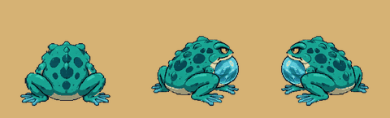

# The water frog: the Water Caves' monster (v2.3.4355)

The owner, 2026-11-09: *"I added new monster (water frog) on GitHub. It
included videos of 5 directions: idle, attack, movement, and death animation
(only South). Can you cut it into the right amount of frames to make it look
smooth and wire it into the game? I want to replace the fish man monster."*

## What players get

- The Water Caves' monster is the **Water Frog** (past level 20 the **Coral
  Frog**): a fat toad with a sac of cave water under its chin.
- It **breathes** standing still, **hops** to move, **winds up** before every
  blow (and before its slam and its other moves), and when it dies its sac
  spins up and **bursts**, leaving it flat in the puddle.
- It fights exactly as the fishman did. Nothing on the server changed: the
  same health, damage, slam, soak, drops and experience.
- Its pet is the **Froglet** (the Finling before), drawn as a small frog.
- The **Bog Lurker** is untouched. It still wears the old fishman picture in
  the bog's colour, with its own death, and its pet the Lurkling too.

## What was uploaded, and what was made of it

Ten videos and one picture, moved from the top of the repository to
`assets/monster animations/water-frog/`. Each video is 10 seconds at 24
frames a second on flat magenta.

| File | What it shows | Used for |
|---|---|---|
| `frog-s-idle-hop.mp4` | facing you: it breathes, then one hop | idle and hop, south |
| `frog-s-attack.mp4` | facing you: it leaps mouth open and lands in a splash | attack, south |
| `frog-s-death.mp4` | facing you: the sac spins up and bursts | the death |
| `frog-sw-hop.mp4` | front-left: one hop | idle and hop, south-west (mirrored: south-east) |
| `frog-sw-attack.mp4` | front-left: the sac swells, it spits the water out | attack, south-west (and south-east) |
| `frog-e-hop.mp4` | side on: one hop | idle and hop, east (mirrored: west) |
| `frog-e-attack.mp4` | side on: the sac swells, it roars | attack, east (and west) |
| `frog-e-attack-take2.mp4` | a second take of the side attack | not used (kept) |
| `frog-e-hop-closeup.mp4` | the side hop filmed too close (the frog leaves the frame) | not used (kept) |
| `frog-views.png` | the frog from five sides, still | north and north-east (below) |

One file had been uploaded twice (byte for byte the second take of the side
attack); the copy was removed.

**The videos cover three of the five sides.** There is no video from behind
or from back-right. Those two sides (and north-west, the mirror) are made
from the still picture: the same frog squashed, stretched and lifted through
a hop, and leaning into its attack. It reads as a frog hopping away from you,
but it does not move its legs. When the two videos arrive, they go in
`SOURCES` and `STRIPS` in the cutting tool and the two `SYNTH` tables go.

## See it

Each as the game plays it (front, front-left, side):

The two sides made from the still picture (back, back-right, back-left):

In the world: `tools/qa/mp/out/waterfrog/` after `node tools/qa/mp/run.mjs
waterfrog`.

## The frames

`python3 tools/art/cut_water_frog.py --preview` cuts everything again and
writes `docs/art/water-frog-strips.png` (every strip, to look at).

| Strip | Frames | Why that many |
|---|---|---|
| idle (3 sides) | 8 | one breath; the video's breath is 32 frames, so every fourth: 170 ms a frame in the game is the video's own pace |
| hop (3 sides) | 12 | crouch 3, spring 2, the air 3, the landing 2, the settle 2. The video's hop is over 100 frames; these are the ones where the pose changes |
| attack (3 sides) | 15 | 12 of wind-up, the last of them the blow, then 3 of recovery |
| death | 20 | at rest, the startle (3), the sac spinning (4), the burst (8, the fastest part, taken closest together), lying in the puddle (4) |
| north and north-east | 1 + 8 + 9 | made from the still |

Each frame is keyed by the magenta's **hue** (so the shadow some videos drew
under the frog goes too, and its dark mouth does not), loses one pixel of
edge (the video's compression smears magenta into the outline), is scaled by
**its own video's frog at rest** so the frog is one size from every side (140
rows of a 256 px cell, feet on row 231), and is written on at most **256
colours** with the game's own quantiser (`tools/art/strip256.mjs`). The side
hop's frames 86 to 92 leave the top of the video and are skipped.

## How the game plays them

`src/rendering/waterFrogSprites.js` loads the sixteen strips, cropped, as one
bundle; the variant key stays `fishman` (the worker's name for the Water
Caves' brute, on the wire and in every saved codex). Its pace is
`MONSTER_VARIANTS.fishman`; the three rules are plain arithmetic in
`src/game/monsterStrips.js`:

- **The hop** (`hopWalk`) is driven by distance like every walk: 2.4 px of
  travel a frame, a hop about every 29 px. A walk that stops, stops on its
  frame; a hop that stopped would hang in the air, so a hopper that stops
  moving plays the rest of its hop by the clock, down to frame 0, and
  breathes from there. Only once it has left the ground (`hopAirFrom: 3`):
  stopped in its crouch it waits, so a frog creeping along at a wander
  gathers itself over a few steps and springs once, where finishing every
  frame would have it leaping on the spot for each pixel it is moved.
- **The attack** (`attackRecoverFrames: 3`): the 12 wind-up frames are spread
  over the server's warning, however long (a swing's 600 ms, the slam's 900),
  so the blow's frame is on screen as the blow lands; then the 3 recovery
  frames. Its specials' warnings play it too (`telegraphAttack`). A strip
  with no recovery frames (the fire goblin's) plays exactly as before.
- **The death** (`deathStripOnly`) is its own animation on **every** kill.
  The other monsters roll between their strip, a cut (sliced, beheaded) and
  their zone death; the frog's burst was made for it, so nothing replaces it.
  The burst is three frogs wide, so the death is cut at its own scale and
  drawn back at the living frog's size with its feet where they were
  (`deathScalePx`, `deathOffsetY`: the cutting tool prints them).
- It is drawn at `liveScalePx: 120` (the skeleton's), about a bro tall and
  half again as wide; `headTopPx` puts its health bar and name on its head,
  not on the top of the room its cell leaves for the hop.

## What else changed with it

- Names: "Water Frog", "Coral Frog", "Froglet", "Coral Froglet"; its codex
  page rewritten; the Sound Studio's three labels.
- The codex page plays the frog's front-left strips (`CODEX_LOOKS.waterFrog`).
- The pet sheet has an eighth row, `waterFrog` (one sitting frame a side: a
  one-pose pet is carried by the renderer's own little hop). 0.19 MB more
  decoded, everywhere a pet is.
- A shot is aimed at the middle of its body (`MONSTER_TORSO_Y.fishman` 54,
  `LAND_CORE.fishman` [16, 13]): it is wide and squat where the fishman was
  tall.
- `DEATH_ZONES.fishman` is gone (the fishman's flop); the bog lurker keeps
  its own zones.

## Memory

The look loads as you walk toward the Water Caves and is let go behind you,
like every land's (`wheelMonsterArt.js`). It is 162 frames where the fishman
was 4 pictures: about 1.6 MB of files, and cropped to the art about 13 MB on
the graphics chip while you are there (the fire goblin's look, for
comparison, is 120 frames). Every strip is on 256 colours, so the page keeps
its colour numbers, not a second copy (`heldNumbers.js`). The memory check
(`mp-membudget`) fights at the Flame Fields and reads none of it; no line
moved.

## Tests

- `server/test/water-frog.test.mjs`: the strips (there, 256 colours, their
  frame counts, one size from every side, nothing cut off), the three rules,
  the wiring, the names, the codex stage's numbers measured off the pictures.
- `node tools/qa/mp/run.mjs waterfrog` (`mp-waterfrog.mjs`): a phone in the
  world; the frog's breath, the eight ways, a stopped hop, a swing's and a
  slam's warning, three deaths, the bog lurker; then out to the Water Caves
  for the server's own frogs. Pictures in `tools/qa/mp/out/waterfrog/`.
