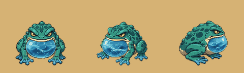
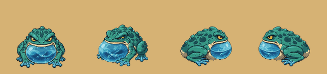
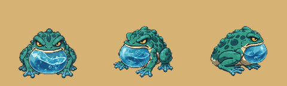
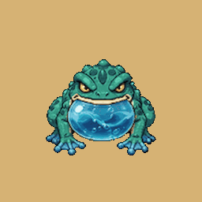
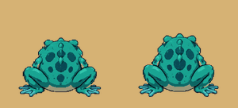

# The water frog: the Water Caves' monster (v2.3.4355)

The owner, 2026-11-09: *"I added new monster (water frog) on GitHub. It
included videos of 5 directions: idle, attack, movement, and death animation
(only South). Can you cut it into the right amount of frames to make it look
smooth and wire it into the game? I want to replace the fish man monster."*

And the same day: *"the northeast attack is slightly messed up (the face
turns southeast during the 2nd half of the attack). Thats just AI drift ... I
intend for you to draw the water attacks in code actually. Don't use the
water in the drawings. (Either cover over it or remove)"*.

## What players get

- The Water Caves' monster is the **Water Frog** (past level 20 the **Coral
  Frog**): a fat toad with a sac of cave water under its chin.
- It **breathes** standing still, **hops** to move, **winds up** before every
  blow (its sac swells, its mouth opens), and as the blow lands **its water is
  drawn in code**: a jet out of its mouth the way it faces and the splash
  where it comes down, or, for its slam, a wave thrown out from under it to
  the ring it hits in. When it dies its sac spins up and **bursts**, leaving
  it flat in the puddle.
- It fights exactly as the fishman did. Nothing on the server changed: the
  same health, damage, slam, soak, drops and experience.
- Its pet is the **Froglet** (the Finling before), drawn as a small frog.
- The **Bog Lurker** is untouched. It still wears the old fishman picture in
  the bog's colour, with its own death, and its pet the Lurkling too.

## What was uploaded, and what was made of it

Ten videos and one picture, moved from the top of the repository to
`assets/monster animations/water-frog/`. Each video is 10 seconds at 24
frames a second on flat magenta.

| File | What it shows | Used for |
|---|---|---|
| `frog-s-idle-hop.mp4` | facing you: it breathes, then one hop | idle and hop, south |
| `frog-s-attack.mp4` | facing you: it leaps, mouth open | attack, south |
| `frog-s-death.mp4` | facing you: the sac spins up and bursts | the death |
| `frog-sw-hop.mp4` | front-left: one hop | idle and hop, south-west (mirrored: south-east) |
| `frog-sw-attack.mp4` | front-left: the sac swells, its mouth opens | attack, south-west (and south-east) |
| `frog-ne-hop.mp4` | back-right: one hop | idle and hop, north-east (mirrored: north-west); **and the hop east and west** |
| `frog-ne-attack.mp4` | back-right: the sac swells, then its face turns to the front (the drift) | attack, north-east (and north-west): **the swell only**, where it still faces away |
| `frog-e-attack.mp4` | side on: the sac swells, it rears, its mouth opens | idle and attack, east (mirrored: west) |
| `frog-e-hop-closeup.mp4` | side on, a hop, filmed so close the frog leaves the frame while the camera pulls back and in | not used (kept) |
| `frog-views.png` | the frog from five sides, still | north (below) |

One file had been uploaded twice (byte for byte the side attack); the copy
was removed.

**What is missing.**

- **From behind (north): no video.** That side is made from the still
  picture: the same frog squashed, stretched and lifted through a hop, and
  swelling into its attack. It reads as a frog hopping away from you, but it
  does not move its legs.
- **Side on (east and west): no usable hop.** A frog going east or west
  stands and attacks side on and hops on the back-right strip, the nearest
  view. It turns a little as it sets off.
- **Back-right: the attack drifts.** Only its first half is used, so its
  mouth never opens from that side: the sac swells to its fullest, the water
  is thrown (in code), and the sac is let down.

A video of any of these drops straight in: `SOURCES` and `STRIPS` in the
cutting tool, and the facing table in `waterFrogSprites.js`.

## No water leaves the frog in a picture

The videos draw their own water: the stream it pours out, the splash it lands
in, the drops thrown off a landing. None of that is in the strips.

- The frames where water is joined to the frog are **not picked**. The
  cutting tool's notes say which: a hop's landing splash (south 134-152,
  south-west 132-152, back-right 111-123), the south attack's splash
  (132-144), the stream the front-left attack pours out (120-138), the side
  attack's drips (120-132).
- Anything loose in a picked frame, a stray drop or a ripple, is **taken
  out**: each cell keeps only its biggest joined-up piece, the frog
  (`largest_part`). The unit suite checks every living cell is one piece.
- The **sac** under its chin is the frog and stays, swelling and sloshing as
  it winds up. The **death** is not an attack and keeps its burst.

## Its water, drawn in code

`data/waterAttack.js` (what each blow is made of), `game/waterAttack.js`
(where every piece is, from the time alone: no randomness, the same on every
phone), `rendering/waterAttackFx.js` and `waterAttackShapes.js` (drawing it).
Built the way the element wind-ups are (`docs/specs/elem-windup.md`), which
already draw the droplets swirling in as the frog winds up.

| Blow | When | What is drawn | For how long |
|---|---|---|---|
| **spray** | its swing, and any move that is not a ring | three lengths of jet out of its mouth the way it faces, nine drops thrown ahead in arcs, two rings spreading where they land and three puffs of foam: 17 pieces, reaching 84 px | 480 ms |
| **ring** | its slam (and a quake or a stomp) | ten wave crests running out from under it to the worker's own radius (88 px for the slam), ten drops leaping off them, foam at its feet: 24 pieces | 620 ms |

- **When:** the moment the worker's warning ends, which is the blow. The
  entity renderer queues it once a warning for a frog it drew
  (`MONSTER_VARIANTS.fishman.blowFx: 'water'`); nothing new is on the wire.
- **Cheaply:** 96 sprites made once with the renderer in one container, every
  one a cell of one 144 x 96 px picture drawn in code on the loading screen.
  A frame only moves, turns, sizes and fades them: nothing is added, removed
  or hidden, so no draw list is rebuilt (TRAPS §218). At most 4 blows at
  once, the nearest first.
- **Off:** `?nowaterfx` for one phone. The probe is `window.__btWaterAttack()`.

## See it

Each as the game plays it (front, front-left, side, back-right):

From behind, made from the still picture (the hop, the attack):

In the world, with its water: `tools/qa/mp/out/waterfrog/` after `node
tools/qa/mp/run.mjs waterfrog`.

## The frames

`python3 tools/art/cut_water_frog.py --preview` cuts everything again and
writes `docs/art/water-frog-strips.png` (every strip, to look at).

| Strip | Frames | Why that many |
|---|---|---|
| idle (4 sides) | 8 | one breath; the video's breath is 32 frames, so every fourth: 170 ms a frame in the game is the video's own pace |
| hop (3 sides) | 12 | crouch 3, spring 2, the air 4, the landing 3. The video's hop is over 100 frames; these are the ones where the pose changes |
| attack (4 sides) | 15 | 12 of wind-up, the last of them the blow, then 3 of recovery |
| death | 20 | at rest, the startle (3), the sac spinning (4), the burst (8, the fastest part, taken closest together), lying in the puddle (4) |
| from behind | 1 + 8 + 9 | made from the still |

Each frame is keyed by the magenta's **hue** (so the shadow some videos drew
under the frog goes too, and its dark mouth does not), loses one pixel of
edge (the video's compression smears magenta into the outline), is scaled by
**its own video's frog at rest** so the frog is one size from every side (140
rows of a 256 px cell, feet on row 231), keeps only the frog (above), and is
written on at most **256 colours** with the game's own quantiser
(`tools/art/strip256.mjs`). The back-right hop's frames 86 to 92 leave the
top of the video and are skipped.

## How the game plays them

`src/rendering/waterFrogSprites.js` loads the fifteen strips, cropped, as one
bundle; the variant key stays `fishman` (the worker's name for the Water
Caves' brute, on the wire and in every saved codex). Its pace is
`MONSTER_VARIANTS.fishman`; the three rules are plain arithmetic in
`src/game/monsterStrips.js`:

- **The hop** (`hopWalk`) is driven by distance like every walk: 2.4 px of
  travel a frame, a hop about every 29 px. A walk that stops, stops on its
  frame; a hop that stopped would hang in the air, so a hopper that stops
  moving plays the rest of its hop by the clock, down to frame 0, and
  breathes from there. Only once it has left the ground (`hopAirFrom: 3`):
  stopped in its crouch it waits, so a frog creeping along at a wander
  gathers itself over a few steps and springs once, where finishing every
  frame would have it leaping on the spot for each pixel it is moved.
- **The attack** (`attackRecoverFrames: 3`): the 12 wind-up frames are spread
  over the server's warning, however long (a swing's 600 ms, the slam's 900),
  so the blow's frame is on screen as the blow lands; then the 3 recovery
  frames. Its specials' warnings play it too (`telegraphAttack`). A strip
  with no recovery frames (the fire goblin's) plays exactly as before.
- **The death** (`deathStripOnly`) is its own animation on **every** kill.
  The other monsters roll between their strip, a cut (sliced, beheaded) and
  their zone death; the frog's burst was made for it, so nothing replaces it.
  The burst is three frogs wide, so the death is cut at its own scale and
  drawn back at the living frog's size with its feet where they were
  (`deathScalePx`, `deathOffsetY`: the cutting tool prints them).
- It is drawn at `liveScalePx: 120` (the skeleton's), about a bro tall and
  half again as wide; `headTopPx` puts its health bar and name on its head,
  not on the top of the room its cell leaves for the hop.

## What else changed with it

- Names: "Water Frog", "Coral Frog", "Froglet", "Coral Froglet"; its codex
  page rewritten; the Sound Studio's three labels.
- The codex page plays the frog's front-left strips (`CODEX_LOOKS.waterFrog`).
- The pet sheet has an eighth row, `waterFrog` (one sitting frame a side: a
  one-pose pet is carried by the renderer's own little hop). 0.19 MB more
  decoded, everywhere a pet is.
- A shot is aimed at the middle of its body (`MONSTER_TORSO_Y.fishman` 54,
  `LAND_CORE.fishman` [16, 13]): it is wide and squat where the fishman was
  tall.
- `DEATH_ZONES.fishman` is gone (the fishman's flop); the bog lurker keeps
  its own zones.

## Memory

The look loads as you walk toward the Water Caves and is let go behind you,
like every land's (`wheelMonsterArt.js`). It is 166 frames where the fishman
was 4 pictures: about 1.6 MB of files, and cropped to the art about 13 MB on
the graphics chip while you are there (the fire goblin's look, for
comparison, is 120 frames). Every strip is on 256 colours, so the page keeps
its colour numbers, not a second copy (`heldNumbers.js`). The memory check
(`mp-membudget`) fights at the Flame Fields and reads none of it; no line
moved.

## Tests

- `server/test/water-frog.test.mjs`: the strips (there, 256 colours, their
  frame counts, one size from every side, nothing cut off, **every cell one
  joined-up piece**), the three rules, the wiring, the names, the codex
  stage's numbers measured off the pictures; the water (its pieces, where
  they go, that a spray goes the way it faces and a ring to its radius, that
  both end).
- `node tools/qa/mp/run.mjs waterfrog` (`mp-waterfrog.mjs`): a phone in the
  world; the frog's breath, the eight ways, a stopped hop, a swing's and a
  slam's warning and the water drawn as each ends, three deaths, the bog
  lurker; then out to the Water Caves
  for the server's own frogs. Pictures in `tools/qa/mp/out/waterfrog/`.
