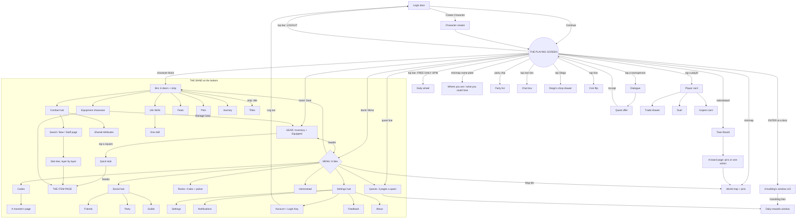

# BroTown's menus: pictures, how they connect, and an honest critique

Made 2026-11-27 from the game as it stood on the main line between 05:27 and 05:54 UTC (the last change merged was "the HUD's corner", late on 2026-11-26). Every picture is the real game, played by a test player on a phone held upright (390 x 844, an iPhone's size).

## A. How to use this

**For you (the owner), five lines:**

1. This zip holds every menu of the game as pictures, in six folders named in plain words, and this one document.
2. Open ChatGPT, start a new chat, attach the zip (or this document and the pictures of the one menu you care about), and paste the message in the box below.
3. Ask about ONE menu at a time ("Start with the Bag"). You get a numbered list of changes back.
4. Bring the list you like to a Claude session and say "build this". Part B says what a design has to keep so that it can be built.
5. The scores in part E are strict on purpose. A 6 is a good screen with things to fix, not a failure.

**The first message to paste to ChatGPT:**

```
I am the owner of BroTown, a real-time multiplayer action RPG played in a
phone's browser. The main way to play is an iPhone held upright (390 x 844
points); it is also played sideways and on a computer. I am not a programmer.

Attached: a zip of screenshots of every menu (upright phone), and one
document, READ-ME-FIRST.md. Please read the document first. It holds:
the rules any design must keep (part B), a map of how every menu connects
(part C), and for each menu what it is for, a box diagram of its regions,
the thinking behind it, a critique, a score from 1 to 10 and a list of
changes (part D).

What I want from you: better MENUS, within the rules in part B. Layout,
grouping, order, emphasis, wording. Not new features, not new pages.

How to answer:
- One menu at a time. I will name the menu.
- A numbered list of changes, the biggest win first. Each change names the
  REGION it touches, using the region names of that menu's box diagram in
  part D, and says exactly what moves, grows, shrinks, goes or is renamed,
  with sizes in px at 390 wide.
- Say where you disagree with the critique in part D, and why.
- A mock-up only when I ask for one, and then at 390 x 844 exactly.
- Never draw the player's character ("the bro") and never copy him from a
  screenshot. Use a grey box labelled "bro" in his place. Layout only.
- Do not suggest anything part D lists under "tried and dropped".
```

**What is in the zip:** 127 pictures in six folders, and this document.

| Folder | Pictures | What |
|---|---|---|
| `1-playing-screen` | 23 | the world with nothing open, the controller, a fight, a harvest, a trial of new controls |
| `2-menu-pages` | 40 | every page of the band at the bottom: the Menu, Gear, Bro and all under it, Quests, Social, Ranks, Codex, Homestead, Settings |
| `3-shops-and-buildings` | 23 | every building's window, Diego's shop, Ace's coin flip |
| `4-windows-and-popups` | 19 | talking, the quest offer, the maps, chat, other players, requests, the wheel, dying |
| `5-first-steps-and-login` | 16 | the login door, the character creator, the drawing editor, the welcome |
| `6-owner-tools` | 6 | your own Test panel, and the kit's sample page |

**What is not in it, and why:**
- **Sideways pictures.** The upright run took 26 minutes, over the 25 set for adding a second set, so upright is what is shown. Sideways the same pages sit in a band 130 tall (82 of page), one row of tiles.
- **Five screens the capture tool could not open** (part D, 2.3, 2.7 and 4.15): the item page, the stat tree with real numbers, the "where you are" window in No man's land, a duel challenge, and "Replace which pin?". They get no score.
- **Thirteen pictures of the old layout** (the old Bro card and the old three-panel Gear tab). Those screens are no longer in the game; the tool still lists them and correctly skipped them.

## B. The rules a design must keep

A design that breaks one of these cannot be built as drawn. Everything else is open.

### B1. The screens

| How it is held | Size (points) | The world | The menu band |
|---|---|---|---|
| Phone upright (the main one) | 390 x 844 | top 601 | bottom 243 (a 52 header row + a 191 page) |
| Small phone upright | 375 x 667 | top 432 | bottom 235 (48 + 187) |
| Phone sideways | 844 x 390 | top 260 | bottom 130 (48 + 82) |
| Computer | 1440 x 900 | above | the same band, centred, at most 840 wide, 243 tall |

- The game never pauses. It is multiplayer, so the world keeps running above every menu. That is why the menus live in a **band at the bottom** and the world stays in sight.
- The band is never taller than a third of the screen, and it does not grow for a page that wants more room. **A page fits 390 x 191 with no scrolling of its main actions.** (Lists may scroll; the first thing to press may not be below the fold.)
- Closed, the band folds to one 52-point row with two buttons, **Gear** and **Menu**.
- Windows that are not part of the band (a building, a townsperson talking, the world map, a player's card) open **over the world**, and each has a round close button, top right.

### B2. A finger's target

Anything you press is at least **44 x 44 points**. Text is never smaller than **11 points** (10 only for a count badge).

### B3. The kit: three weights, and what each means

The owner's rule (2026-11-26): *"Navigation buttons: Raised, beveled, prominent. Reserved for destinations and actions. Important statistics: Recessed surfaces with large numbers. No heavy beveling. Supporting information: Flat, aligned within shared containers. No individual heavy borders."*

| Weight | Looks like | Means | Never |
|---|---|---|---|
| **Raised** | a lighter, bevelled tile or button that stands up from the page | "press me": a place to go or a thing to do | used for something that does nothing |
| **Stat** | a dark, sunk well with one large number | an important number; a small arrow only if it opens something | bevelled, or made to look like a button |
| **Fact** | flat label-and-value rows sharing one sunk box | supporting information | given its own border, background or shadow |

The kit's parts: Header (Back, title, Menu, Close), Tile (a raised door: a picture and one word), Action button (five colours, below), Stat, Facts box, Two panels side by side, Progress bar, Slot (an item's square), Badge (a count or a dot), Empty state, Confirm.

### B4. Colours (the kit's named tokens, with their hex)

| Name | Hex | Used for |
|---|---|---|
| Frame (top to bottom) | #1A2E3D, #14232F, #0F1C26 | the band itself |
| Page | #14232F | the page under the header |
| Raised (top to bottom) | #294963, #223D53, #1B3243 | tiles and controls you press |
| Sunk (top to bottom) | #0A1620, #132636 | stats and fact boxes |
| Well | #0E1D29 (soft #132533, deep #09141D) | item squares, empty slots |
| Brass | #D8AA58 (light #EAC474, deep #8C6530) | selection, focus, the one main action |
| Line | #4B6275 (faint #293C4B) | hairline edges |
| Text ivory | #F1F0E9 | main words |
| Text muted | #BCC8CC | labels, secondary words |
| Text disabled | #6F8087 | what cannot be pressed |
| Text gold | #EAC474 | progression and important numbers |
| Text on an action | #141D22 | the dark label on every coloured button |
| Action gold | #E4BA68 | the routine action (Equip, Buy, Track) |
| Action green | #7FCDA2 | accept, confirm |
| Action blue | #88BBEE | guide, "show me" |
| Action red | #EE958A | destroy only (Drop, Leave, Delete) |
| Action silver | #CFD8D9 | dismiss, cancel |
| Item grade: normal, rare, elite, godly | #7E8F97, #5B99DE, #E8893A, #F0C45F | a thin edge on an item's square |
| Count badge | #B23A31 with #FFF6EC text | "3 waiting" |
| New dot | #E9C46A | "something new here" |
| Progress fill | #F1D58E to #B98B3E | bars |

Rules of colour: the painted world is the brightest thing on screen; the menus are quiet dark slate. **Gold is for progression, selection and the one main action, never a general border.** Red only destroys. A colour always means something, and nothing relies on colour alone. Contrast at least 4.5 to 1.

### B5. Type

One family everywhere: **Source Sans 3** (the owner, 2026-11-26: *"swap out the typography on all menus to be same as the 'logout' font"*). The "BroTown" wordmark is the only exception.

| Name | Size | Used for |
|---|---|---|
| Badge | 10 | a count on a badge |
| Small | 11 | the smallest label |
| Body | 12 | compact text |
| Label | 13 | buttons, panel titles, tile words |
| Value | 15 | a value |
| Title | 17 | the header's title |
| Big | 24 | a stat's large number |

Spacing steps: 2, 4, 6, 8, 12. Corner radius: band 14, tile 12, button 11, group 10, item square 8, pill fully round.

### B6. What is fixed by the game, and what a designer may change

**Fixed (do not redesign):**
- Which pages exist and what each is for (the map in part C). No new pages, no new features to fill a gap.
- The numbers shown are the server's. A design may not invent a number the game does not have (a "Combat Power" total, an online count).
- The playing screen's places: the top bar, the character block top left, the minimap top right, the controller sitting on the band, the band at the bottom.
- The header of every deep page: **Back (named for where it goes), the title, Menu, Close**, each 44 tall.
- The Menu is an equal-weight directory of eight; there is no always-on tab strip.
- No blur, no glow filters, no light theme, no boxes inside boxes, no always-running animation (they cost an iPhone its frame rate and memory).
- Menus never pause or cover the whole world on a phone.

**Open (a designer may change):**
- Layout inside a page's 390 x 191; grouping; order; what is emphasised; which weight a thing wears (within B3's meanings).
- Wording of labels, titles, empty states, and button words.
- The frame round an icon, an icon's size, where a badge sits.
- Colour, within the kit's tokens.
- Inside a building's window or a pop-up: the same freedoms, within the window's size.

### B7. How to hand a design back so it can be built

- **One menu a message.** Name it as part D names it.
- Name each region as that menu's box diagram names it, and say what happens to it: moves (from where to where), grows or shrinks (to what size in points at 390 wide), goes, is renamed (old words to new words), changes weight (raised, stat, fact).
- Give sizes in points at 390 wide, and say what happens sideways (82 points of page) only if it matters.
- Say what the first thing to look at should be, and what the one gold action is.
- A picture is welcome but the words are what gets built.

### B8. The art rule

These pictures are for **layout** advice. Never ask ChatGPT to draw the bro (the player's character) or to copy him, a townsperson, a building or an icon from a screenshot: the game's art is made another way, to its own rules. In a mock-up, a grey box with a word in it stands for any picture.

## C. The map of connections

How to read it: an arrow is a tap. "Back" in a page's header always names where it goes. **Close** (the ✕) on any band page folds the band and returns to play. **Menu** in any header jumps to the Menu's eight tiles.

### C1. As an indented tree (reads anywhere)

```
THE PLAYING SCREEN (the world, always running)
├─ Top bar
│   ├─ LOGOUT ......................... asks, then the login door
│   └─ FREE DAILY SPIN ................ the daily wheel (window)  → Spin → Keep / Double or nothing → ✕
├─ Character block (top left: face, name, level, XP bar, quest line)
│   ├─ tap the block .................. Menu ▸ Bro
│   └─ tap the quest line ............. Menu ▸ Quests (that quest)
├─ Minimap (top right)
│   ├─ tap the map .................... World map (window)  → tap ground: drop a pin → ✕
│   ├─ tap one of your pins ........... "Remove this pin?" card
│   └─ tap the name plate ............. "Where you are" window (No man's land: what you could lose)
├─ Party chip (only in a party) ....... the party list  → kick / leave (two taps) → tap its head to fold
├─ The world itself
│   ├─ tap your own bro ............... Chat box  → emotes, voice
│   ├─ tap a townsperson .............. Dialogue (window) → Next → Quest offer → Accept → "Quest accepted" banner
│   ├─ tap Diego (shopkeeper) ......... Diego's shop (a drawer on top of your bag)
│   ├─ tap Ace (gambler) .............. Coin flip (window): Gold / Items / Records
│   ├─ tap another player (in town) ... Player card → Party / Trade / Friend / Duel / Inspect / Mute / Block / Report
│   ├─ tap another player (outside) ... "Attack <name>?" → Attack / Party / Trade / Ignore
│   ├─ stand at a building's steps .... ENTER button → that building's window (list below) → ✕
│   ├─ stand at the noticeboard ....... Town Board (window) → a page → Red pin / Blue pin, or one action
│   └─ stand at a tree, rock, water ... the action button becomes the tool (chop, mine, fish)
├─ The controller (sits on the band): move stick · three weapon wells · Jump · Attack · (in a fight) Shield, Special
└─ THE BAND (bottom)
    ├─ closed: [ Gear ] [ Menu ]
    ├─ GEAR  (header: ✕ · Gear · Menu ›)
    │   ├─ Inventory panel (left): filter ▾, your gold, the bag's squares
    │   │    └─ tap a square ............ a quick look replaces the Equipped panel → Details / Equip / ⋯
    │   ├─ Equipped panel (right): nine squares in a body's shape
    │   │    └─ tap a square ............ a quick look replaces the Inventory panel → Details / Unequip
    │   └─ Details ..................... THE ITEM PAGE (one page for every item, from anywhere) → ‹ Gear
    └─ MENU  (header: ‹ Gear · Menu · ✕)   eight equal tiles, 4 x 2
        ├─ Bro ........................ six doors + one strip
        │   ├─ Combat ................. hub: Sword · Bow · Staff · Shared
        │   │   ├─ Sword / Bow / Staff . a weapon's page (level, XP, stats, points to spend)
        │   │   │   └─ tap a stat ...... the stat tree: "how is this number made?" layer by layer (up to 7 deep)
        │   │   │        └─ a worn item named in a layer → the Item page
        │   │   └─ Shared .............. Shared Attributes (Max HP, Defense, shared points)
        │   ├─ Equipment .............. the showcase: your figure + nine worn squares
        │   │   ├─ a square ............ the Item page
        │   │   └─ Manage Gear ......... GEAR
        │   ├─ Life Skills ............ the list of skills → one skill in detail
        │   ├─ Feats .................. achievements → tap a row to open it in place → wear its title
        │   ├─ Pets ................... your pets, the one out with you, the journal
        │   ├─ Journey ................ lifetime records (kills, deaths, gold, XP, duels)
        │   └─ the strip: AP → Feats · Quests → Quests · Party → Party · Guilds → Guilds · Title → Titles (Equip)
        ├─ Quests ..................... Active / Daily / Completed; a quest in three pages: now · journey · rewards
        │   └─ Daily rewards card ..... Daily rewards (window)
        ├─ Social ..................... hub of three: Friends · Party · Guilds
        ├─ Ranks ...................... four tabs (Power, Stats, Records, Skills) + a picker of boards
        │   └─ (later) tap a player .... their Character page
        ├─ Codex ...................... a card per monster → one monster's page
        ├─ Homestead .................. your farm's state (the farm itself is reached from the Feed & Seed)
        ├─ Map ........................ the World map (the same window the minimap opens)
        └─ Settings ................... hub: Settings · Notifications · Account · Feedback · About
            └─ Account ................ Log out / Switch character · your Login Key

BUILDINGS (each: stand at the steps → ENTER → its window over the world → ✕)
├─ Blacksmith ......... tabs: Smelt · Forge · Armor · Upgrade · (Amulet) · Salvage
├─ Woodworker ......... tabs: Bow · Staff · Hardened · Upgrade · Traps
├─ Gem Works .......... tabs: Cut gems · Set gems
├─ Cookhouse .......... recipes
├─ Gambling Den ....... Daily rewards (streak + free spin) and the games
├─ Feed & Seed ........ Visit Your Farm · Buy (seeds) · Deliver (orders)
├─ Land Office ........ Travel to your farm
├─ Bank ............... gold in/out · vault ⇄ bag
├─ General Store ...... the Marketplace (buy and sell orders) → a way to the Auction House
├─ Auction House ...... Market (players' listings and bids)
├─ Saloon ............. your party, find a party
├─ Post Office ........ mail, friends' messages
├─ Sheriff's Office ... the player list (duels) · the arena sign-up → Gladiator Arena (window)
├─ Guild Hall ......... the skill guilds
├─ Hotel .............. a free rest
└─ Noticeboard ........ the Town Board (above)

THINGS THAT COME TO YOU (no tap opens them)
├─ a trade request .... a drawer on the band: Open trade / Decline
├─ a duel challenge ... a card: Accept / Decline
├─ you reach a pin .... "Remove it?" Remove / Keep
├─ you die ............ a red strip under the top bar for 5 seconds, then BroTown
├─ a rare fish, a feat  a banner that fades by itself
└─ a window fails ..... "Couldn't open this": Reload / Close

BEFORE THE GAME
Login door → Continue (pick a bro) ──────────────┐
           → Create Character → the Creator ──────┴→ loading → the Welcome plate (Skip tutorial) → play
```

### C2. The same as a Mermaid diagram (paste into any Mermaid viewer)



### C3. The ways back, in one place

| You are in | The way back |
|---|---|
| Any band page | **‹ Back** (top left, named: "‹ Bro", "‹ Combat", "‹ Gear"), **Menu** (to the eight tiles), **✕** (fold the band, keep playing) |
| Gear | ✕ folds the band; "Menu ›" goes to the eight tiles |
| A quick look in Gear | tap the same square again, or the dimmed space |
| A building, the Town Board, a shop, the coin flip | the round ✕, top right of the window |
| The world map | the ✕, top right |
| Dialogue | Next to the end, or its ✕ |
| Chat box | tap the world |
| A request (trade, duel) | Decline |
| The death strip | nothing to press; it leaves after 5 seconds |

## D. Every menu: what it is for, where it leads, its boxes, the thinking, a critique, a score

How the scores were given: I looked at each picture myself, at the phone's own size. 10 is perfect. Most good screens are 6 to 8; a 9 is rare. Sizes in the box diagrams are in points at 390 wide, measured from the pictures (so within a few points). "Raised", "stat" and "fact" are the kit's three weights from part B3.

### D1. The playing screen (folder `1-playing-screen`)

#### 1.1 The playing screen at rest (the HUD) — score 7 — CHANGES TONIGHT (its top-left corner)
Pictures: `01-playing-screen.jpg`, `02-character-block.jpg`, `03-band-open.jpg`, `04-band-closed.jpg`, `05-band-closed-gear-and-menu.jpg`, `06-moving.jpg`, `09-no-mans-land.jpg`, `10-outlaw.jpg`

**What it is for:** playing. Everything else in the game is reached from here.

**Where you come from / where the buttons lead:** see the map, part C. LOGOUT → asks → the login door. FREE DAILY SPIN → the daily wheel. The character block → Bro. The quest line under it → that quest. The minimap → the world map; its name plate → "where you are". Gear and Menu → the band's two workspaces.

```
+--------------------------------------+
| [LOGOUT]    BroTown    [FREE DAILY   |  top bar, y 0-52
|  90x38      wordmark     SPIN] 100x30|
+-------------------+------------------+
| face | name  Lv 1 |   minimap        |  character block 184 x 52 at y 62-114
|      | Sword 0/280|   132 x 100      |  minimap box 132 wide at y 52-150
+-------------------+   name plate     |  plate 132 x 34: "BroTown / safe"
| quest line 180x26 |   (red words in  |  quest line y 120-146 (only with a quest)
+-------------------+    danger)       |
|                                      |
|          THE WORLD (never pauses)    |  clear world: about y 150-690
|                                      |
| +--------+                 o  o  o   |  controller shell, y 688-790 (131 tall)
| | stick  |               (Jump)(Atk) |  stick 83; small wells 37; Jump 60; Attack 65
| +--------+ (w1)(w2)(w3)              |  three weapon wells, 40 each
+-------------------+------------------+
| [ Gear ]          | [ Menu ] dot     |  folded band, y 792-844, two buttons 190 x 44
+-------------------+------------------+
With the band OPEN: the band takes y 601-844 and the controller rides up on top of it,
so the clear world shrinks to about y 150-490.
```

**The thinking behind it:** the painted world is the game, so the interface is a thin frame round it. The owner (2026-11-26): *"the upper HUD tells you who you are and how you're progressing, while the bottom dashboard lets you manage your character."* Where you are and whether you are safe lives on the minimap's plate because the owner asked for it off the top bar. The controller is one shell that sits on the band because the first design *"is too large and doesn't connect in a seamless way to the dashboard."* The pull handle went (*"It has an open button making pull handle redundant"*). Tried and dropped: health and mana in the top-left block; a place name in the top bar's centre; gold on the top bar; always-on chat and emote buttons; words on the touch buttons; a band taller than a third of the screen.

**Critique:** The world really is the brightest and biggest thing, and the frame is quiet. Who you are (top left) and where you are (top right) are found at a glance. What does not work:
- **The best corner of the top bar is LOGOUT**, the action a player wants least often, in a 90-wide button where a thumb can brush it. The centre is a logo that does nothing. The top bar spends 52 points of height on a logo, a rare action and one daily button.
- **The quest line is cut off** ("Into the Blue · 0/4 · Bring …"): the one line that says what to do next loses its end, and it is 26 tall, under a finger's 44.
- **Empty wells.** A new player sees two empty weapon wells and two empty small wells on the controller: four dark circles that do nothing.
- **Danger is small.** "No man's land 1" and "Outlaw · 18 min" are about 10-point red words on a dark plate; the most important warning in the game is the smallest text on the screen.
- The Menu's "something is waiting" dot is 6 across in the button's far corner; it does not say what is waiting.
- With the band open the world is cut to about 340 points of clear height, because the controller rides on top of the band. That is the price of never pausing; it is fair, but it means the band's pages must be quick to read.

**To make it a 10:**
1. Move LOGOUT off the top bar (it is already under Menu, Settings, Account). Put the quest line there instead, full width of the bar's centre and left: "Into the Blue 0/4 · Bring 4 Slime Remains", 44 tall, never cut.
2. Until then: let the quest line run the block's full 184 and wrap to two lines rather than cut; make its tap box 44 tall.
3. Draw an empty well only once its thing exists (a second weapon, a skill); before that the shell shows fewer wells.
4. In danger, colour the whole name plate (a red plate with ivory 13-point words), not just 10-point red words.
5. Put a count on Menu's dot when it is a number ("2"), as Bro's points already do.
6. Shrink the wordmark in the top bar to 28 tall, or drop the bar to 44.

#### 1.2 The controller, at rest and in a fight — score 7
Pictures: `06-moving.jpg`, `07-weapon-wells.jpg`, `08-controller-in-a-fight.jpg`, `16-fight.jpg`, `17-locked-on-a-monster.jpg`

**What it is for:** moving, switching weapon, jumping, attacking, blocking, the special.

**Where the buttons lead:** nowhere; they act. A weapon well puts that weapon in hand (the one in hand wears a gold ring).

```
AT REST                                   IN A FIGHT (the right lobe grows taller)
+----------+               (o)(o)(o)      +----------+                  (special)
|  stick   |              (Jump)(Attack)  |  stick   |            (o)(Jump)(star)
|   83     | (w1)(w2)(w3)   60     65     |          | (w1)(w2)(w3) (Shield)(Attack)
+----------+   40 each                    +----------+                 65      65
```

**The thinking behind it:** one shell joined to the band; buttons are pictures in gold rings, no words; a control shows only when it can act (the owner: *"I just don't want the screen to be too busy with text"*). Sprint is the stick pushed past its edge, with no button. Tried and dropped: a two-grip controller ("too large"), a Sprint button, timing bars and hold rings, tap-to-target.

**Critique:** It looks like one object and it is clearly the game's own. In a fight the big left button changes from Jump to Shield and Jump shrinks to a small well: the thumb's most-used spot changes meaning at the moment of most stress. Small wells are 37, under 44 (their touch boxes are said to be 44, which the picture cannot show). The purple skateboard well is never explained on screen. At rest two of the three small wells are empty circles.

**To make it a 10:**
1. Keep Jump where it is in a fight; bring Shield in on the arc beside it rather than swapping them.
2. Draw only wells that hold something.
3. The first time a new well fills (the skateboard, the special), name it once with a small word that fades.

#### 1.3 Things you walk up to: a townsperson, a door, a tree — score 6
Pictures: `11-near-a-townsperson.jpg`, `12-at-a-door-enter.jpg`, `13-at-a-tree.jpg`, `14-chopping.jpg`, `15-chop-gesture.jpg`

**What it is for:** telling you that the thing in front of you can be used, and how.

**Where the buttons lead:** a tap on a townsperson → dialogue. ENTER at a door → the building's window. At a tree, rock or water the action button becomes the tool → the harvest → a short gesture.

```
Townsperson:  name plate over the head + one mark (gold "!" quest, grey "?" waiting, tick, talk bubble)
Door:         a dark pill on the door, about 100 x 34:  [E] ENTER / BANK      and a door picture in the action well
Tree:         "Pine Log Lv 1" plate over it; the action well shows the axe
Chopping:     a green count over the tree "7/10"; the well turns red CHOP; a hint bubble above the controller
```

**The thinking behind it:** nobody walks into a building (*"Have it open up as backgrounds behind the different buildings menus instead of literally going into a building"*); talking and entering are *"always two different things"*; the harvest is a motion on the button, not a mid-screen bar.

**Critique:** The marks over heads are clear. Two things in the pictures are wrong on a phone: **the ENTER pill shows a keyboard "E" key** on a touch screen, and it is about 34 tall, under 44; and **the chop hint ("Now ... side to side!") is half covered by the skateboard well**, so the one sentence that teaches the gesture cannot be read. The ENTER pill sits on the building's own sign and hides it ("BANK" over "BANK").

**To make it a 10:**
1. On a phone the pill reads "ENTER BANK" with no key cap, 44 tall, placed under the sign, not on it.
2. Move the harvest hint above the whole controller (its bottom edge 8 above the shell).
3. Give the action well a one-word caption the first three times it changes (ENTER, CHOP, TALK).

#### 1.4 The two-button trial — not scored
Pictures: `18-trial-two-buttons.jpg` to `23-trial-two-buttons-at-a-townsperson.jpg`

A trial of a different control layout (Attack and Jump always, Block, Special and Charge appearing when a monster is near) kept beside today's until the owner has played both. It is not what players have today, so it has no score. One look says it is calmer at rest than today's controller.

### D2. The menu's pages (folder `2-menu-pages`)

Every page here lives in the band: a **header row 52 tall** (Back at the left, the title in the middle, Menu and ✕ at the right, each 44 tall) over a **page of 390 x 191**. The diagrams below show the page under the header unless they say otherwise.

A note on the pictures: several were opened by name by the test player, so their Back button reads "‹ World" or "‹ Menu" where a real player coming through Bro would read "‹ Bro". That is the test, not a fault.

#### 2.1 The Menu (the directory of eight) — score 8
Pictures: `01-menu.jpg`

**What it is for:** the one place every page is reached from.

**Where you come from / where the buttons lead:** the band's Menu button, or "Menu" in any header. ‹ Gear → Gear. ✕ → fold the band. Tiles: Bro, Quests, Social (hub), Ranks, Codex, Homestead, Map (opens the World map window, not a page), Settings (hub).

```
[‹ Gear]            Menu                 [✕]     header 52
+--------+--------+--------+--------+
|  Bro   | Quests | Social | Ranks  |            8 raised tiles, each about 90 x 88
+--------+--------+--------+--------+            picture about 44, one word 13 bold
| Codex  |Homestead|  Map  |Settings (11)        red count badge on a tile's corner
+--------+--------+--------+--------+
```

**The thinking behind it:** eight equal tiles so none looks more important (*"an equal-weight directory, not a prioritized list"*); it replaced a row of five buttons plus a "More" page of fifteen. Tried and dropped: six buttons, then five; swipes on the band; a pull handle; captions under tiles.

**Critique:** The clearest screen in the game: one glance, eight big targets, plain words. Three things hold it back. **Bro's picture is a magnifying glass**, which everywhere else in software means "search". **Homestead** gets one of eight prime tiles and leads to a page with nothing to do (2.21). **The red "11" on Settings** is really unread notifications; a player hunting for the 11 opens Settings and finds a hub, then another Settings tile also wearing 11. In the picture "‹ Gear" wears a gold glow as if selected, which reads as "you are in Gear".

**To make it a 10:**
1. Bro's tile shows the player's own face (the same portrait as the top-left block).
2. Replace Homestead's tile with **Notifications** (it then carries its own count) until the farm can be managed from the band; Homestead moves under Bro or the Feed & Seed.
3. The count sits only on the tile that holds the thing counted.
4. No glow on Back unless a guide arrow is pointing at it.

#### 2.2 Gear (your bag and what you wear) — score 7
Pictures: `02-gear.jpg`, `03-gear-with-first-arrow.jpg`, `04-gear-bag.jpg`, `05-gear-quick-look-mystery-piece.jpg`

**What it is for:** seeing what you carry and what you wear, and moving a piece between them.

**Where you come from / where the buttons lead:** the band's Gear button; Manage Gear on Equipment. ✕ (top LEFT here) → fold the band. Menu › → the Menu. The filter pill → a list of kinds. A bag square → a quick look in the Equipped panel's place (the item's picture, name, where it is, ✕, **Details** → the item page, and one gold action: Equip, Reveal). A worn square → the same look in the Inventory's place (Details, Unequip).

```
[✕]                 Gear             [Menu ›]    header 52
+-------------------+-------------------+
| INVENTORY [All▾] (coins) 2,550       | EQUIPPED          |   label row 24
| [sq][sq][sq]      | [sword][cape ][shield]|   each panel about 189 x 172
| [sq][sq][sq]      | [bow  ][chest][amulet]|   squares about 46, 3 x 3
| [sq][sq][sq] ...  | [staff][legs ][gem   ]|   the bag scrolls; Equipped is a body's shape
+-------------------+-------------------+
Quick look (replaces the opposite panel):
| picture 40 | name / "In your bag" / grade      [✕] |
|                                                    |
| [ Details ] silver        [ Reveal / Equip ] gold  |   two buttons about 90 x 44
```

**The thinking behind it:** the owner's rule: *"Keep the source panel in its original location during quick inspection; the opposite panel is replaced with the summary."* Equipped is shaped like a body and the bag is a packed grid, so the two read apart without colour. Worn things are not also in the bag. Tried and dropped: a separate Bag page, a middle card with tabs, a "Combat Power" total, Sell in this tab, squares of two sizes.

**Critique:** The two-panel idea is strong and the quick look is tidy: one silver, one gold, nothing else. Problems seen: **the ✕ is at the top left here and at the top right on every other page**, so the thumb learns two places for "close". The **filter pill "All" is about 44 x 22**, half a finger tall. **Nothing says the bag scrolls**: nine squares show, with no count, no edge of a tenth. Empty worn squares are dark ghosts on dark; a new player cannot tell "empty sword slot" from decoration. The first-quest arrow ("Tap to equip") lands on top of the filter pill and the coins. The coins are an important number but sit as a small chip in a label row.

**To make it a 10:**
1. ✕ at the top right, as everywhere; "Menu ›" moves left of it.
2. Filter pill 44 tall and it names itself: "All ▾".
3. Show half a fourth row of the bag (or a count "9 of 23") so scrolling is obvious.
4. Empty worn squares carry a small word under the ghost on first sight ("Sword", "Cape") or a brighter ghost (the muted text colour, not the well colour).
5. Coins as a stat at the right end of the header row of the Inventory panel, 15-point gold.

#### 2.3 The item page — NOT SCORED (no picture)
The one page that describes any item, opened by Details from Gear, Equipment, the Codex and the stat tree. The test player never wore the sword the test presses, so the tool could not open it, twice. From its notes: header [‹ where you came from] [the item's kind] [Menu] [✕]; the picture in its grade's outline with stars; the name, grade and "Worn"; up to six facts three across; actions from one list, an unavailable one shown with its reason. It needs a picture before anyone redesigns it.

#### 2.4 Bro (your character's page) — score 6
Pictures: `06-bro.jpg`

**What it is for:** the front page of everything about your character.

**Where you come from / where the buttons lead:** Menu's Bro tile, or a tap on the top-left character block. Six doors: Combat (2.5), Equipment (2.9), Life Skills (2.10), Feats (2.11), Pets (2.12), Journey (2.13). The strip: AP → Feats; Quests done → Quests; Clan → Party; Guilds → Guilds; Title → Titles (2.14).

```
[‹ Menu]            Bro                  [✕]
+------------+------------+------------+
|  Combat    | Equipment  | Life Skills|      6 raised tiles, each about 125 x 66
+------------+------------+------------+      picture about 30, word 13 bold
|  Feats     |   Pets     |  Journey   |
+------------+------------+------------+
| AP 0 › | Quests done 0 › | Clan No clan › | Guilds Skill guilds › | Title No title equipped › |
  one sunk strip, about 46 tall, five facts, each a door
```

**The thinking behind it:** the owner, 2026-11-26: *"I'd turn the Bro menu into a unified character management dashboard."* Your face, name and level moved to the top-left block, so this page repeats none of it. Dropped: a separate Character landing, a large portrait and combat banner, the anvil picture for Combat.

**Critique:** The six doors are clear and equal. **The strip is the weak part.** Five facts in 390 points leaves about 75 each, so "Skill guilds" and "No title equipped" wrap to two and three lines and the last line touches or is cut by the band's bottom edge. The labels are grey 11-point, the values 13, the arrows tiny: five doors that look like a footnote. To make room for it the tiles' pictures shrank to about 30 points, so the doors, the page's point, got smaller. "Guilds: Skill guilds" says nothing. For a new player four of the five read 0, "No clan", "No title".

**To make it a 10:**
1. Strip down to three stats that are numbers: **AP**, **Quests done**, **Title**. Clan and Guilds live under Social, where their pages are.
2. Each of the three is a proper stat: a 15-point value over an 11-point label, 44 tall, never wrapping ("No title" not "No title equipped").
3. Give the freed height back to the tiles: 125 x 72, picture 40.
4. If Guilds stays, show a number ("Guilds 2 of 10").

#### 2.5 Combat (the hub) — score 8
Pictures: `07-combat.jpg`

**What it is for:** your three weapon skills at a glance, and the door to each.

**Where you come from / where the buttons lead:** Bro's Combat door. Sword, Bow, Staff → that weapon's page (2.6). Shared Attributes → 2.8. ‹ Bro, Menu, ✕.

```
[‹ Bro]          Combat          [Menu][✕]
+-----------+-----------+-----------+
|  picture  |  picture  |  picture  |     3 raised tiles, each about 122 x 132
|   Sword   |    Bow    |   Staff   |     picture 48, name 13, level 24 gold,
|   Lv 1    |   Lv 1    |   Lv 1    |     a thin XP bar under it
|  ───────  |  ───────  |  ───────  |
+-----------+-----------+-----------+
| (bust)  Shared Attributes                 |     one raised row, about 375 x 40
```

**The thinking behind it:** three weapons in a row, each with its level large, Shared below because it belongs to none of them. A count shows on a tile only while points wait. Dropped: "Melee" and "Magic" as names, a left-side attributes column.

**Critique:** The best-composed page in the band: one glance gives three levels, the gold numbers are the first thing the eye lands on, and every target is huge. The Shared row is squeezed against the bottom edge at about 40 tall with almost no margin, and it has no number on it while the three above each do. The XP bars are so thin and dark that at 0 they read as an underline.

**To make it a 10:**
1. Shared row 44 tall with 6 of margin under it; give it its number ("Max HP 50 · Defense 0%").
2. XP bar 4 tall with a visible track (the faint line colour), so an empty bar still reads as a bar.

#### 2.6 A weapon's page (Sword, Bow, Staff share one layout) — score 6
Pictures: `08-combat-sword.jpg`

**What it is for:** one weapon skill: its level, what it does in a fight, and where its points go.

**Where you come from / where the buttons lead:** the hub's Sword, Bow or Staff. The DPS stat → the stat tree (2.7). An attribute tile → a preview of what one more point gives, and spending it. ‹ Combat, Menu, ✕.

```
[‹ Combat]        Sword          [Menu][✕]
| Lv 1 | Each Sword level gives 3 Sword points      0 / 280 XP |   level row 18, words over a thin bar
| [ — DPS › ] stat 100 x 44 | Damage —   Attack speed —        |   strip 44: one stat + four facts
|                           | Crit chance 1.0%   Range —       |
| Attributes                         0 Sword points to spend   |   line 14
| [Range 0 placed][Power 0 placed][Speed 0 placed]             |   six raised tiles, 3 x 2,
| [Luck  0 placed][Special 0 placed][Element 0 placed]         |   each about 125 x 45, coloured icon
```

**The thinking behind it:** the owner, 2026-11-26: *"Eliminate the left-side Attributes column, consolidate the combat statistics into one summary strip, and give the six attributes a full-width three-by-two grid."* Dropped: plus buttons, a weapon picker on the page, a count drawn at zero.

**Critique:** The structure is right: level, then what it does, then where points go. In the picture the weapon is not in hand, so **DPS, Damage, Attack speed and Range are all dashes and nothing on the page says why**; a new player reads a broken page. The level row packs three things into 18 points of height with words laid over the bar, the hardest line in the band to read. The six attribute tiles are the biggest, brightest things on the page even when there are 0 points to spend, so the page shouts about the thing you cannot do. "0 placed" six times is noise.

**To make it a 10:**
1. When the weapon is not in hand, one line in the strip says so with a door: "Sword not in hand · Equip" (to Gear).
2. Level row 24 tall: "Lv 1" and "0 / 280 XP" on the row, the bar under them, the "3 points a level" sentence moved to the attributes line.
3. With 0 points to spend, attribute tiles drop to the flat fact weight (still tappable for the preview); they rise to raised tiles with a gold "+" only when points wait.
4. Show a number only where it is not zero ("Power 3"); a bare name where nothing is placed.

#### 2.7 The stat tree ("how is this number made?") — NOT SCORED (pictures show only its empty message)
Pictures: `09-combat-stat-tree-empty.jpg`, `10-combat-stat-tree-deep-empty.jpg`

Both pictures show one line, "No Sword in hand: no DPS to explain.", on an otherwise empty page, because the test player held the bow. The tree itself (a headline number, a line saying how its rows join, and rows you can open layer by layer, up to seven deep) was not seen, so it has no score. What the empty state does show: the title is just "DPS" and Back reads "‹ DPS" at the second layer, so two layers down the header says "‹ DPS · DPS"; and the empty page offers no way forward (no "Equip a sword" button).

#### 2.8 Shared Attributes — score 6
Pictures: `11-combat-shared-attributes.jpg`

**What it is for:** the stats every weapon shares (health, defence, mana, stamina, dodge, speed, resist) and their points.

**Where you come from / where the buttons lead:** the hub's Shared row. Max HP stat → an explanation. An attribute tile → its preview and spend.

```
| [ 50 Max HP › ] stat 187 x 44      | Defense            0% |   strip 44
| Attributes                         0 shared points to spend |
| [Max HP][Defense][Max Mana][Stamina]                        |   7 raised tiles, 4 + 3,
| [Dodge][Move speed][Resist][ empty ]                        |   each about 94 x 56, no pictures
```

**The thinking behind it:** the same template as a weapon's page; *"Shared points/EHP belong to shared screen."* No made-up "effective health" number.

**Critique:** Reads at a glance and "50 Max HP" is a proper stat. But it is not quite the weapon page's twin: the weapon's attributes have coloured pictures and sit 3 x 2; these have none and sit 4 + 3 with a hole at the end. Max HP and Defense each appear twice (as a stat or fact above, and as a tile below) with nothing saying the top is "what you have" and the bottom is "where points go". Mana and Stamina, which the player sees as bars in a fight, have no number here.

**To make it a 10:**
1. Top strip shows all four you can feel: HP, Defense, Mana, Stamina as four stats in one row.
2. Tiles get the same picture treatment as a weapon's, or neither page has pictures.
3. Seven tiles as 4 + 3 centred, or add the eighth cell as the points count ("0 to spend").

#### 2.9 Equipment (the showcase) — score 5
Pictures: `12-equipment.jpg`, `13-equipment-older-window.jpg`

**What it is for:** showing off what your character wears.

**Where you come from / where the buttons lead:** Bro's Equipment door. A worn square → the item page. Manage Gear → Gear. ‹ Bro, Menu, ✕.

```
[‹ Bro]        Equipment         [Menu][✕]
|                    | [sword][cape ][shield] |   nine squares about 50, body shape,
|   figure 40 x 90   | [bow  ][chest][amulet] |   the same nine as Gear's right panel
|  [ Manage Gear ]   | [staff][legs ][gem   ] |
|   gold 100 x 44    |                        |   left half: about 190 x 190, mostly empty
```

**The thinking behind it:** a read-only showcase under Bro (it is also what another player would see of you), with Gear as the place to change things.

**Critique:** It is Gear's right-hand panel again, with a small figure beside it. The left half is nearly empty: the figure is about 40 points wide in a 190-wide space. The page's one gold button exists to take you to the page you probably wanted. The showcase says nothing Gear does not: no total, no set, no "what this gives me". The second picture is an **older Equipment window that is still in the game** (reached by name): gold capital title, red, yellow and blue HP, EN and MP bars, "DAMAGE 4.09 DPS ▶". It is the only place the three bars' numbers are written, and it speaks a different visual language from everything round it.

**To make it a 10:**
1. Make it a real showcase: the figure large (about 120 x 170) in the middle, the nine squares round it in the body's shape (left column, right column), as a paper doll.
2. Under the figure, three stats the gear gives: DPS, Defense, Max HP.
3. Manage Gear becomes a plain raised button, not gold; nothing here is "the main action".
4. Retire the older window; move its HP, EN and MP numbers into Shared Attributes (2.8).

#### 2.10 Life Skills — score 7 — CHANGES TONIGHT
Pictures: `14-life-skills.jpg`, `15-life-skill-detail.jpg`

**What it is for:** your ten gathering and crafting skills and their levels; one skill's details.

**Where you come from / where the buttons lead:** Bro's Life Skills door. A tile → that skill's detail in the same page; "‹ All skills" → back to the ten.

```
List:   10 tiles, 5 x 2, each a coloured square about 52 with its picture,
        a "Lv 1" pill on its corner, a thin XP bar inside, the name under it (11 to 12 point)
Detail: ‹ All skills (a word, about 80 x 20)
        picture 44 | Mining / Level 1
        XP bar, "0 / 1000 XP · 1000 XP to Lv 2"
        rows (fact weight): EACH HIT ... Always 1 | AT LV 2 ... 1 (90%) · 2 (10%) | FULL XP ... (scrolls)
```

**The thinking behind it:** the owner: *"Make the lifeskills menu look more like iPhone apps instead of elongated pills."* A fixed order so each keeps its place. Dropped: group headings, "coming soon" cells, Track and Find Trainer buttons nothing backed.

**Critique:** The list is one of the better pages: ten things, all visible, each with its level, nothing to scroll. The tiles are a different family from the rest of the band (coloured app squares, where every other page uses the slate raised tile), and the names are the smallest text in the menu. In the detail, "‹ All skills" is a bare word about 20 tall sitting under a header that already has a Back button: two backs, the nearer one too small to hit. The detail scrolls, and its most useful line (what the next level unlocks) is below the fold.

**To make it a 10:**
1. The header's Back does the job ("‹ Life Skills"); remove the small word.
2. Detail in one page: level and bar on the first row, then "Next: Lv 2 unlocks ..." as the first fact.
3. Names at 12 points minimum; "Woodcutting" and "Woodworking" must both fit without shrinking.

#### 2.11 Feats (achievements) — score 5 — CHANGES TONIGHT
Pictures: `16-feats.jpg`

**What it is for:** the 33 achievements, which you have, and choosing one as your title.

**Where you come from / where the buttons lead:** Bro's Feats door; the AP on Bro's strip. A row opens in place. A row you have earned → wear it as your title.

```
[‹ ]        Achievements         [Menu][✕]
|                                      0 AP   2/33 |   right-aligned, 13 point
|              No title yet: tap one you have       |   right-aligned, runs to the edge
| (All) (Common) (Rare) (Super-rare)                |   chips about 30 tall
| picture | First Blood            | (10 AP)        |   rows 48 tall; two rows fit
|         | Defeat your first monster | Nov 27      |
| picture | Blooded ...                             |
```

**The thinking behind it:** points for completing the game, on a page under Bro; super-rares shown, not hidden, so players know what to chase.

**Critique:** **The page has three names**: the tile says Feats, the header says Achievements, the points are AP. Header, summary, hint and chips take 100 of the 191 points, so **two rows of 33 show**: sixteen screens of scrolling. The summary sits right-aligned in grey as if it were a footnote, though "2 of 33" is the page's headline. The chips are about 30 tall. In the picture the total reads **0 AP beside two earned 10 AP feats**, and Titles (2.14) says "0 of 33 earned"; either the test player's data or a real mismatch, worth checking.

**To make it a 10:**
1. One name everywhere: "Feats" in the header.
2. One summary row, 28 tall: "2 of 33 · 20 AP" as a stat at the left, the filter as one pill at the right ("All ▾").
3. Rows 40 tall, so four show; earned ones first.
4. The title hint moves onto earned rows as a small "Wear as title" action.

#### 2.12 Pets — score 5 — CHANGES TONIGHT
Pictures: `17-pets.jpg`

**What it is for:** the pets you have caught, the one out with you, and room for more.

**Where you come from / where the buttons lead:** Bro's Pets door. More room → buys space in the Pet House for gold.

```
| paw | 0/30 in your collection                     |   summary, two lines
|     | No pet out with you · Trapping 1            |
| "No pets yet. Make box traps at the Woodworker,   |   a sunk box, four lines of 13-point text
|  target a monster ..., tap TRAP, then kill it..." |
| (house) Pet House: room for 10 more pets,         |   a row with a dark button "More room"
|         1,000 gold            [ More room ]       |   (cut by the bottom edge)
```

**Critique:** For a player with no pets this is a page of instructions: a four-line paragraph is the biggest thing on it. The only button sells more room to someone who has no pets to put in it, and it is cut by the band's edge. The price is inside a sentence, not on the button. Nothing shows what a pet looks like, which is the reason to want one.

**To make it a 10:**
1. Empty state as three steps with pictures in a row: "1 Make a trap (Woodworker) · 2 Tap TRAP on a monster · 3 Defeat it".
2. Show the thirty kinds as silhouettes in a grid (as the Codex does) so there is something to collect.
3. "More room" only appears when the house is nearly full, with its price on the button: "More room · 1,000".

#### 2.13 Journey (lifetime records) — score 7
Pictures: `18-journey.jpg`

**What it is for:** your lifetime numbers.

```
| [0 KILLS]        [0 DEATHS]      [0 LIFETIME GOLD]  |   six stats, 3 x 2, each about 122 x 50,
| [0 LIFETIME XP]  [0 DUELS WON]   [— DEEPEST ZONE]   |   picture 24 + number 15 + label 11 caps
| ACCURACY                                            |
| [SWORD — no shots yet][BOW — ...][STAFF — ...]      |   three more (cut by the bottom edge)
```

**Critique:** A clean, even grid in the right weight (sunk stats, nothing pretending to be a button), and the page's purpose is plain. The numbers are 15-point where the kit's stat number is 24, so the "important number" is no bigger than its label is wide. The accuracy row is cut by the bottom edge. Nothing here can be tapped, which is honest, but it also means the page is a dead end.

**To make it a 10:**
1. Numbers at 20 to 24 points, labels under them.
2. Fit all nine in the page (3 x 3 at 56 tall) so nothing is cut.
3. Kills → the Codex; Duels won → Ranks: let two of them be doors.

#### 2.14 Titles — score 6
Pictures: `19-titles.jpg`

**What it is for:** choosing which earned title shows under your name.

```
| Your title   No title equipped            0 of 33 earned |   one fact row, 30 tall
| (medal) No titles yet                                    |   an empty-state box, 70 tall
|         A title is the name of an achievement you have   |
|         earned. Earn one in Feats.                       |
|                    (the lower half is empty)             |
```

**Critique:** Honest and readable, and the empty state explains itself. But it says "Earn one in Feats" and gives no button to Feats. A title is just a feat's name, so this is a second page for something Feats could do on its own rows; a player has to learn that two pages hold one list.

**To make it a 10:**
1. Fold it into Feats: "Wear as title" on an earned row; the strip's Title entry opens Feats filtered to earned.
2. If it stays: a raised "Go to Feats" button in the empty state.

#### 2.15 Another player's Character — score 5
Pictures: `20-another-players-character.jpg`

**What it is for:** another player's public page (nothing opens it yet; Ranks will).

```
| face 80 x 80 | Reviewer                | [Titles] | [Sunburn] |   identity row 80 tall
|              | No title equipped       |  raised  |   ???     |
|              | [Combat Lv         1]   |          |           |
| [Sword Lv 1] [Bow Lv 1] [Staff Lv 1]                           |   three raised, 122 x 44
| [Clan No clan][Guilds Skill guilds][AP 0][Quests done 0]       |   four boxes, 44 tall
```

**Critique:** The order is sensible (who, how strong, what they belong to). Two faults stand out in the picture: **the face is the magnifying-glass icon**, not a face, and **a box reading only "Sunburn"** sits at the top right with no label saying what it is. The bottom four are facts but each has its own raised-looking box, against the kit's rule that facts share one container. Everything on the page is the same size, so nothing leads.

**To make it a 10:**
1. A real portrait; if none, a silhouette.
2. Label or remove the unlabelled box.
3. Combat level as the one large number beside the name (24-point gold).
4. Clan, Guilds, AP and Quests as one flat facts box.

#### 2.16 Quests — score 8 — CHANGES TONIGHT
Pictures: `21-quests.jpg`, `22-quests-journey.jpg`, `23-quests-rewards.jpg`, `24-quest-opened-by-name.jpg`

**What it is for:** what you are doing now, where, and what it pays.

**Where you come from / where the buttons lead:** Menu's Quests tile; the quest line on the playing screen. Active / Daily / Completed switch lists. Three dots → the quest's three pages (now, journey, rewards). Track → pins it on the playing screen. Map → the World map at that place. There is no Accept or Hand in here, on purpose: both happen in the world.

```
| (Active 1)(Daily)(✓ Completed)            ● ○ ○ |   tabs 32 tall + three page dots (about 10)
| face 40 | Into the Blue                 [☆ Track] |   head 44; Track about 50 x 44
|         | IN PROGRESS · Mayor Bro                 |
| (slime) Bring 4 Slime Remains from the...    0/4  |   objective 40, gold 15-point words + bar
| (pin) Earth Forest, west of BroTown       [Map]   |   place row 32; Map about 48 x 24
| REWARDS | 25 gold | +5 AP | Pine Bow | Pine Staff |   reward tiles 36 tall
Page 2: a line of steps (done green with a tick, now gold, to come grey)
Page 3: reward tiles large, then NEXT QUEST with its giver, place and a lock
```

**The thinking behind it:** the owner, 2026-11-25: *"I want it so that it shows 'pages' where all the information needs to be displayed together (instead of scrolling little by little)."* Accept and Turn in were removed from the menu because they skipped the Mayor's handover.

**Critique:** The best information page in the game. One look answers "what, how many, where, for what". The gold objective is clearly the first thing to read. What is weak: the **three dots are the only way between pages** and they are about 10 points across in a corner; nothing says "there is more". **Map** is about 24 tall. Tabs are about 32 tall. "IN PROGRESS" in blue capitals competes with the quest's name.

**To make it a 10:**
1. Replace the dots with three words in the header row's place: "Now · Journey · Rewards" (44 tall), or let a sideways swipe change page and keep the dots as a mark only.
2. Map button 44 tall, at the right of the objective row.
3. Tabs 44 tall or, with one quest, hide Daily and Completed behind one "All quests" door.

#### 2.17 Social (the hub of three) — score 5
Pictures: `25-social.jpg`

**What it is for:** choosing between Friends, Party and Guilds.

```
| [ Friends ] [ Party ] [ Guilds ] |   three raised tiles, each about 125 x 185: a 44 picture and one word
```

**Critique:** Three tiles 185 points tall holding a small picture and one word: the page is 90 percent empty button. It tells you nothing (no "2 friends online", no "in a party of 3") and costs a tap every time. Its title, "Social", is also the title of the Friends page under it.

**To make it a 10:**
1. Each tile carries its one live fact under the word: "0 online", "Not in a party", "2 guilds".
2. Or remove the hub: Menu's Social tile opens Friends with Party and Guilds as two doors on its top row.

#### 2.18 Friends — score 6
Pictures: `26-friends.jpg`

```
| 0 ONLINE                    [+ Add Friend] [•••] |   row 44
| [ Friends (0) ]        [ Requests (0) ]          |   two tabs, 40 tall
| (icon) No friends yet                            |   empty state, helpful two lines
|        Tap another player anywhere in BroTown... |
```

**Critique:** Clear and the empty state teaches the right thing. The header says "Social" on a page that is Friends. "•••" hides something with no hint of what. Add Friend is a plain dark button although it is the page's one action.

**To make it a 10:** title it "Friends"; make Add Friend the gold action; name what "•••" holds or put its one item on the row.

#### 2.19 Ranks (the leaderboards) — score 5 — CHANGES TONIGHT
Pictures: `27-ranks.jpg`, `28-ranks-a-skill.jpg`, `29-ranks-picker.jpg`, `30-ranks-daily-spin.jpg`, `31-ranks-biggest-fish.jpg`

**What it is for:** where you stand against other players, on many boards.

**Where you come from / where the buttons lead:** Menu's Ranks tile; Records on the fish weigh-in card. Four tabs (Power, Stats, Records, Skills); the picker → a list of that tab's boards; on some boards a third row of choices (Biggest wins / losses; a kind of fish).

```
[‹ ]         Leaderboards        [Menu][✕]
| (Power)(Stats)(Records)(Skills)                 |   four tabs, about 88 x 26
| [Overall ▾]   ❦ RANKS ❦   (All-time leaderboard) |   picker 140 x 24 + an ornament + a label that looks like a button
| #  Player              ?   Lv   Power            |   column heads 18
| ... rows 44 tall (about one and a half fit) ...  |
| face | Reviewer · You | Rank #— | Lv — | —      |   your row, pinned, gold outline, 28 tall
```

**The thinking behind it:** the owner's own mock-up (2026-11-25): tabs with pictures, a picker, your row pinned. Dropped: side lists, a podium, pages as well as scrolling.

**Critique:** **Two names again** (tile "Ranks", header "Leaderboards"). Before any rank is shown the page spends its height on four tabs, a picker, a "RANKS" ornament, a label and column heads: about 100 of 191 points, and on fish boards a third row of chips takes more, leaving **one row of actual ranking**. The tabs are about 26 tall and the picker 24, both well under a finger. "All-time leaderboard" is drawn as a pill and looks pressable but is not. The #1 row on the fish board is a heavy gold bar (going tonight, by the owner's word). On the Daily spin board the empty state is a trophy with no words.

**To make it a 10:**
1. Header says "Ranks".
2. One control row, 44 tall: the four tabs as pictures only (44 x 44 each) at the left, the picker ("Overall ▾") filling the rest. Remove the ornament and the "All-time" pill.
3. Rows 36 tall so three show above your pinned row.
4. Third-row choices (fish kinds, wins/losses) move into the picker's list.
5. Every empty board says a sentence ("Nobody has spun today").

#### 2.20 Codex — score 6 — CHANGES TONIGHT
Pictures: `32-codex.jpg`, `33-codex-a-monster.jpg`

**What it is for:** the monsters you have met; one monster's drops, facts and places.

```
List:    MONSTERS OF THE WORLD                  0 of 9 met
         nine cards, 3 x 3, each about 122 x 46: silhouette, "???", the land, "Not met yet",
         a coloured top edge for the land; a help line under them, cut by the bottom edge
Monster: [‹ All] Snowman        (Drops)(ⓘ Info)(Where)      row 44; tabs about 60 x 40
         picture 40 | 3 defeated | (Lv 1–40)(Frost)(Beast)
         ITEM            TYPE        ROLL                    a table; two rows fit
         Gold 5–18       Currency    ████  Always (100%)
```

**Critique:** The list fits in one view and the silhouettes make you want to fill it in. Each card says "???" and "Not met yet", the same thing twice, in three lines of small text. On the monster's page there are two backs ("‹ All" and the header's) and after the name row, the picture row and the table's heads, two drops show. The "roll" bar is a full blue bar reading "Always (100%)" for everything in view, so it carries no information there. In the picture the list says 0 of 9 met while Snowman's page says 3 defeated (test data or a real mismatch).

**To make it a 10:**
1. Card: silhouette larger (40), one line "Frost Ridge", and a lock mark; drop "???" and "Not met yet".
2. Monster page: the header carries the name and Back ("‹ Codex · Snowman"); the tabs take the row under it at 44 tall; picture and chips join that row's right.
3. Drops as rows 32 tall with the chance as a number at the right; the bar only for less than 100 percent.

#### 2.21 Homestead — score 3
Pictures: `34-homestead.jpg`

**What it is for:** today, one sentence about your farm.

```
| (barn 44)  Nothing ready to harvest yet. Your farm is reached   |   one picture, three lines of text,
|            from the Feed & Seed in BroTown: walk in its door    |   nothing to press;
|            to plant, water and harvest.                         |   the rest of the page is empty
```

**Critique:** One of the Menu's eight tiles opens a page with nothing to do and nothing to press; the sentence tells you to go somewhere else. It also says "walk in its door" in a game where nobody walks into buildings. For a new player this reads as a broken or unfinished feature.

**To make it a 10:**
1. Until the farm can be managed from here, take it off the Menu (see 2.1).
2. If it stays: six bed squares showing what grows and its time left, a count "2 ready", and one gold action "Go to my farm" (the Land Office's Travel).

#### 2.22 Settings (the hub of five) — score 5
Pictures: `35-settings-hub.jpg`

```
| [Settings (11)] [Notifications (11)] [Account] |   five raised tiles, 3 + 2, each about 125 x 88;
| [Feedback]      [About]              [ empty ] |   Notifications and About have NO picture
```

**Critique:** Looks unfinished: two of five tiles are blank slabs with a word. A tile called Settings inside a page called Settings. The same red 11 sits on two tiles though only one holds the 11 things. Account (log out, your Login Key) is the most important thing here and is third.

**To make it a 10:**
1. Pictures for Notifications (a bell) and About (an "i"), or none on any.
2. Rename the inner tile "Sound & controls"; the count only on Notifications.
3. Order: Account, Sound & controls, Notifications / Feedback, About.

#### 2.23 Settings — score 7
Pictures: `36-settings.jpg`

Rows 48 tall: Audio (a gold switch), Music (slider, 100%), Effects (slider, 100%), "Landscape menu side" (three choices, cut by the bottom edge), more below.

**Critique:** Plain, big, standard; nothing to learn. It is one long list with no groups, and the picture cannot show how long. "Landscape menu side" is a setting about holding the phone sideways shown fourth to an upright player.

**To make it a 10:** group under three small headings (Sound, Controls, Display); show a setting that only matters sideways only when the phone is sideways, or last.

#### 2.24 Notifications — score 6
Pictures: `37-notifications.jpg`

A line "World chat and news from the game." with a button "Show on screen" (120 x 40); then a feed, newest first: names in blue, news in gold, rows about 28 tall.

**Critique:** Readable and the colours mean something. "Show on screen" does not say whether it is on or off, or what will show where. Chat lines and game news are mixed in one stream with no times.

**To make it a 10:** make it a labelled switch ("Show chat over the game: On"); add a small time at the right of each row; two filter pills, Chat and News.

#### 2.25 Account — score 6
Pictures: `38-account.jpg`

```
| [ ↩ Log out ]                         full width, 44 tall, dark |
| YOUR LOGIN KEY                                                   |
| [ nexus-zeal-dusk-lava-41 ]  gold letters on a well    [ Copy ]  |
| "This Login Key is the only way to get your character back..."   |   (cut by the bottom edge)
```

**Critique:** The key is large and Copy is beside it: good. But the first and biggest thing on the page is **Log out**, above the key you must save before logging out, and the warning that explains why is cut off below the fold. Log out is dark like any button; it deserves the kit's "leave" treatment and a confirm.

**To make it a 10:** key and Copy first, the warning in one bold line directly under them ("Save this. It is the only way back."); Log out last, silver, with a confirm that shows the key once more.

#### 2.26 Feedback — score 5
Pictures: `39-feedback.jpg`

Tabs Submit | Browse (44 tall); a text box 100 tall; "What kind?" with six chips (Bug, Balance, Remove, Add, Improve, Praise), cut by the bottom edge; the Send button is below the fold and not in the picture.

**Critique:** **The main action is hidden behind scrolling**, which part B forbids. When the phone's keyboard opens, the box and chips will be under it. Six kinds is a lot to choose from before saying anything.

**To make it a 10:** one row: the kind as a picker pill ("Bug ▾") and a gold Send at its right; the text box under them; three kinds (Bug, Idea, Praise).

#### 2.27 About & privacy — score 7
Pictures: `40-about.jpg`

Gold headings, 13-point body text, a scrolling page. Plain and honest ("An early demo... progress may be reset"). Nothing to fix but length: put "progress may be reset while the demo runs" in bold as its own first line.

### D3. Shops and buildings (folder `3-shops-and-buildings`)

#### 3.0 The building window (the frame every building shares) — score 7
Pictures: every picture in this folder from `01` to `21`

**What it is for:** doing a building's business without walking inside it.

**Where you come from / where the buttons lead:** stand at a building's steps → ENTER. The round ✕ (top right) → back to play. The band's Gear and Menu stay in reach under it.

```
+------------------------------------+   a card 360 wide over the world, from about y 75-230 down to the band
| the owner's painting of the room   |   about 150 tall, fading into slate          (✕) round, 40, top right
| (icon) NAME IN CAPITALS            |   13-point caps + one grey line
|        one line: what it is        |
+------------------------------------+
| tabs (if any): icon + one word     |   one row, each at least 44 tall
| rows: picture | name, cost chips | [button] |   rows 80 to 100 tall; the button about 84 x 44
| ...scrolls...                      |
+------------------------------------+
[ Gear ]                    [ Menu ]     the folded band stays; the controller is covered
```

**The thinking behind it:** the owner: *"Have it open up as backgrounds behind the different buildings menus instead of literally going into a building"* and *"Vendor menus need a more prominent escape icon in the corner."* The painting scrolls away with the list. Dropped: the room in a box above the menu, a faint close button, walk-in interiors.

**Critique:** The paintings give each building its own face at once, and the big round ✕ is the most consistent control in the game. The cost is height: painting and title take about 220 points before the first thing you can do, so short windows (Sheriff, Hotel, Guild Hall) are mostly picture and long ones (Marketplace, Gem Works) start their work halfway down. Windows open at different heights (some from y 75, some from y 230), so the ✕ is in a different place each time. The title is small grey capitals under a painting that already has the name on a sign.

**To make it a 10:**
1. One top edge for every building window (y 64, just under the top bar), so the ✕ never moves.
2. Painting 110 tall on windows with more than three rows; full height only on the short ones.
3. Drop the capitals title where the painted sign already says the name; keep the one-line "what it is".

#### 3.1 Blacksmith — score 7
Pictures: `01-blacksmith.jpg`
Tabs: Smelt, Forge, Armor, Upgrade, Salvage (five, each about 64 x 50, the open one raised). A row: picture, "Copper Bar ×4", chips "9/1" (have/need) and "+80" (XP), then a gold **Smelt** and a dark **All (9)**; a locked row shows "Locked" and a red chip "Smithing 5".

**Thinking:** rebuilt after the owner said *"I hate the blacksmithing menu... Nobody wants to read a novel to know how it works."* One job a tab, costs as picture chips, a lock that names the one missing thing.

**Critique:** It delivers on that: no paragraphs, one gold action a row, the reason for a lock in plain sight. The chips are cryptic the first time ("9/1" reads as nine of one; "+80" of what?). "Locked" is drawn as a button that does nothing.

**To make it a 10:** chip reads "have 9 · need 1"; "+80 XP"; a locked row shows the lock chip only, no dead button.

#### 3.2 Woodworker — score 7
Pictures: `02-woodworker.jpg`
The Blacksmith's layout: tabs Bow, Staff, Hardened, Upgrade, Traps; "Holding Pine Bow"; rows with chips ("0/5" logs in red, "2550/8" gold, "+1000").

**Critique:** Same strengths. **Make** is grey with no reason beside it; the reason is the red "0/5" chip two lines away. "2550/8" (you have 2,550, it costs 8) reads like a fraction.

**To make it a 10:** the disabled button says why ("Need 5 logs"); gold cost shown as "8 gold" only, red when you cannot pay.

#### 3.3 Gem Works (Cut gems, Set gems) — score 5
Pictures: `03-gem-works-cut-gems.jpg`, `04-gem-works-set-gems.jpg`
Two big tabs with a sub-line each. Cut: a paragraph, then a row a shard ("Ice Shard ×12 · 10% a Raw Frost Gem") with **Crack** (dark) and **All 12** (gold). Set: sections MELEE, BOW, STAFF, each mostly "None", "0/0 used" and a dead button ("No open gem slot", "No polished gems").

**Thinking:** one building for both jobs, at the owner's word; the server does every cut.

**Critique:** Cut gems works but is gold-heavy: five gold "All 12" buttons in view make the riskiest choice (spend all) the loudest, and the single Crack the quietest. Set gems, for a new player, is a wall of grey sentences and three dead buttons: the page says "you can't" three times and never says what to do first in one line. It says MELEE where the rest of the game now says Sword.

**To make it a 10:**
1. Cut: Crack is the gold action; "All 12" is plain and asks to confirm.
2. Set: when nothing can be set, one empty state: "No gems to set yet. Cut a gem first" with a button to the Cut tab; hide the three dead sections.
3. Sword, Bow, Staff as the names.

#### 3.4 Cookhouse — score 6
Pictures: `05-cookhouse.jpg`
Three small grey paragraphs (what it is; raw fish are cooked at a campfire; meals and brews), then recipe rows: picture, name and tier, effect, "Needs: ...", an unlock line, and a button that reads "Need herb", "Lv3", "Lv6", "Lv10".

**Critique:** The recipe rows are good: the button itself tells you what is missing. But the first 130 points under the title are 11-point grey prose, which is exactly what the owner removed from the Blacksmith. Each locked row says its level twice (the button and "Unlocks at Cooking Lv3").

**To make it a 10:** cut the prose to one line ("Fish cook at a campfire, not here"); the unlock line goes, since the button says it.

#### 3.5 Gambling Den and Daily rewards — score 5
Pictures: `06-gambling-den.jpg`, `07-daily-rewards.jpg`
Den: FREE DAILY SPIN (a small eight-prize wheel, a locked button "Unlocks with the first quest"), "Your gold", then WAGER · DOUBLE OR NOTHING with chips 10g to 1000g (about 30 tall) and "Select a wager". Daily rewards: a small window with the streak, a freeze count and the spin's lock line; a small bare ✕.

**Critique:** **There are two "free daily spins"**: this small wheel in the Den, and the big wheel behind the top bar's FREE DAILY SPIN button (4.11), with different prizes drawn on them. A player cannot tell if they are one thing or two. The Den's page leads with the thing that is locked. Wager chips are under a finger's height. Daily rewards uses a small plain ✕ unlike every building's round one.

**To make it a 10:**
1. One daily spin, in one place; the other becomes a door to it.
2. Lead with what can be played now (the wager); the locked spin folds to one line.
3. Chips 44 tall; the round ✕ on Daily rewards.

#### 3.6 Feed & Seed — score 6
Pictures: `08-feed-and-seed.jpg`
A wide gold-rimmed **VISIT YOUR FARM** first; "6 beds to plant"; tabs Buy | Deliver; a legend line of four tiny icons (grow, watered, harvest, with compost); rows: seeds with four or five small chips ("8m", "6m", "×2", "×3", "+25") and two stacked buy buttons ("+1 · 2", "+5 · 10").

**Critique:** Visit Your Farm first is right. The seed rows need a legend to be read at all, the legend is 10-point, and the chips still do not say which number is which. Two buy buttons a row, each about 40 tall.

**To make it a 10:** chips with words ("grows 8m", "yield ×2"); one Buy button with a − 1 + stepper; legend gone.

#### 3.7 Land Office — score 8
Pictures: `09-land-office.jpg`
One sentence, one gold-rimmed **TRAVEL TO FARM**, Cancel. Nothing to learn. Only fault: it is a window for one button, the same button the Feed & Seed already has, and Cancel repeats the ✕.

**To make it a 10:** ENTER at the Land Office travels after one confirm line, with no window; or keep the window and drop Cancel.

#### 3.8 Bank — score 7
Pictures: `10-bank.jpg`
A three-line note; GOLD: "On you 2,550 · In the vault 0"; Put in: [10][100][All][Amount][OK]; Take out: the same, greyed; THE VAULT (0 of 48): "Nothing in the vault yet."; YOUR BAG: a grid six across; a tap moves an item.

**Thinking:** the owner: *"make it so you can actually deposit and retrieve items and gold from the bank"*; the vault keeps things when you die.

**Critique:** The order matches the task and the empty vault says so. The amount buttons are about 34 x 32, small for money. "Safe from death" is the reason the Bank exists and it is in a grey paragraph. The bag grid here is six across, where Gear's is three: the same things at two sizes.

**To make it a 10:** amount buttons 44 tall; the first line as a bold stat ("Safe when you die"); bag squares the same size as Gear's.

#### 3.9 General Store (the Marketplace) — score 5
Pictures: `11-general-store-marketplace.jpg`
A row "AUCTION HOUSE · Buy now or bid ›"; gold and a rules line; tabs Buy | Sell | My Orders; CATEGORY chips (Weapons, Armor, Shields, Amulets); TYPE chips (Great Sword, Bow, Staff); FILTERS "Iron · Any element ›"; MAX YOU'LL PAY [100], "Est. value ~25G"; gold **Place Buy Order (100G)**; the order book below the fold.

**Critique:** **Three names for one place**: the building is the General Store, its painted sign says DEALS, the title says MARKETPLACE; and its first row sends you to a different market. The page is a form: three rows of choices and a price before you see a single thing for sale, with what is actually on offer below the fold. The default would pay 100 for something it estimates at 25.

**To make it a 10:**
1. One name. Say in one line how it differs from the Auction House ("Orders by kind" against "one item, one price").
2. Show the order book first (what is for sale now, cheapest first); the form opens from a "Place an order" button.
3. Default price = the estimate.

#### 3.10 Auction House — score 4
Pictures: `12-auction-house.jpg`
"Your gold 2550"; one large row **MARKET · Buy, sell, and bid with players**; and a stray line: "Meals and drinks are cooked at the Cookhouse, from what the farm grows."

**Critique:** A whole window whose only job is one button to open another window. The line about meals has nothing to do with auctions. The owner asked for *"the only button"*; that is honoured, but the button could be the door itself.

**To make it a 10:** ENTER opens the listings directly; remove the stray line.

#### 3.11 Saloon — score 6
Pictures: `13-saloon.jpg`
ALLIANCE: a three-line box and a row "Alliance board ›"; YOUR PARTY: a row "Invite a player ›" and another three-line box.

**Critique:** Two paragraphs and two doors. The alliance (a 20-player goal) comes before the party (what you can do today). "Invite a player" sends you away to tap someone.

**To make it a 10:** Your party first, with nearby players listed and an Invite beside each; alliance below as one line and a door.

#### 3.12 Post Office — score 6
Pictures: `14-post-office.jpg`
YOUR MAIL: rows (an envelope or coins, "3× Minnow", the sender, "just now"); then a row "Messages from friends ›".

**Critique:** A tidy list, but nothing says how to take a parcel (no button, no "Take all"), and gold and items look alike but for the icon.

**To make it a 10:** a gold "Take all" at the top; each row a small "Take"; unread rows marked.

#### 3.13 Sheriff's Office and the Gladiator Arena — score 6
Pictures: `15-sheriffs-office.jpg`, `16-gladiator-arena.jpg`
Sheriff: two rows, "Duel a player ›" and "The arena ›". Arena: a card with "Your gold", a bullet line, a dense five-line grey paragraph, and a wide gold **Enter Arena · 100G**.

**Critique:** The Sheriff is short and clear. The arena's rules are a block of 11-point grey text; the price is on the button, which is right. "Duel a player" explains that duels start somewhere else.

**To make it a 10:** arena rules as four facts (Entry 100 · Up to 8 · Single knockout · No healing) and the prize as a stat; the paragraph goes.

#### 3.14 Guild Hall — score 5
Pictures: `17-guild-hall.jpg`
Two rows: "Party · Make a party in the Saloon..." and "Skill guilds ›". The subtitle says "Clans and guilds", though clans are gone.

**Critique:** Half the window is a signpost to another building. Old wording.

**To make it a 10:** ENTER opens Skill guilds directly; subtitle "Skill guilds".

#### 3.15 Hotel — score 7
Pictures: `18-hotel.jpg`
A three-line box (full health, stamina and mana; Well Rested, +10% combat XP for 30 minutes; Free) and a row "Rest ›".

**Critique:** Clear and friendly. The one action is drawn as a "go somewhere" row with an arrow, not as an action.

**To make it a 10:** a gold "Rest (free)" button; the benefit as two stats above it.

#### 3.16 The Town Board — score 8
Pictures: `19-town-board.jpg`, `20-town-board-a-page.jpg`, `21-town-board-a-page-with-one-action.jpg`

**What it is for:** everything there is to do in the world, and where it is.

**Where you come from / where the buttons lead:** the noticeboard on the square. Jump chips (Quests, Explore the Lands, Dungeons, Fight). A tile → its page: a short text, "Where:", then **Red pin** and **Blue pin** (mark it on your maps) or one gold action ("Open Quests"). "‹ All things to do" → back.

```
| intro line                                         |
| (Quests)(Explore the Lands)(Dungeons)(Fight)       |   chips about 30 tall
| QUESTS                                             |
| [Mayor's Story][Town Quests][Guild Hall]           |   tiles about 106 x 108: picture 52, name, one line
| EXPLORE THE LANDS                                  |
| [Earth Forest][Flame Fields][Frost Ridge] ...      |
```

**The thinking behind it:** it began at the Town Hall's door and moved to the noticeboard (*"It's too confusing when trying to turn in mayor bro quests"*); a line under every tile.

**Critique:** The best "what can I do?" answer in the game: grouped, pictured, one line each, and each page ends in a clear action. The jump chips are small. Red and Blue pin wear the kit's destroy-red and guide-blue as outlines, so "Red pin" looks like a warning.

**To make it a 10:** chips 44 tall; pin buttons in plain raised slate with a red or blue pin picture; put this board one tap from the Menu too (it is the game's best guide and only reachable on foot).

#### 3.17 Diego's shop — score 8
Pictures: `22-diegos-shop.jpg`

**What it is for:** buying tools and selling what you carry.

```
| face | Diego · "The more I have, the less I pay."   2,550  (✕) |   head 44
| HIS SHELF                                                      |
| [rod 100g][pick 100g][axe 100g][ ][ ]                          |   five squares about 66
| Tap his shelf to buy · tap your bag below to sell              |
+--- the Gear band, each bag square now showing its price -------+
```

**The thinking behind it:** the owner: *"Tap my inventory -> sell it. Tap his inventory -> buy it."* A drawer on top of your own bag, so there is no buy/sell switch.

**Critique:** The smartest window in the game: your bag never moves, and one sentence teaches the whole shop. The sell prices on the bag's squares are about 9-point and overlap the stack counts ("12g↑ 2"). A sale happens on one tap with no undo.

**To make it a 10:** price as a small plate under each square, 11-point; a three-second "Undo" after a sale.

#### 3.18 Ace's coin flip — score 7
Pictures: `23-aces-coin-flip.jpg`
Head (face, ACE, Gambler, ✕); tabs GOLD | ITEMS | RECORDS; his pitch with the true odds; a coin on a dark stage 130 tall; YOUR STAKE [10][212][425][Max 850]; WIN (45%) and LOSE (55%) boxes; **PICK A STAKE** (disabled until you pick).

**Critique:** Honest about the odds, one clear flow top to bottom, and the disabled button tells you what to do. The stakes "212" and "425" look arbitrary. The coin's stage is large while empty.

**To make it a 10:** round stakes (10, 100, 250, Max); stage 90 tall until a flip starts.

### D4. Windows and pop-ups (folder `4-windows-and-popups`)

#### 4.1 Talking to a townsperson and the quest offer — score 8
Pictures: `01-talking.jpg`, `02-quest-offer.jpg`, `03-after-accepting-a-quest.jpg`

**What it is for:** hearing what a townsperson says, then deciding on the quest.

**Where you come from / where the buttons lead:** a tap on a townsperson. "See the quest" / Next → the offer. ACCEPT QUEST → back to play with the quest pinned under the top-left block and, the first time, a gold arrow at Gear. "Not now" → back to play.

```
Talking (the world dimmed behind):                Offer (an ornate brass-cornered frame, 330 x 560):
+----------------------------------------+        | NEW QUEST (gold caps)                 |
| portrait | MAYOR BRO (gold caps)       |        | Into the Blue (22-point)              |
| 124x124  | his lines, 14-point         |        | Bring 4 Slime Remains from the...     |
|          |          [ See the quest ]  |        | HE HANDS YOU NOW   [item 72][item 72] |
+----------------------------------------+        | FOR FINISHING ...  [item 72][item 72] |
  card 356 x 240, mid screen; gold button 120 x 42| [ ACCEPT QUEST ] 284 x 44, gold rim    |
                                                  |   Not now (a word)                    |
```

**The thinking behind it:** talking and deciding are two windows on purpose; the owner: *"Make talking to a npc player and entering a building always two different things."* Dropped: one scrolling card, a video greeting, a path on the ground.

**Critique:** Both read instantly, text is the largest in the game, and the offer's order (what, what you get now, what you get after, accept) is exactly right. Two small things: the offer's frame is an ornate brass style that no other window uses, and its main button is a dark button with gold letters while the dialogue's is solid gold, so the more important button is the quieter one. After accepting, the pinned quest line is cut off ("Bring …", see 1.1).

**To make it a 10:** ACCEPT QUEST solid gold; "Not now" a 44-tall silver button; keep the ornate frame only if the building windows share its corners.

#### 4.2 The World map and your pins — score 7
Pictures: `04-world-map.jpg`, `05-world-map-pins.jpg`

**What it is for:** where everything is, and marking two places.

**Where you come from / where the buttons lead:** a tap on the minimap; Menu's Map tile; a Town Board page. A tap on open ground drops a pin (blue, then red); "Remove blue" / "Remove red" at the top; +, − and "find me" at the bottom right; ✕ top right.

```
| BroTown / You are in BroTown · safe            [✕] 44 |   head 60
| (N)  ( Tap the map to drop a pin )                    |   a hint pill, or the Remove pills
|                THE MAP, full screen                   |   labels 11-point with a dark outline
|                                              [+]      |   three buttons 44, stacked right
| legend: 12 marks in three rows, 10-point     [−] [◎]  |   legend about 300 x 70, bottom left
```

**The thinking behind it:** the owner: *"I value SIMPLICITY and INTELLIGIBILITY."* Marks are shaped like what they mark; each land is one flat colour; in town it opens on the town.

**Critique:** Opens where you are, the buildings are named, the pins are obvious. In the town's middle the labels pile up ("Post Office & Telegraph", "Bank", "You", "Mayor Bro" within 60 points). The legend is twelve 10-point entries covering a corner of the map all the time. The coloured lands have no names at this zoom, so the colours mean nothing yet.

**To make it a 10:** the legend folds to a "Key" button; each land's name written once across its colour; at town zoom, labels step aside from "You" (your mark always on top, others nudge).

#### 4.3 The pin cards — score 8
Pictures: `06-reached-a-pin.jpg`, `07-remove-a-pin.jpg`
A small card (264 x 100) under the minimap: a pin picture, "You reached the blue pin. Remove it?", **Remove** (gold) and **Keep**, a small ✕. No dimming, no timer.

**Critique:** Small, clear, out of the fight's way; one gold, one plain. The ✕ is about 20 across and does the same as Keep. (A third card, "Replace which pin?", was not shown by the tool.)

**To make it a 10:** drop the ✕ (Keep is the close), or make it 44.

#### 4.4 Chat — score 6
Pictures: `08-chat.jpg`
A box across the top (about 360 x 150): lanes (All, Area, Whisper) as chips about 30 tall, "Everyone in the world", a line "Say something…", "1 online", and two 44 buttons (emotes, voice). No Send button: the phone's keyboard sends (the owner's choice).

**Critique:** Simple and it keeps the keyboard's half of the screen free. While open it covers the character block and part of the minimap, and it shows no earlier messages, so you answer a conversation you cannot see. Lane chips are under a finger's height.

**To make it a 10:** show the last two lines of the lane above the input; chips 44 tall; keep the box clear of the minimap.

#### 4.5 Player list — score 5
Pictures: `09-player-list.jpg`
A small dark card at the top left reading "No other players nearby" with a small ✕; it sits over the character block.

**Critique:** Only the empty state was seen. It covers your own name and level to tell you nobody is there, and the line does not say what to do about it.

**To make it a 10:** place it under the character block; the empty line offers a door ("Find players at the Saloon").

#### 4.6 Another player's card — score 7
Pictures: `10-player-card.jpg`
A card 345 x 345: portrait 68, the name (20-point), an "LV 1" pill, a small square ✕; four equal tiles 150 x 68 (Invite to Party, Trade, Add Friend, Duel), each a picture and a word; under a divider, Mute, Block, Report (about 100 x 40).

**Critique:** A good card: four friendly actions large, three safety actions smaller and apart. The ✕ is a 24-point square, unlike the round 40 one on every building. Duel sits beside Add Friend at the same weight, a mis-tap away. The portrait opens the Inspect card, and nothing says so.

**To make it a 10:** the round 40 ✕; a small "View profile" under the name; Duel asks to confirm.

#### 4.7 "Attack this player?" (outside town) — score 6
Pictures: `11-attack-a-player.jpg`
A compact card under the minimap: a red skull with an (i), "Attack Rival Bro?", "Lv 3"; **Attack** (red), Party, Trade, Ignore, each about 57 x 38.

**Thinking:** the owner: *"I want attacking other players to be intentional."*

**Critique:** Small and out of the way, and red is used correctly. But the dangerous button is first, under the thumb, and all four are 38 tall and 57 wide, close together: the easiest mis-tap in the game has the biggest consequence.

**To make it a 10:** buttons 44 tall with 8 between; Ignore first, Attack last and apart.

#### 4.8 The Inspect card (a player's profile) — score 6
Pictures: `12-inspect-card.jpg`
Portrait, name, "LV 1", "★ 0 AP", "0 Quests", a trophy button; "No Clan"; Melee 1 | Bow 1 | Magic 1; six small worn squares; a "0 Lifetime Kills" box, a "COMMON ACHIEVEMENT · Blooded" box, and a HOMESTEAD picture with "0 plots ready".

**Critique:** A lot of a person on one card, sensibly ordered. It still says **Melee and Magic** where the menu says Sword and Staff. Its corner-bracket frame is a third window style. The lower third (kills, an achievement, a farm picture) is three unrelated boxes of different sizes. It overlaps in purpose with the Character page (2.15): two profiles of the same player.

**To make it a 10:** one profile, not two (this card becomes the Character page's short form with a "Full profile" door); Sword, Bow, Staff; the lower third as one flat facts box.

#### 4.9 Your party: the chip and its list — score 6
Pictures: `13-party-chip.jpg`, `14-party-list.jpg`
Chip: a pill about 90 x 26 at the left ("4/4" and a dot a friend, coloured by health). Open: "PARTY 4/4 ▲" and a red ✕ (leave); a row a member (name, level, a health bar, a 24-point ✕ to kick, two taps).

**Thinking:** the owner asked whether partying was *"unobtrusive"*; the list folded to a chip.

**Critique:** Unobtrusive, yes: the chip is tiny and the dots are a clever summary. Too tiny to tap (26 tall). In the list the red ✕ (leave) and the grey ✕s (kick) are the same shape a few points apart; two taps guard them, but a word would guard them better.

**To make it a 10:** chip 44 tall in its tap box; "Leave" as a word; kick behind a tap on the member's row.

#### 4.10 A trade request — score 7
Pictures: `15-trade-request.jpg`
A drawer on top of the band: a handshake, "Rival Bro wants to trade", **Open trade** (gold, 175 x 44) and **Decline**.

**Critique:** Clear, two big buttons, nothing else. It sits over the lower half of the controller, so while it waits you cannot use the stick or Attack properly; in a fight that is dangerous. (The open trade itself was not shown by the tool.)

**To make it a 10:** show the request as a card under the minimap, like the pin cards; never over the controller.

#### 4.11 The free daily spin (the wheel) — score 8
Pictures: `16-free-daily-spin.jpg`
A green FREE DAILY SPIN plate, a large wheel (100 Gold about half of it, then 200, 300, 500, 1,000, a sliver of 10K), "Tap SPIN: one free spin a day", one huge gold **SPIN**; a small ✕ at the plate's corner.

**Thinking:** the owner: *"the daily spin popup wouldn't leave me alone... just leave it as a button in the top right."* The printed slices are the true odds.

**Critique:** One purpose, one button, and it shows its odds honestly. It is the loudest screen in the game, on purpose. The ✕ is about 28 across and tucked against the plate. It is a different wheel from the Gambling Den's (3.5).

**To make it a 10:** the ✕ round and 40, at the screen's top right; one wheel for both places.

#### 4.12 The fish weigh-in card — score 7
Pictures: `17-fish-weigh-in.jpg`
A card under the top-left block (340 x 95): the fish's picture, WEIGH-IN, "This albino Trout weighs 2.1 kg.", "Your heaviest Trout yet! · #1 on the board · 1 more to weigh", a ✕ and a small **Records** button (56 x 24). It fades by itself.

**Critique:** A nice small reward moment. The weight, the point of the card, is inside a sentence at the same size as the rest. Records is 24 tall.

**To make it a 10:** "2.1 kg" as a 24-point gold stat at the right; Records 44 tall.

#### 4.13 "You died" — score 8
Pictures: `18-you-died.jpg`
A dark red strip across the top under the top bar (390 x 52): "YOU DIED · killed by a Blue Slime / back in BroTown in 2". Nothing to press.

**Thinking:** the owner: *"The you died by snowman message should span the entire top strip of the game screen."*

**Critique:** Says what, who and how long, and stays off the body. It covers your own name block for those seconds, which is fine. It does not say what you lost, the one thing a player wants to know at that moment.

**To make it a 10:** a second line when something was lost ("You dropped 120 gold").

#### 4.14 "Couldn't open this" — score 6
Pictures: `19-could-not-open.jpg`
A dark brown card mid-screen: "Couldn't open this / Reload the game to get the newest version." with **Reload** and **Close**, both outlined the same.

**Critique:** Plain words and the game keeps playing. Reload is the answer but looks the same as Close. The brown card is not the slate of anything else.

**To make it a 10:** Reload gold, Close silver; the kit's slate card.

#### 4.15 Windows the tool could not show — NOT SCORED
- **"Where you are"** (a tap on the minimap's name plate in No man's land: what a player kill would take). The plate's window did not open for the test player, twice.
- **A duel challenge.** The picture taken showed no card.
- **"Replace which pin?"** The picture taken showed the map without the card.
- **The open trade** (the drawer joined to your bag) and the **item page** (2.3).


### D5. First steps and login (folder `5-first-steps-and-login`)

#### 5.1 The login door — score 8
Pictures: `01-login-door.jpg`

**What it is for:** choosing between coming back as a bro you have and making a new one.

**Where you come from / where the buttons lead:** every load of the game stops here. CONTINUE → your list of bros (up to 10) → loading → the world. CREATE CHARACTER → the creator.

```
+--------------------------------------+ 390 wide
| Logo: HEMI BROS / BroTown /          |  y 45-305   (260 tall)  art
|       MULTIPLAYER RPG                |
|                                      |
| [ CONTINUE ]            gold words   |  y 365-430  310 x 66   raised, the main action
| [ CREATE CHARACTER ]    white words  |  y 470-535  310 x 66   raised
|                                      |
|   (painted landscape, empty)         |  y 540-750
| Login Key line / "Any device..." /   |  y 755-815  three small lines, fact
| version                              |
+--------------------------------------+
```

**The thinking behind it:** coming back is the common act, so the door asks first and Continue is the one gold button. The owner: *"Player should need to tap continue or create a character."* The painted art is the owner's. Tried and dropped: the creator as the first screen; a known key walking straight in; email or password recovery.

**Critique:** Purpose is clear in one second and there is one obvious first thing to press. Both targets are large. The two buttons are the same size and shape, so only the word colour says which is the main one. The bottom third is empty painted ground, while the one line that matters for safety ("Your Login Key lets you access your character on any device") is small grey text at the very foot, where nobody reads. The version line is fine.

**To make it a 10:**
1. Make CREATE CHARACTER visibly the second choice: same width, 52 tall instead of 66, no gold rim.
2. Move both buttons down about 60 so they sit under a right thumb (CONTINUE at y 430-496).
3. Raise the Login Key line to directly under the buttons at 13 points in ivory, and keep "Any device, any browser, no download, free" as the foot line.

#### 5.2 The character creator — score 6
Pictures: `02-creator.jpg`, `03-creator-bro-type.jpg`, `04-creator-hair.jpg` to `12-creator-shoes.jpg`

**What it is for:** making your bro: his type, looks and name, then entering the game.

**Where you come from / where the buttons lead:** from the login door's Create Character. A tab on the right swaps the choices under it. The picture card on Skin, Shirt, Pants and Shoes → the drawing editor (5.3). Tap to name → the keyboard. Randomize Bro rolls a look; Reset clears it. ENTER BROTOWN → loading → the world. Back → the login door.

```
+------------------+-------------------+
| BroTown wordmark | TRAIT PICKER      |  left 0-195, right 195-385
| y 10-75          | Bro type  170x50  |  y 50-100   raised (selected = gold rim)
|                  | 3 x 3 tabs        |  y 108-275  each 56 x 54, raised
| the bro on a     | Hair Hats Skin    |
| round stage,     | Eyes Eyewear Beard|
| turn arrows      | Shirt Pants Shoes |
| y 120-350        +-------------------+
|                  | the choices of    |  y 285-830
| BRO NAME frame   | the open tab      |  Bro type: 3 faces 50 x 46, then EMPTY to the foot
| y 390-700        | (Skin: 4 x 7      |  Skin: swatches about 30 x 26, 8 apart
|  Tap to name     |  swatches, then   |  then a drawing card 170 x 270 with
|  155x50  [reroll]|  a drawing card)  |  12 colour dots about 22 across
|  Randomize Bro   |                   |
|  Reset (red word)|                   |
| [ENTER BROTOWN]  |                   |  y 718-772  172 x 54  the one gold action
|  Back            |                   |  y 785-805  a word, no button shape
+------------------+-------------------+
```

**The thinking behind it:** the bro is the star and the picker is the screen's purpose, so the picker is always open beside him rather than in a drawer. Tabs keep one height so he never jumps. The owner removed the separate "open the editor" button because *"Every time somebody playtests the game they always never notice it"*, so the drawing card itself is the door. Tried and dropped: a Build tab, species inside Skin, rotate buttons on the stage, a second gold button.

**Critique:** The two-column idea works and the bro is always in sight. But the right column is uneven: on Bro type it shows three faces and then about 500 points of empty slate, while on Skin it is crowded with swatches of about 30 x 26 and colour dots of about 22, well under the 44 a finger needs. ENTER BROTOWN, the one gold action, is the dimmest thing on the screen until a name is typed, and nothing says "name him first". Reset sits between Randomize and ENTER in red, the easiest mis-tap on the screen, and it wipes your work. "Back" is a bare word with a small target. The ornate lion frame round the name is a different visual language from the plain slate picker beside it.

**To make it a 10:**
1. Swatches at least 40 x 40 with 6 gaps, three across instead of four; the drawing card's colour dots the same size, or leave them to the editor.
2. When no name is typed, say so on the button: "Name your bro to enter"; light the button gold the moment a name exists.
3. Move Reset out of the thumb's path: a small silver "Reset" beside Back at the foot, with a confirm.
4. Give Back a button shape, 44 tall.
5. On short tabs (Bro type, Beard), make the choices bigger to fill the column (faces 80 x 80 with their names) instead of leaving it empty.
6. One frame language: either the picker gets a thin brass rim like the name frame, or the name frame becomes plain slate.

#### 5.3 The drawing editor — score 6
Pictures: `13-drawing-editor.jpg`, `14-drawing-editor-designs.jpg`

**What it is for:** drawing your own tattoos, shirt, pants or shoes, pixel by pixel.

**Where you come from / where the buttons lead:** from the drawing card on the creator's Skin, Shirt, Pants and Shoes tabs. Designs… → ready-made designs. Done → back to the creator with the drawing on the bro.

```
+--------------------------------------+ window 8-382, y 85-760
| TATTOOS (title)                      |  y 95-120
| preview 125x125 | canvas 205 x 200   |  y 128-330
| zone name, hint | zoom row 4 x 48x44 |  y 338-382
| [Designs...] gold                    |  y 370-402
| tools: Pen Line Box Circle Fill      |  y 442-486  7 x (48 x 44), raised
|        Letters Select                |
| brush: Fine Medium Thick | Mirror    |  y 496-540  4 x (88 x 44)
| hint line                            |
| order: To back Back Forward To front |  y 568-604  5 x (70 x 36), greyed
|        Delete                        |
| colours 2 x 8                        |  y 615-695  each 38 x 36
| Undo | Redo | bin | [Done]           |  y 706-744
+--------------------------------------+
```

**The thinking behind it:** a real drawing tool, so the player's clothes are their own; the preview shows which zone of the body is being drawn on. The design notes record no owner quotes on its layout.

**Critique:** Everything a drawing needs is on one screen with no scrolling, which is right. It is, though, the densest screen in the game: about 35 controls. Two gold things compete (Designs… filled gold, Done gold-rimmed), and Done, the way out, is the smaller and quieter of the two. Five greyed buttons (the order row) sit in the middle doing nothing until Select is used. The colours are 38 x 36, just under a finger's size. The title says TATTOOS on what the player reached by tapping "Skin".

**To make it a 10:**
1. Done is the one gold action: filled gold, 100 wide. Designs… becomes a plain raised button.
2. Hide the order row until Select is the tool; give its room to the colours (2 x 8 at 44 x 44).
3. Title the window for the tab it came from ("Skin: tattoos").
4. Merge the hint lines into one line under the tools that changes with the tool.

#### 5.4 The welcome plate and the first arrow — score 5
Pictures: `15-welcome.jpg`, `16-first-arrow.jpg`

**What it is for:** the first seconds of a new bro: say hello, offer to skip the teaching, then point at the first thing to do.

**Where you come from / where the buttons lead:** after the loading screen of a brand-new character. Skip tutorial → no more coach cards. Otherwise the plate fades and four more one-time steps follow (talk to Mayor Bro, gear up, the minimap's star, the quest card), at least 20 seconds apart.

```
+--------------------------------------+
| top bar                              |
| character block        | minimap     |
|        (the world)                   |
|   +--------------------+             |
|   | WELCOME (gold)     |             |  plate 200 x 160 at y 410-570
|   | BroTown            |             |
|   | Your adventure...  |             |
|   | [ Skip tutorial ]  |             |  130 x 40 pill
|   +--------------------+             |
| controller (the plate covers its middle) |
| band                                 |
+--------------------------------------+
```

**The thinking behind it:** a new player gets five steps, each once, in order, and nothing else. The owner: *"Put a minimum 20 second timer on the onboarding tutorial between pop ups"*. Tried and dropped: a video greeting, a path on the ground, a tutorial that stops play.

**Critique:** In the picture the plate sits **on top of the controller**: it covers the weapon wells and half the jump button, and the band is open under it, so the very first screen a new player sees is three things stacked. The only button on it is the one that turns the teaching off, so the plate's main action is "leave". "Your adventure starts here." tells the player nothing to do. Skip tutorial is about 40 tall, under a finger's size.

**To make it a 10:**
1. Place the plate in the clear world, its bottom edge at least 12 above the controller, and keep the band folded while it is up.
2. Give it a main action that goes forward: a gold "Let's go" (44 tall) and, under it, a quiet word "Skip tutorial".
3. Replace the line with the first instruction: "Tap Mayor Bro, by the Town Hall steps."

### D6. The owner's own tools (folder `6-owner-tools`) — score 5, one entry
Pictures: `01-test-panel-economy.jpg` to `05-test-panel-feedback-board.jpg`, `06-the-kit-sample-page.jpg`

Only the owner sees the Test panel. It is one long scrolling column of plain boxes: the economy's numbers by day, the server's usage against its plan, the live switches (a chip each, on/off, and "Sure? Set ..." before anything is sent), renaming a character, and the feedback board with a red "Sweep the feedback board". Everything dangerous asks twice and says what it will do, which is the part that matters. As a screen it is a wall of 12-point text with no sections to jump between; a row of jump chips at its top (Economy, Usage, Switches, Players, Feedback) would make it a 7. The last picture is the kit's own sample page: every part from B3 drawn once, useful to ChatGPT as the reference for how tiles, headers and stats look.

## E. The scores in one table, and the ten changes that would help most

### E1. Every score, the lowest first

66 menus scored. The average is 6.3. Nothing scored 9 or 10.

| Score | Menus |
|---|---|
| **3** | Homestead (2.21) |
| **4** | Auction House (3.10) |
| **5** | Welcome plate (5.4) · Equipment (2.9) · Feats (2.11)* · Pets (2.12)* · Another player's Character (2.15) · Social hub (2.17) · Ranks (2.19)* · Settings hub (2.22) · Feedback (2.26) · Gem Works (3.3) · Gambling Den and Daily rewards (3.5) · General Store Marketplace (3.9) · Guild Hall (3.14) · Player list (4.5) · Owner's Test panel (D6) |
| **6** | Character creator (5.2) · Drawing editor (5.3) · Things you walk up to (1.3) · Bro (2.4) · A weapon's page (2.6) · Shared Attributes (2.8) · Titles (2.14) · Friends (2.18) · Codex (2.20)* · Notifications (2.24) · Account (2.25) · Cookhouse (3.4) · Feed & Seed (3.6) · Saloon (3.11) · Post Office (3.12) · Sheriff and Arena (3.13) · Chat (4.4) · Attack a player (4.7) · Inspect card (4.8) · Party chip and list (4.9) · Couldn't open (4.14) |
| **7** | The playing screen (1.1)* · The controller (1.2) · Gear (2.2) · Life Skills (2.10)* · Journey (2.13) · Settings (2.23) · About (2.27) · The building window frame (3.0) · Blacksmith (3.1) · Woodworker (3.2) · Bank (3.8) · Hotel (3.15) · Ace's coin flip (3.18) · World map (4.2) · Player card (4.6) · Trade request (4.10) · Fish weigh-in (4.12) |
| **8** | Login door (5.1) · The Menu (2.1) · Combat hub (2.5) · Quests (2.16)* · Land Office (3.7) · Town Board (3.16) · Diego's shop (3.17) · Talking and the quest offer (4.1) · Pin cards (4.3) · Free daily spin (4.11) · You died (4.13) |
| not scored | Item page (2.3) · Stat tree (2.7) · Two-button trial (1.4) · four windows (4.15) |

\* changes tonight (part F).

**What the pattern says.** The 8s are screens with one job and one obvious action. The 5s and below fail in one of three ways: they are a stop on the way to somewhere else (Homestead, Auction House, Guild Hall, the Social and Settings hubs), they spend the band's small height on controls instead of content (Ranks, Feats), or they greet a new player with paragraphs and dead buttons (Pets, Gem Works' Set gems, the Marketplace).

### E2. The ten changes that would help most, across all menus

1. **One name for each thing, everywhere.** Today: Feats / Achievements / AP; Ranks / Leaderboards; Social (the hub) / Social (Friends); Settings / Settings; Sword-Bow-Staff / Melee-Magic (the Inspect card, the Gem Works); General Store / DEALS / Marketplace. Pick one word each and use it on the tile, the header and every label. *Costs little, fixes six screens.*
2. **Close and Back in one place, in one shape.** ✕ at the top right on every band page (Gear has it top left); the round 40 ✕ on every window (the player card, the Inspect card, Daily rewards, the wheel and the pin cards each have their own small one); every building window opening from the same top edge so the ✕ never moves; one Back a page (Life Skills and the Codex each have two).
3. **Every target 44 tall.** Seen under it: Gear's filter pill (22), Ranks' tabs (26) and picker (24), the Quests' Map button (24) and page dots (10), every row of filter chips (30), the quest line on the playing screen (26), the ENTER pill (34), the four "Attack?" buttons (38), the party chip (26), the Bank's amounts (32), the creator's swatches (26 to 30), Records on the weigh-in card (24).
4. **Nothing cut off, nothing important below the fold.** The quest line ("Bring …"), Bro's strip (three-line wraps against the edge), Feedback's Send button (below the fold), Account's warning (below the fold), Pets' only button (cut), the Combat hub's Shared row (against the edge).
5. **Spend the band's 191 points on content.** A rule for every page: at most one control row (44) under the header; the rest is the thing itself. Ranks shows one row of ranks, Feats two of 33, a Codex monster two drops. Merge tabs, picker and chips into one row.
6. **No dead ends and no one-button stops.** Homestead leaves the Menu until it can do something; the Auction House, Guild Hall and Land Office open what their one button opens; the Social and Settings hubs' tiles each carry one live fact, or the hubs fold into their first page.
7. **Every empty state is one sentence and one door.** The weapon page's dashes ("Sword not in hand · Equip"), the stat tree, Titles ("Go to Feats"), Set gems ("Cut a gem first"), Pets (three pictured steps), the player list, the empty spin board.
8. **Give the top bar a job.** LOGOUT leaves the top-left corner (it is already under Settings, Account); the current quest takes that space at full length, 44 tall. The most-asked question, "what do I do next?", gets the best spot on the screen.
9. **Gold means "the one main action here", once a screen.** Today gold is missing where it should be (Accept Quest, Add Friend, Reload, Rest, Crack) and spent where it should not be (five "All 12" buttons in the Gem Works, Manage Gear on Equipment, Designs… in the drawing editor).
10. **Numbers bigger than words; chips that say what they are.** Stats at 20 to 24 points (Journey, the weigh-in's weight, your coins in Gear); cost chips with words ("have 9 · need 1", "+80 XP", "8 gold", "grows 8m") in the Blacksmith, Woodworker and Feed & Seed; and cut the grey paragraphs in the Cookhouse, Arena, Saloon and Bank to one line each, as the Blacksmith already did.

## F. What is about to change

These pictures are the game as it stood on the main line on **2026-11-27 at about 05:30 UTC**. A round of work is under way tonight that replaces parts of it. Do not polish these; ask for new pictures after the round:

| Menu | What changes tonight |
|---|---|
| **Ranks** (2.19) | its gold, silver and bronze bars go (the owner asked) |
| **Quests** (2.16) | the page is being redone |
| **Codex** (2.20) | the page is being redone |
| **Pets** (2.12) | the page is being redone |
| **Life Skills** (2.10) | the page is being redone |
| **Feats** (2.11) | the page is being redone |
| **The playing screen's top-left corner** (1.1) | the character block is being reworked |

Each of those entries in part D is marked "CHANGES TONIGHT". Their critiques still say what is wrong today, which is useful for judging the replacement, but the numbered changes may already be overtaken.

Everything else (Gear, the item page, Bro, Combat, Equipment, the hubs, Settings and its pages, every building, every window, the login door and the creator) is not in tonight's round.

## G. Seen broken in the pictures (reported here, not mended)

These are faults a picture shows, apart from design taste. Each is also in its menu's critique.

1. **The welcome plate sits on top of the controller**, with the band open under it (5.4).
2. **The quest line under your name is cut off**: "Into the Blue · 0/4 · Bring …" (1.1).
3. **Bro's strip wraps to three lines and touches the band's bottom edge** ("No title equipped", "Skill guilds") (2.4).
4. **The ENTER pill at a door shows a keyboard "E" key on a phone** (1.3).
5. **The chop hint ("Now ... side to side!") is half hidden behind the skateboard button** (1.3).
6. **Numbers that disagree** (possibly only the test player's made-up data, worth one check): Feats shows 0 AP beside two earned 10 AP feats; Titles says "0 of 33 earned" while Feats says 2/33; the Codex list says "0 of 9 met" while Snowman's page says "3 defeated" (2.11, 2.14, 2.20).
7. **Another player's Character page**: the face is the magnifying-glass icon, and a box reads only "Sunburn" with no label (2.15).
8. **The Auction House** carries a line about meals and the Cookhouse (3.10).
9. **Old words**: the Inspect card and the Gem Works say Melee and Magic; the Guild Hall says "Clans and guilds"; Homestead says "walk in its door" (4.8, 3.3, 3.14, 2.21).
10. **The stat tree's header reads "‹ DPS · DPS"** two layers down (2.7).
11. **The first-quest arrow "Tap to equip" covers Gear's filter pill and coins** (2.2).
12. **The capture tool itself**: its "skip tutorial" did not take; five of its screens cannot be opened as the game is now (the item page, two Gear looks, the "where you are" window, the quest offer when shot alone); two shots came back without their card (a duel challenge, "Replace which pin?"); thirteen of its screens are of the old layout and can be retired.
